# QSAR Activity Prediction with Machine Learning


Predicting how potently a compound inhibits a target (pIC50) from
structure, two ways with verified test alignment:
classic QSAR (Morgan fingerprints -> RandomForest) and a GIN graph
network, across eight ChEMBL targets (EGFR is counted twice: every one
of `egfr`'s 4,560 parents also sits in `egfr_full`, so the "7 of 8"
tallies below double-count EGFR) plus a MoleculeNet fallback.
On the random/scaffold panel, **the GIN does not consistently beat the tuned
fingerprint baseline**. The corrected time split gives a mixed result, detailed
below. Deep detail:
[docs/methodology.md](docs/methodology.md); interview prep:
[docs/interview.md](docs/interview.md).

> **Status - 2026-10-11 refresh.** Every number below comes from the
> rebuilt datasets (exact-measurement label filter + parent-structure
> dedup; review outcome: the 19-item
> [fix checklist](docs/reviews/fixes-2026-10-11.md), label-policy
> [sensitivity report](docs/reviews/h1-sensitivity-2026-10-10.md)).
> `egfr` was **re-pulled** in the same pass (commit `e37c572`,
> "rebuild egfr (8k early-stop)" - raw 8,936 -> 8,000 rows), so its
> 6,165 -> 4,560 compound change mixes a new early-stopped subset with
> the label/parent fixes, and its 2016 document ceiling comes from that
> pull rather than the label refresh (the other seven ChEMBL pulls kept
> their row counts). The **GINE / AttentiveFP architecture panels**,
> the **fingerprint-ablation** re-run (all 8 tags) and the **fairness
> campaign** (`vegfr2`/`herg`/`abl1`) are refreshed against those
> datasets (`experiments/LOG.md`).

> **2026-10-13 temporal correction and retraining.** All **8 RF + 24 GIN**
> time jobs have completed with versioned `exact-dated-asof-v1` labels, followed
> by artifact acceptance and regeneration of the B=10,000 paired bootstrap,
> summary tables and figures. The previous all-year labels allowed future
> measurements into training labels; those old results are historical only.
> Random/scaffold labels and results are unchanged. See the
> [corrected time results](#publication-year-time-split-corrected-results).

## Results

### EGFR (primary dataset, 4,560 unique compounds, test = 20%)

| Split | R2 | RMSE | MAE |
|---|---|---|---|
| random | **0.721** | 0.733 | 0.535 |
| scaffold | **0.649** | 1.015 | 0.807 |

The random-vs-scaffold gap is the expected fingerprint of analogue
leakage: random splits let near-identical compounds land on both sides,
inflating scores; the scaffold split (whole Bemis-Murcko scaffolds held
out; **largest scaffold groups are assigned to test first** - the
reverse of DeepChem's `ScaffoldSplitter`, see [Method](#method))
approximates genuinely new chemotypes - the honest number.

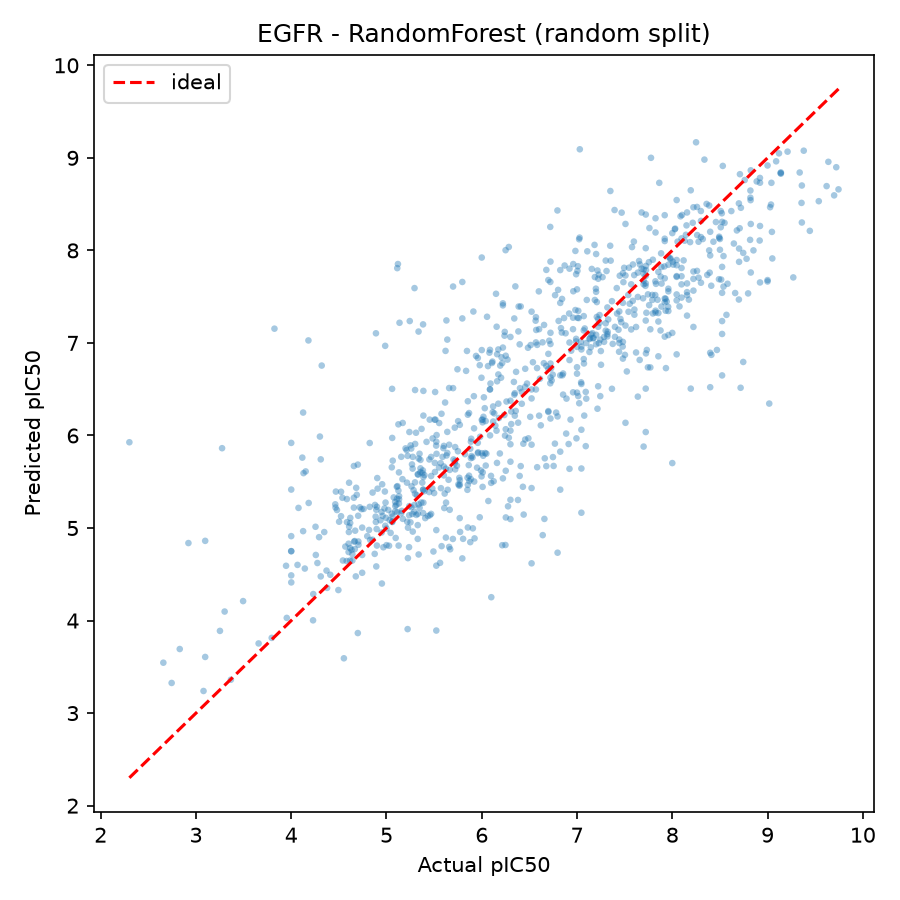

### Fallback dataset (BACE-1, 1513 compounds)

| Split | R2 | RMSE | MAE |
|---|---|---|---|
| random | 0.643 | 0.795 | 0.574 |
| scaffold | 0.643 | 0.613 | 0.478 |

For BACE the two RMSEs are inverted (random > scaffold) **because the
test sets have different potency spreads** - random is wider (std 1.33,
range 2.7-10.5) vs scaffold (std 1.03, range 3.9-9.0). R2 is scale-free,
RMSE is not. See `figures/testset_hist_bace.png`.

### Eight-target panel

Test R2; GIN = 3-seed mean +- std. **Δ(mean) = mean of the three
per-seed GIN R2 values − RF R2** describes a typical fitted seed.
**Δ(ensemble) = R2 of the mean prediction − RF R2** describes the fitted
three-seed ensemble and is used for GNN confidence-interval verdicts.
These are different estimands; ensemble gain is non-negative. **sig** = which model's paired
bootstrap 95% CI excludes 0 (B = 10,000, mean3 *ensemble* convention;
`results/significance/summary.csv`); `ns` = CI straddles 0.
**conditional** = the verdict changes when at least one training seed is
dropped (single-seed standard, see *Conditional verdicts* under
*Significance* below).
These CIs resample molecules, not scaffold groups. A separate **24-cell
scaffold-cluster sensitivity analysis** (8 targets × 3 GNN architectures;
`results/significance/scaffold_cluster_sensitivity.csv`, B = 10,000) resamples
whole held-out Murcko groups. Across all 24 scaffold cells, **7 of the 10 molecule-level significant
verdicts become intervals containing zero** under scaffold-group resampling:
2 of 3 GNN wins and 5 of 7 RF wins. All 14 original intervals containing zero
remain so. Only GINE/abl1 (GNN), GINE/a2a (RF), and AttentiveFP/mpro (RF)
retain an exclusion of zero. Thus the 21 RF / 5 GNN wins across random and
scaffold panels are molecule-bootstrap counts, not counts robust to both
resampling units. The full 24-cell table is in methodology; only 5–85 held-out
groups are available, which also limits the group bootstrap. This sensitivity
is separate from deleting a training seed.

| Tag | Target (ChEMBL id) | Family | n | RF rand | GIN rand | Δ rand (mean) | sig | RF scaf | GIN scaf | Δ scaf (mean) | sig | conditional |
|---|---|---|---|---|---|---|---|---|---|---|---|---|
| `a2a` | A2a adenosine receptor (CHEMBL251) | GPCR | 1,366 | 0.710 | 0.621±0.009 | −0.089 | RF | 0.702 | 0.654±0.025 | −0.049 | ns | scaf |
| `abl1` | ABL1 tyrosine kinase (CHEMBL1862) | kinase | 2,120 | 0.822 | 0.767±0.010 | −0.055 | RF | 0.714 | 0.737±0.027 | **+0.022** | GIN | scaf |
| `egfr` | EGFR (CHEMBL203) | kinase | 4,560 | 0.721 | 0.665±0.004 | −0.057 | RF | 0.649 | 0.612±0.013 | −0.037 | ns | scaf |
| `egfr_full` | EGFR, full B/F pull (CHEMBL203) | kinase | 10,729 | 0.729 | 0.667±0.006 | −0.062 | RF | 0.608 | 0.588±0.006 | −0.020 | ns | — |
| `herg` | hERG / KCNH2 channel (CHEMBL240) | ion channel | 8,403 | 0.607 | 0.619±0.009 | **+0.012** | GIN | 0.384 | 0.352±0.038 | −0.032 | ns | rand+scaf |
| `hivpr` | HIV-1 protease (CHEMBL243) | viral protease | 2,573 | 0.692 | 0.632±0.003 | −0.061 | RF | 0.538 | 0.457±0.010 | −0.081 | ns | scaf |
| `vegfr2` | **VEGFR2 / KDR** (CHEMBL279) | kinase | 9,643 | 0.670 | 0.605±0.004 | −0.064 | RF | 0.585 | 0.583±0.002 | −0.003 | ns | — |
| `mpro` | Replicase polyprotein 1ab / Mpro (CHEMBL4523582) | viral protease | 3,410 | 0.602 | 0.572±0.015 | −0.029 | ns | 0.433 | 0.322±0.049 | **−0.111** | RF | — |

BACE is not in the table (RF baseline only). Columns from
`results/multi_target/summary.csv`; Δ computed at full precision, then
rounded. Significance: **RF significantly wins 7 of 16 cells, the GIN 2
(`abl1`/scaffold and `herg`/random - both *conditional*), 7 are
undecided** - bootstrap CIs
quoted under *Significance* below. The CI is computed on the *ensemble*
Δ, so it can differ from the per-seed-mean Δ shown here (reading rule:
[Panel Δ conventions](docs/methodology.md)).

### Reproduce: fast path

To recompute the current temporal statistics from a fresh checkout, no model
or raw-data download is needed. Git contains the predictions, metrics and
`results/time_split/inputs/` frozen split package:

```bash
pip install -r requirements.txt
python scripts/restore_time_inputs.py
python experiments/paired_bootstrap.py --model gin --splits time --n-boot 10000
python experiments/time_split_summary.py
```

The restore command verifies the archive and every split's SHA256, validates
its label checksum, and checks all 32 prediction/metric label versions plus
all 24 GIN checkpoint label/role/seed records before atomically installing the eight NPZ files under `data/processed/splits/`. It refuses conflicting
local splits or `*_time_NA.json` markers; inspect and archive those files first,
or run in a clean checkout. It never replaces local data automatically. The
as-of constant baseline reads training labels directly from these frozen splits.
This reproduces statistics from predictions; it does not retrain models.

For the historical random/scaffold pipeline and full feature caches:

```bash
python scripts/fetch_artifacts.py --all   # models/、data/raw/ 和指纹缓存（GitHub Release）
```

**Temporal model download limitation:** `fetch_artifacts.py` still reads the
`artifacts-v2` release, whose RF time models predate this retraining. The fetcher now installs only
the 18 random/scaffold models and explicitly skips legacy time members after
archive safety checks; existing accepted time models are preserved. Downloading
that release does **not** obtain the new as-of RF models. The accepted RF models
are retained on M3 and in the coordinator's local results; no replacement RF
release has been published. Current Git artifacts contain the 24 new GIN
checkpoints and all 32 RF/GIN prediction files, so the published temporal
statistics can be recomputed from predictions. To reproduce RF inference,
use an accepted campaign model or rerun the documented RF campaign; do not pair
a release's historical RF model with the new temporal labels or scores.

Python **>= 3.12** is required: the pinned numpy 2.5.3, scipy 1.18.1,
xgboost 3.4.1 and shap 0.52.0 publish no 3.11 wheels, so the install
fails on Python 3.11 by design.

The fetched assets are verified twice: each archive against the release's
own `sha256sums.txt` (download integrity), and the extracted raw files
against the repo's `data/raw/sha256sums.txt` — the script aborts loudly
on any release whose raw data predates the 2026-10-11 refresh.

The release-based random/scaffold path is designed so that Phase 2 runs directly
(`gnn_01_make_splits.py` onward): its saved RF models and regenerated
random/scaffold splits verify against the corresponding published metrics
with no retraining.
`--all` also downloads and extracts `processed_cache.tar.gz`, the
fingerprint caches `gnn_01` reads first, so no re-featurization is
needed before Phase 2. Full retraining, incl. phase 3:
[methodology](docs/methodology.md).

`requirements.txt` is a **snapshot of the working environment at campaign
time, not a hard boundary**: development ran the full test suite on
slightly different minor versions (e.g. scikit-learn / torch patch
levels) and the code is insensitive to them, so a fresh environment that
resolves newer compatible versions will usually work - realign to the
snapshot only if something actually breaks.

## Data

Sources, switched via the `QSAR_TAG` environment variable. All ChEMBL
targets come from the same generic downloader
(`scripts/01e_download_chembl.py`, `standard_type=IC50`,
`standard_units=nM`, assay types B/F):

| Dataset tag | Target | ChEMBL id | Unique compounds | Source |
|---|---|---|---|---|
| `egfr` (default) | EGFR | CHEMBL203 | 4560 | ChEMBL REST API (`01d`, early-stopped pull) |
| `egfr_full` | EGFR, full B/F pull | CHEMBL203 | 10729 | ChEMBL REST API (`01e`, `--max-rows 0`) |
| `bace` (fallback) | Beta-secretase 1 | – | 1513 | MoleculeNet BACE |
| `a2a` | A2a adenosine receptor | CHEMBL251 | 1366 | ChEMBL REST API (`01e`) |
| `abl1` | ABL1 tyrosine kinase | CHEMBL1862 | 2120 | ChEMBL REST API (`01e`) |
| `mpro` | Replicase polyprotein 1ab / Mpro | CHEMBL4523582 | 3410 | ChEMBL REST API (`01e`) |
| `hivpr` | HIV-1 protease | CHEMBL243 | 2573 | ChEMBL REST API (`01e`) |
| `herg` | hERG / KCNH2 channel | CHEMBL240 | 8403 | ChEMBL REST API (`01e`) |
| `vegfr2` | **VEGFR2 / KDR** | CHEMBL279 | 9643 | ChEMBL REST API (`01e`) |

Counts are the post-refresh clean sizes (2026-10-11 label/parent
rebuild; seven of the eight ChEMBL raw pulls kept their original row
counts - **`egfr` was re-pulled** in the same pass (raw 8,936 -> 8,000
data rows, commit `e37c572`, "rebuild egfr (8k early-stop)"), so its
6,165 -> 4,560 change mixes a new early-stopped subset with the
label/parent fixes - provenance and the pre-refresh superset check live
in [data/README.md](data/README.md); what changed and why:
[fix checklist](docs/reviews/fixes-2026-10-11.md) +
[sensitivity report](docs/reviews/h1-sensitivity-2026-10-10.md)). The
`vegfr2` dataset was formerly tagged `mapk14` (misnomer fixed
2026-10-08).

Primary data: **ChEMBL** (EBI), IC50/nM, binding/functional assays. The
resilient downloader (page retries, disk flushes; the original `egfr`
pull survived intermittent HTTP 500s) and full per-file provenance:
[data/README.md](data/README.md).

Cleaning (`scripts/02_clean_data.py`): IC50 in **nM** only; exact
measurements only (`standard_relation == "="` - censored `>`, `<`, `~`
rows are dropped, they are bounds, not labels); salts collapsed to the
parent structure before dedup (fingerprint key = parent SMILES); drop
missing/non-positive rows; **pIC50 = -log10(IC50 x 1e-9)** (100%
agreement with ChEMBL's `pchembl_value`); repeats collapsed to the
**median**.

## Method

- **Featurization**: 2048-bit Morgan fingerprints (radius 2), RDKit.
- **Model**: `RandomForestRegressor` + `GridSearchCV` (5-fold CV on train
  only) over n_estimators x max_depth x min_samples_split.
- **Splits**: random 80/20 (`random_state=42`) + RDKit-only **scaffold
  split** (no DeepChem); phase 2 mirrors these exactly.
- **Why pIC50**: raw IC50's heavy tail spans orders of magnitude and
  dominates least-squares training; pIC50 is roughly normal - the
  standard QSAR target.

**Scaffold-split convention - largest groups fill *test* (DeepChem does
the opposite).** `scaffold_split` (`scripts/qsar_common.py`) groups
molecules by Bemis-Murcko scaffold and assigns groups to the **test**
set **largest-first** until ~20%; DeepChem/MoleculeNet's
`ScaffoldSplitter` convention is the reverse - largest groups fill
*train*, leftovers become test. The two conventions test different chemotype populations, so absolute scaffold
R2 is not directly comparable. The direction and size of the effect, including
whether model rankings would persist, have not been tested here. Chosen deliberately: big
families in test enable
chemotype-level error analysis (`scripts/gnn_05_error_analysis.py`);
the cost: campaigns already run stay as-is, and aligning with
MoleculeNet later would require full retraining. Details:
[methodology](docs/methodology.md).

## Interpretation & data QC

EGFR top fingerprint bits mapped back to the substructures that set them
(`scripts/05_explain_bits.py`):

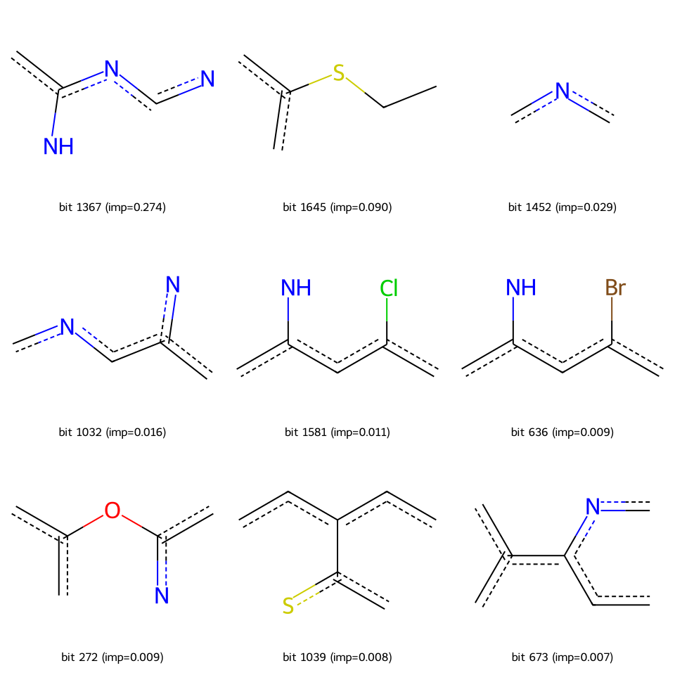

The dominant bit (bit 1367) decodes to an **aminopyrimidine** - the
classic kinase hinge-binding motif. MDI is inflated by correlated
features, so every importance claim was cross-checked with
**permutation importance on the held-out test set** (numbers:
[methodology](docs/methodology.md)).

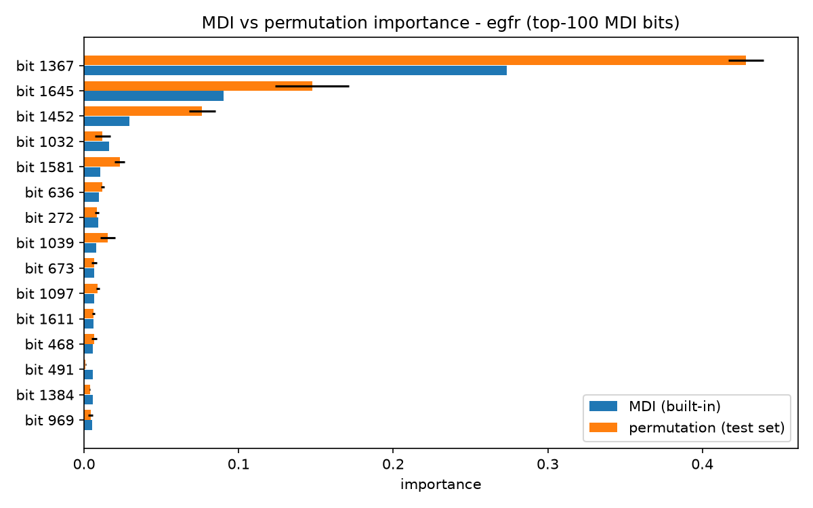

Data QC (ultra-potent audit, censoring, test-set spreads): censored
bounds are dropped at cleaning time (`standard_relation == "="`, see
[Data](#data)); the ultra-potent audit needs no filtering rule - the
audit is the deliverable ([methodology](docs/methodology.md)).

**Cross-model attribution alignment.**
`experiments/interpretability_alignment.py` loads the committed RF and
compares its top fingerprint bits (SHAP) with the GIN's GNNExplainer top
atoms on the scaffold test split, molecule by molecule. The chemotype
families are chosen **per tag**: the two documented EGFR-family queries
where they match (`egfr`/`egfr_full` - thienopyrimidine; `herg`/`mpro` -
chromone, 5 molecules each), and tags where neither query occurs fall
back to their own two most frequent held-out Murcko scaffolds (`a2a`,
`abl1`, `hivpr`, 10 molecules each); `vegfr2` was not run. Across the
**7 tags**, the mean share of GNN top atoms inside the RF's top-bit
coverage spans **0.32-0.68**, and the share sitting on the scaffold core
spans **0.21-0.96**; per-tag numbers and per-family RF recurring bits:
`figures/interpretability/by_tag/<tag>/findings.md`. Reading caveat: for
the Murcko-fallback families the "core" *is* the molecule's whole
scaffold - on average **66-86% of its atoms** (family means) - so core
attention there sits near its chance level and must be compared against
that chance, not pooled with the substructure-query families (whose
cores are much smaller fractions of the molecule). GNNExplainer/SHAP
caveats: [methodology](docs/methodology.md).

**Y-randomization (leakage sanity check).** Trained on permuted labels,
every shuffled group mean collapses towards zero and stays far under the
pass bar: across the seven tags run (the driver skips `vegfr2`), 2 splits
x {RF, GIN} x 3 seeds, all **28 shuffled group means lie between −0.843
and +0.010** - the largest (`egfr`/random shuffled GIN, **+0.010**) is
still more than an order of magnitude under the 0.2 verdict threshold,
every shuffled RF mean is ≤ −0.054, and each tag's
`results/y_randomization/summary_*.json` verdict reads **`ok: all
shuffled-label means < 0.2`**. Individual shuffled GIN seeds can still
land slightly positive (up to **+0.047**) - that is why the check is on
group means. The real-label control RF reads **0.7179** vs the headline
**0.7214** (`egfr`/random). That ~0.003 gap is the control's training
pool, not skipped tuning: `experiments/y_randomization.py` fits its RF
on the GNN train pool (`egfr`/random 3,283 rows), while the headline RF
also trained on the 10% validation carve-out (3,648 rows, 365 more) -
expected in direction and magnitude, not leakage evidence. Real and
shuffled controls always fit on the same pool, so the comparison stays
valid; the test only asks that shuffled means collapse (file verdict:
< 0.2) with the real control inside the baseline band. Details:
[methodology](docs/methodology.md).

## GNN vs traditional QSAR: a controlled comparison

**On the same molecules and the same train/test partitions, does a graph
neural network beat Morgan fingerprints + RandomForest?**

- Same data (cleaned EGFR, 4,560, pIC50); same splits regenerated with
  identical code (random_state=42, deterministic scaffolds), **verified
  bit-identically**: saved RF models reproduce the published metrics to
  7 decimals on the regenerated indices (`gnn_01_make_splits.py` aborts
  on mismatch; indices in `data/processed/splits/`).
- The GIN gets a 10% validation carve-out from *train* (seed 42); test
  stays untouched, keeping the comparison paired.
- Molecules are graphs (MoleculeNet/OGB convention); architecture:
  [methodology](docs/methodology.md).

| Split | RF R2 / RMSE | GIN R2 / RMSE (seed 42) | GIN R2 mean +- std (3 seeds) |
|---|---|---|---|
| random | 0.721 / 0.733 | 0.669 / 0.799 | 0.665 ± 0.004 |
| scaffold | 0.649 / 1.015 | 0.631 / 1.042 | 0.612 ± 0.013 |

**Provenance:** six current EGFR GIN runs (random/scaffold × seeds 42/1/2)
have no committed training logs and an unrecorded original device. The review
originally counted nine, including three historical time runs; those time
runs have since been replaced by the accepted as-of campaign with separate
provenance. A new CUDA replay of the six remaining runs is planned separately;
its logs will describe that new run, not establish the historical device.

**On this dataset the GIN does not beat the fingerprint RF.** The random
ensemble CI favours RF (Δ −0.044 [−0.079, −0.010]). The scaffold
per-seed-mean gap is −0.037, but its ensemble CI [−0.053, +0.006]
includes zero and is conditional on the GIN seeds. Seed spread alone does
not establish a difference. Both models lose ~0.05-0.07 R2 from random to scaffold - novel
chemotypes are still harder for both feature types. Tuning negatives,
error analysis, ESOL: [methodology](docs/methodology.md).

Same test molecules, coloured by scaffold:

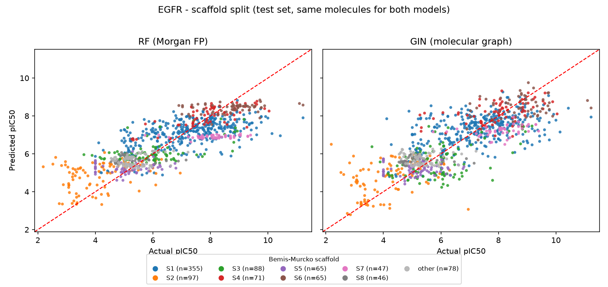

**Do the models fail on the same molecules?** Their worst test
predictions overlap far above chance on both splits. These are shared
difficult examples; the overlap does not identify their cause. Assay noise,
common model limitations and distribution shift remain possible explanations. Chemotypes still fail
asymmetrically in the displayed seed-42 case study: on the refreshed scaffold
test set the thienopyrimidine series (47 molecules) costs the **RF** more
(mean |err| 1.32 vs the GIN's 1.02). This direction is not stable across
GIN seeds and is not a model-wide chemotype conclusion. Meanwhile, while the chromone query now matches **0 of 912** test
molecules (37 pre-refresh), so the old "chromones hurt the GIN" claim
no longer has a sample to stand on; numbers, figure:
[methodology](docs/methodology.md).

## Cross-target generality & data scaling

**Finding 1 - on random splits the GIN has one nominal, conditional lead.** Δ(mean) runs from **+0.012** (`herg`) down to −0.089 (`a2a`):
7 of 8 per-seed-mean deltas are negative (also 7/8 under the ensemble
convention), and the single positive is also the one
random cell where the bootstrap significantly favours the GIN
(`herg`/random, ensemble Δ **+0.038 [+0.006, +0.069]** - *conditional*:
like 4 of the 5 GNN wins across the three panels, its CI exclusion
disappears when at least one training seed is dropped, see *Conditional
verdicts*). Six random cells significantly favour RF. With analogues
leaking across
the split, message passing buys nothing over circular substructure
counts on seven of eight targets - the EGFR conclusion above is not an
EGFR artefact. (Every "7 of 8" tally double-counts EGFR: all 4,560
`egfr` parents are also inside `egfr_full`.)

**Finding 2 - on scaffold splits one target flips positive, and the
the mean deficit varies across targets without a monotonic relation to n.** Seven of eight
Δ(mean) are negative; under the ensemble convention only five of eight
are non-positive. These point-estimate counts are not significance counts.
For Δ(mean), closest to parity `vegfr2` at **−0.003**, worst
`mpro` at **−0.111**. The exception is `abl1`: **+0.022** per-seed mean,
and it survives every Δ convention - seed42 **+0.060 [+0.025, +0.096]**,
3-seed ensemble **+0.037 [+0.006, +0.069]** (significantly GIN) - so
not the seed-42 mirage the pre-refresh data showed, but a
*conditional* verdict: dropping seed 42 alone halves it to +0.015
[−0.017, +0.046], a tie (see *Conditional verdicts*). What
still varies is the *magnitude*: scaffold diversity and assay structure
are possible contributors, but this panel does not isolate their effects - `mpro` (3,410 compounds) sits at
−0.111 with twice `a2a`'s data (1,366) yet more than twice its deficit
(−0.049), and `herg` (8,403) and `vegfr2` (9,643) are within 15% of
each other in n yet about 10x apart in deficit (−0.032 vs −0.003), so Δ
does not follow n.

**Significance, upgraded to bootstrap CIs (P8).** The Δ(mean) statements
above are backed by a paired bootstrap (B = 10,000; test molecules
resampled with replacement, same indices for both models; CI on the
3-seed-mean prediction). Of the 16 random/scaffold cells, **9 have a
95% CI excluding 0**:

- **7 favour RF**: `a2a`/random −0.073 [−0.138, −0.013], `abl1`/random
  −0.044 [−0.076, −0.016], `egfr`/random −0.044 [−0.079, −0.010],
  `egfr_full`/random −0.039 [−0.059, −0.021], `hivpr`/random −0.048
  [−0.083, −0.014], `mpro`/scaffold −0.074 [−0.133, −0.018],
  `vegfr2`/random −0.044 [−0.068, −0.021] - none of the 7 changes
  verdict under a seed drop.
- **2 favour the GIN**: `abl1`/scaffold +0.037 [+0.006, +0.069] and
  `herg`/random +0.038 [+0.006, +0.069] - both read
  `frac_boot_gin_better` ≈ 0.99, and both are *conditional* under the
  single-seed standard below.
- **7 are undecided** (CI straddles 0); the near-miss is
  `vegfr2`/scaffold, +0.024 with `frac_boot_gin_better` = 0.97. Four
  of the 7 (`a2a`/scaffold, `egfr`/scaffold, `herg`/scaffold,
  `hivpr`/scaffold) turn RF-significant when at least one training seed is
  dropped.

**Conditional verdicts - one standard for every model (2026-10-13).**
GNN CI verdicts in this README come from the paired-bootstrap CI of the
**3-seed ensemble**; a verdict that changes when **at least one training
seed** is dropped (kept-seed mean as the ensemble, same B = 10,000
bootstrap) is marked *conditional* - in the panel table by its
`conditional` column, in prose by the word itself. The check recomputes
all **48** GIN/GINE/AttentiveFP random/scaffold cells x 3 drops from the
committed predictions (`logs/2026-10-13_single_seed_dependence.log`):
**14 of 48 cells are conditional - 4 of the 5 GNN wins (all but GINE
`abl1`/scaffold), 1 of the 21 RF wins (`AttentiveFP` `hivpr`/scaffold),
and 9 ties that turn RF-significant** (frozen GIN `a2a`/scaffold,
`egfr`/scaffold, `herg`/scaffold, `hivpr`/scaffold; GINE `egfr`/
scaffold, `egfr_full`/scaffold, `hivpr`/random; AttentiveFP
`a2a`/scaffold, `vegfr2`/scaffold). This check changes only the GNN
arm; the RF is a single seed-42 fit. Averaging across the three drops
necessarily reduces the ensemble advantage because it also reduces ensemble
size. It identifies sensitivity to GNN seeds and ensemble size; **it cannot
establish that RF wins are robust to RF training randomness**. GINE
`abl1`/scaffold survives every GNN seed drop (worst drop +0.047
[+0.017, +0.080]), conditional on the fixed RF and test sample.

`frac_boot_gin_better` is the
fraction of the 10,000 bootstrap deltas above 0 - **not a p-value**.
All reported 95% intervals and win/tie tallies are **uncorrected per-cell,
exploratory comparisons** across many targets and models, not simultaneous
95% coverage for the full panel. Multiplicity can inflate the chance of
at least one apparent win. In particular, neither this fraction nor
`2 × min(fraction, 1 − fraction)` is a calibrated null-test p-value; the
earlier review's Bonferroni counts obtained that way are a heuristic, not
a confirmed family-wise error guarantee. No formal multiplicity-adjusted
claim is made here; scaffold-group sensitivity and seed deletion address
different sources of uncertainty. The seed-42 column
still overstates leads where it matters (`abl1`/scaffold +0.060 vs
+0.037 at mean3); elsewhere it reads below the mean3 value in 13 of 16
cells (within 0.005 of it in the other two), so the 3-seed-mean
convention stays the reference. Bond features move **5 of the 16
mean3 verdicts** against the frozen GIN - `a2a`/random and
`hivpr`/random (RF-significant → undecided), `a2a`/scaffold and
`hivpr`/scaffold (undecided → RF-significant), and `herg`/random (the
frozen GIN's win → undecided): they add **no new win** and give up the
GIN's `herg`/random win. The refreshed GINE panel bootstraps **all 16
cells** and reads **1 GINE win, 7 RF wins, 8 straddling 0**. The single
win is `abl1`/scaffold, ensemble Δ **+0.058 [+0.028, +0.092]** - the
same cell the frozen GIN already wins (+0.037 [+0.006, +0.069], itself
*conditional*) - and the only GNN win in all 48 cells that survives
every single-seed drop (worst drop +0.047 [+0.017, +0.080]); held to
the same nominal CI standard it is a
cell-level win, but 1 win against 7 RF wins leaves the panel verdict
standing.
Tables `results/significance/summary.csv`,
`results/significance/summary_gine.csv` (32 rows, all 16 cells),
`results/gine_panel/summary.csv`; forest plots
`figures/significance/ci_panel.png`,
`figures/significance/ci_panel_with_gine.png`,
`figures/gine_panel/panel_dR2.png`. The ±std
columns throughout are auxiliary spread descriptions - the CIs are the
significance statement.

One reading rule for everything above: the panel tables' Δ(mean) and the
bootstrap CI are **two different conventions** - per-seed-mean Δ vs
mean3 *ensemble* Δ (R² of the per-molecule mean prediction) - and the
ensemble side always carries a small non-negative gain, which is why
`egfr`/random is −0.057 in the panel table but −0.044 in the
significance table. Read significance from the CI, point estimates from
the panel, and never compare one against the other; full formulas and
the worked example are in **Panel Δ conventions** in
[methodology](docs/methodology.md).

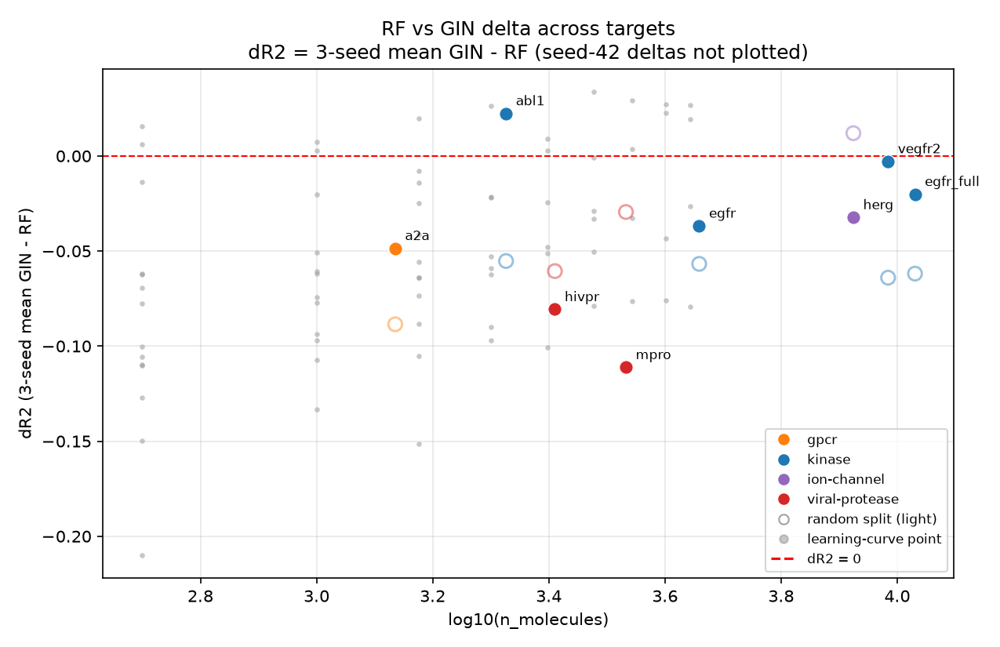

Learning curves (7 tags re-run on the refreshed data; each tag's n grid
is capped by its train pool, up to 4,400 - `herg`'s random curve has the
GIN ahead at 7 of its 9 points, ending 0.576 vs RF 0.549 at n = 4,400,
and `abl1`/scaffold leads at every point, while `a2a`'s pool only fits a
single n = 500 point), extrapolated n\* with its weak-identifiability
caveat, training-budget caveat, cross-target failure replication:
[methodology](docs/methodology.md).

## Giving the GNN a fair chance (bounded tuning + GINE + AttentiveFP)

> **Status - panels + fairness refreshed (2026-10-11).** The GINE and
> AttentiveFP panels and the fairness campaign (`vegfr2`/`herg`/`abl1`)
> are retrained against the refreshed data (`experiments/LOG.md`), so
> every number below is a single-vintage batch; the fairness table's RF
> references equal the refreshed panel RF. The fairness tags' GINE
> cells bootstrap from the frozen-recipe per-seed predictions committed
> in `23e202a`; all 16 GINE panel cells carry bootstrap CIs.

Sections above deliberately froze the GIN recipe - every Δ is a
**frozen-recipe** Δ. `experiments/gnn_fairness.py` (36 runs/target) gives
it a bounded chance: on the three near-parity targets (frozen-recipe
scaffold Δ on the refreshed panel: `vegfr2` −0.003, `herg` −0.032,
`abl1` +0.022), 8 configs
(hidden {128, 256} x layers {4, 5} x dropout {0.2, 0.3}) train **only on
the scaffold split**, selected by **3-seed mean validation RMSE**, never a
single seed. Winners: `vegfr2` 256/5L/0.2 (0.6937), `herg` 256/5L/0.2
(0.6215), `abl1` 256/5L/0.2 (0.7833) - 256/5L/0.2 on all three, i.e.
every winner sits on the grid's capacity corner (max hidden, max
layers, min dropout). A **GINE**
variant adds a `BondEncoder` (`BOND_FEATURE_DIMS = [13, 7, 2]`); all else
is `gnn_03`'s.

Test R2, 3-seed mean ± std; Δ = GIN − RF (RF = this campaign's
reference RF, equal to the refreshed panel RF):

| Target | Model | random R2 | Δ rand | scaffold R2 | Δ scaf |
|---|---|---|---|---|---|
| `vegfr2` (VEGFR2) | RF | 0.670 | — | 0.585 | — |
| | baseline GIN | 0.605±0.004 | −0.064 | 0.583±0.002 | −0.003 |
| | tuned GIN | 0.620±0.003 | −0.050 | 0.600±0.006 | **+0.015** |
| | GINE | 0.600±0.006 | −0.070 | 0.563±0.010 | −0.022 |
| `herg` | RF | 0.607 | — | 0.384 | — |
| | baseline GIN | 0.619±0.009 | **+0.012** | 0.352±0.038 | −0.032 |
| | tuned GIN | 0.616±0.005 | **+0.009** | 0.385±0.015 | +0.000 (tie) |
| | GINE | 0.613±0.009 | **+0.006** | 0.352±0.017 | −0.033 |
| `abl1` | RF | 0.822 | — | 0.714 | — |
| | baseline GIN | 0.767±0.010 | −0.055 | 0.737±0.027 | **+0.022** |
| | tuned GIN | 0.765±0.024 | −0.058 | 0.770±0.014 | **+0.056** |
| | GINE | 0.779±0.009 | −0.043 | 0.742±0.015 | **+0.028** |

(The frozen-recipe cells in this table that are *conditional* under the
single-seed standard - `herg`/random, `herg`/scaffold and `abl1`/scaffold - see
*Conditional verdicts* under *Significance* above.)

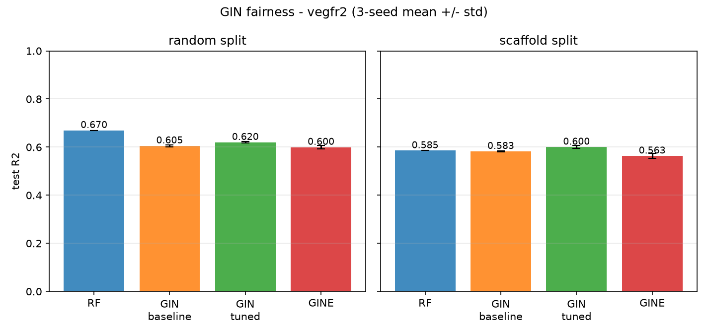
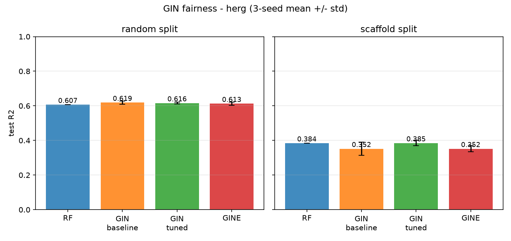
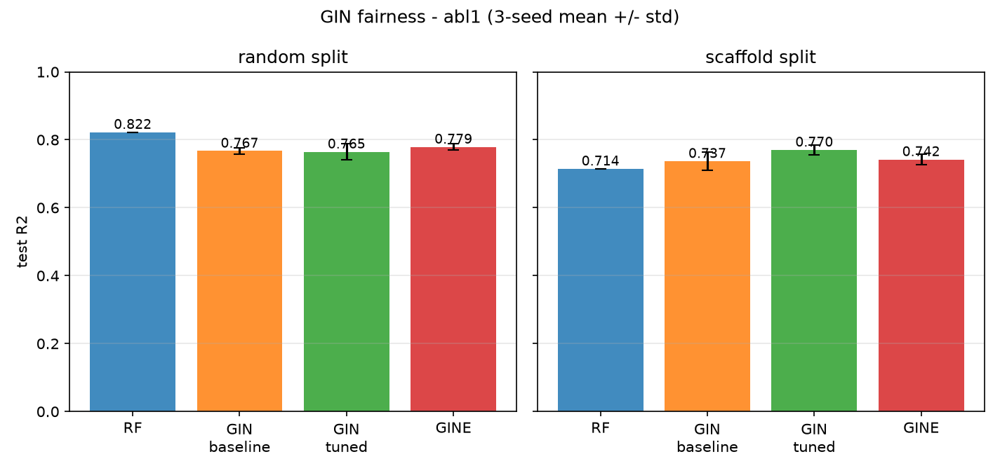

**(i) Bounded tuning raises the mean scaffold score on all three targets,
with different uncertainty limits.** The clearest descriptive lift is on `vegfr2`,
which crosses zero (−0.003 → **+0.015**), and on `herg`, which climbs to
a tie (−0.032 → +0.000); hERG's +0.033 lift is smaller than the frozen
recipe's seed SD (0.038), so this alone does not establish a tuning benefit. On `abl1` - already positive under the frozen
recipe (+0.022) - the tuned run widens to **+0.056** while its seed
spread shrinks (0.027 → 0.014), but count that as run noise, not a
tuning lift: the same
256/5L/0.2 config with the same three seeds was trained twice by
`gnn_fairness.py` - tuning phase **0.734** (**+0.019** vs RF, i.e.
*below* the frozen recipe's +0.022) vs final
phase **0.770** (+0.056), a **0.036** run-to-run gap between identical
trainings, larger than the +0.033 lift itself (`results/fairness/abl1_tuning.csv`
vs `results/fairness/summary_abl1.json`). Random flips
on none of the three: tuned `vegfr2` and `abl1` stay negative (−0.050 /
−0.058, `abl1`/random the one cell where tuning costs a little and the
seed spread grows 0.010 → 0.024), while `herg`/random was already
positive and eases from +0.012 to +0.009.

**(ii) GINE bond features are not a general gain in this tested recipe.**
The fairness table reports GINE minus **RF**, not a paired ablation against
GIN: positive deltas occur on `abl1` scaffold (+0.028) and `herg` random
(+0.006); the other four are negative. Relative to frozen GIN means, GINE
is higher on `abl1` (about +0.012 random / +0.005 scaffold), lower on
`vegfr2` (−0.005 / −0.020), and near or below GIN on `herg` (−0.006 /
−0.001). These independently trained estimates do not isolate a causal
bond-feature effect. (The fairness
campaign's GINE and the panel GINE are **two independent trainings** of
the same recipe; same-seed test R² between them differs by up to
**0.066** - e.g. `herg`/scaffold seed 2 - so do not read the two sets
of GINE numbers as replicates of each other.) Panel-wide
against the refreshed RF this holds with bootstrap CIs: the full GINE
panel wins **1 of 16 cells - `abl1`/scaffold +0.058 [+0.028, +0.092]**
(the one GNN win in 48 cells that survives every single-seed drop); 7
significantly favour RF (`a2a`/scaffold, `abl1`/random, `egfr`/random,
`egfr_full`/random, `hivpr`/scaffold, `mpro`/scaffold, `vegfr2`/random),
8 straddle 0 - of which `egfr`/scaffold, `egfr_full`/scaffold and
`hivpr`/random turn RF-significant when at least one seed is dropped - and
the lone GINE win is the same cell the frozen GIN already wins, one
significant cell in 16. Tables
`results/significance/summary_gine.csv` (all 16 cells) +
`results/gine_panel/summary.csv`; figures
`figures/gine_panel/panel_dR2.png`,
`figures/significance/ci_panel_with_gine.png`.

**(iii) Boundary, not a reversal.** The frozen recipe itself shows two
significant - but *conditional* - leads (`abl1`/scaffold and
`herg`/random, the two GIN cells in *Significance* above); bounded
tuning crosses zero on scaffold and nowhere else - `vegfr2` −0.003 →
**+0.015** remains a point estimate without a tuning-selection-adjusted
interval, `herg` only ties (+0.000), and
`abl1`'s nominal widening to **+0.056** sits inside its own replicate
spread (0.036, see (i)) - while no
random-split cell flips. The two positive scaffold point estimates (`vegfr2`, `abl1`) and the
near-zero hERG result describe the tested tuning runs; they do not
reverse the panel verdict.

**AttentiveFP control: attention + GRU + bond features, still no
reversal.** A further small-molecule architecture control - PyG
AttentiveFP, gated attention with a 30-timestep GRU over the same
atom/bond encoders, frozen recipe otherwise - is the third control: 8
targets x 2 splits x 3 seeds = 48 runs (`experiments/afp_panel.py`,
`--model attentivefp`), retrained against the refreshed data. Under the
mean3 paired bootstrap it wins **2 of 16 cells - `herg`/scaffold,
ensemble Δ +0.062 [+0.030, +0.092], and `herg`/random, +0.034
[+0.002, +0.065]** - both *conditional* under the single-seed standard
(dropping seed 1 alone moves each CI to straddle 0). Per-seed point
estimates are +0.020 and −0.022 (the
two Δ conventions are defined in **Panel Δ conventions** in
[methodology](docs/methodology.md)); meanwhile **7 cells significantly
favour RF** (`a2a`/random, `abl1`/random, `egfr_full` both splits,
`hivpr`/scaffold - *conditional*, see below - `mpro`/scaffold,
`vegfr2`/random) and **7 are
undecided** (2 of them, `a2a`/scaffold and `vegfr2`/scaffold, turn
RF-significant when at least one seed is dropped). `abl1`/scaffold moved to undecided when its stalled
seed-42 run (early-stopped at epoch 35, best epoch 15, train MSE 0.57,
on the campaign's CUDA machine) was replaced by an **independent rerun
with fresh randomness on another device (MPS)**:
`logs/review11_n3_afp_abl1_scaffold_s42_min60.log` - the rerun ran all
100 epochs, and the `--min-epochs 60` floor never bound it (no gap
between improvement epochs reaches patience 20, so the run would have
gone the distance with or without the floor); the cell flipped because
of the rerun itself, not the floor: ensemble Δ +0.020 [−0.018,
+0.057]. The `hivpr`/scaffold RF win likewise rests on one seed -
AFP per-seed R² **0.201 / 0.508 / 0.377** (seed 42 / 1 / 2) against the
RF's 0.538 - drop
seed 42 and the ensemble Δ is −0.013 with a CI straddling 0
(−0.076 to +0.046), a tie, so that cell is *conditional* on seed 42.
On the random split all 8 point estimates are negative
(−0.167 `a2a` to −0.022 `herg`), and `herg`/random is the one cell
where the ensemble convention turns a negative point estimate into a
significant AttentiveFP lead - the other 4 significant random cells
favour RF. The friendliest cell depends on the variant: `abl1`/scaffold
is friendliest for tuned GIN (+0.056, replicate spread 0.036 - see
(i)) and for GINE (fairness table +0.028, a separate training; panel
ensemble **+0.058 [+0.028, +0.092]**), while
`herg`/scaffold is AttentiveFP's friendliest (+0.062 ensemble / +0.020
per-seed; tuned GIN +0.000 tie, GINE −0.033 there, frozen GIN −0.032 on
the refreshed panel). Tables `results/afp_panel/summary.csv`,
`results/significance/summary_attentivefp.csv`; figures
`figures/afp_panel/panel_dR2.png` and the three-model forest plot
`figures/significance/ci_panel_with_afp.png` (gin / gine / afp side by
side). Bond features, bounded tuning and now AttentiveFP have each
not produced a broad improvement over RF under these tested configurations.
That limits the practical claim to this data, protocol and search budget;
it does not identify data scale or signal as the cause, or rule out better GNN recipes.

## XGBoost: a stronger tree baseline, still under the RF

`experiments/xgboost_baseline.py` asks the obvious follow-up: is the RF
ceiling an artefact of a weak tree ensemble? Same 2048-bit Morgan
features, same splits, XGBoost 3.4.1 (`hist`, CPU) with fixed generic
hyperparameters (500 trees, lr 0.05, depth 6); the control is the
headline RF, and XGBoost is fit on the same full non-test pool as that
RF (`same_pool: true` in every cell). Δ = XGB − RF per split
(`results/xgboost/summary_*.json`, controls recomputed against the
refreshed `results/metrics_*.json`):

| Tag | Δ rand | Δ scaf |
|---|---|---|
| `a2a` | −0.015 | −0.022 |
| `abl1` | **+0.006** | −0.018 |
| `egfr` | −0.011 | −0.045 |
| `egfr_full` | −0.047 | −0.040 |
| `herg` | −0.024 | **+0.032** |
| `hivpr` | **+0.010** | −0.080 |
| `mpro` | **+0.005** | −0.023 |
| `vegfr2` | −0.045 | **+0.003** |

**XGBoost does not broadly outperform the tuned RF**: 11 of 16 point
estimates are ≤ RF. The positive deltas are `abl1`/random +0.006,
`herg`/scaffold +0.032, `hivpr`/random +0.010, `mpro`/random +0.005 and
`vegfr2`/scaffold +0.003. Three are ≤ +0.010 at full precision;
`hivpr`/random (+0.0102) joins them only after rounding. The largest deficit
is `hivpr`/scaffold (0.458 vs RF 0.538, Δ −0.080).

**Paired test-molecule bootstrap:** deterministic refits under xgboost 3.4.1
reproduce all 16 historical R² values exactly and now save per-molecule
predictions separately. B = 10,000, bootstrap seed 42, gives **6 RF wins,
1 XGBoost win and 9 intervals containing zero**. The XGBoost win is
**hERG/scaffold +0.032 [+0.014, +0.051]**. These are nominal unadjusted
95% intervals conditional on the two fitted models; they do not include
training randomness or scaffold-group dependence. A deterministic estimator
still permits test-sample uncertainty analysis. Reproduce with
`python experiments/xgboost_paired.py`; saved predictions, intervals and
input/source provenance are in [`results/xgboost_paired/`](results/xgboost_paired/).

**"3 seeds" here is a deterministic repeat, not an uncertainty
estimate.** All three seeds are bit-identical on every cell
(`r2_std = 0.0` everywhere): with default `subsample`/`colsample` = 1.0
under `hist`/CPU there is no random path left for `random_state` to
seed - a property of the algorithm as configured, not a data or split
uncertainty (full note in [methodology](docs/methodology.md)).

**Version pin matters when reproducing.** Under the pinned xgboost
3.4.1 all 16 cells reproduce bit-exactly; under 3.2.0 `egfr_full`/random
moves (0.68950 vs 0.68144, ~0.008 R²) while `egfr_full`/scaffold stays
put - committed 3.2.0 evidence covers `egfr_full` only, the other 14
cells were not re-run under 3.2.0 - so pin the version when re-checking
(`logs/review12_p5_xgb_egfr_full_xgb_3.2.0.log`).

Figures: `figures/xgboost/`.

## Fingerprint ablation: radius and bit width

`experiments/fingerprint_ablation.py` re-runs the RF over
r ∈ {2, 3} x bits ∈ {1024, 2048} (3 seeds) against the r=2/2048 anchor
on the refreshed data.

**Status (2026-10-11): all 8 tags landed** - 8 tags x 2 splits x 4
configs x 3 seeds = 192 RF fits, one `summary_<tag>.json` per tag in
`results/fp_ablation/`. Δ is measured against each run's own r=2/2048
anchor (3-seed mean); that anchor reproduces the published RF to within
0.006 in 13 of the 16 cells - the third outlier is `vegfr2`/scaffold
(+0.006 above) - and it sits 0.021 (`hivpr`/scaffold) and 0.012
(`mpro`/scaffold) below it, the two flagged `anchor_failures` in the JSON.

| Tag | random anchor R² | random Δ range | scaffold anchor R² | scaffold Δ range |
|---|---|---|---|---|
| `a2a` | 0.709 | −0.017 … −0.006 | 0.707 | +0.007 … +0.018 |
| `abl1` | 0.822 | −0.019 … −0.008 | 0.714 | −0.040 … −0.012 |
| `egfr` | 0.718 | −0.009 … +0.002 | 0.648 | −0.021 … −0.003 |
| `egfr_full` | 0.728 | −0.016 … −0.003 | 0.611 | −0.027 … +0.000 |
| `herg` | 0.608 | −0.016 … −0.008 | 0.388 | −0.020 … +0.004 |
| `hivpr` | 0.694 | −0.015 … +0.001 | 0.517 | −0.042 … +0.041 |
| `mpro` | 0.604 | −0.007 … +0.003 | 0.421 | −0.003 … +0.002 |
| `vegfr2` | 0.670 | −0.010 … −0.002 | 0.592 | −0.043 … −0.011 |

Each Δ range spans the other three configs (r2/1024, r3/1024, r3/2048)
of that tag. What the eight tags say:

- On **random** splits the tag-to-tag spread is tiny: all 24
  non-anchor cells land between **−0.019 and +0.003** of their
  anchor, and no tag's random range is wider than 0.016 - the
  headline r=2/2048 default is not leaving obvious performance
  behind on any target.
- On **scaffold** the spread is ~4x wider (**−0.043 … +0.041**) and
  **radius moves R² more than bit width**: as two-way main effects
  averaged over the 8 tags, r=2 → 3 costs **−0.015** R² while halving
  the fingerprint 2048 → 1024 bits costs **−0.007** (`egfr` itself:
  −0.018 vs −0.003; on **random** splits both effects are −0.006).
  Bit width still hurts where the grid is worst: at r=3, cutting to
  1024 bits costs 0.003-0.033 on 6 of 8 tags (worst `vegfr2` −0.033,
  `hivpr` −0.028, `abl1` −0.026), and the three worst cells of the whole
  grid are all r3/1024 - `vegfr2` −0.043, `hivpr` −0.042, `abl1` −0.040.
  The sign is not universal (`a2a` +0.012 and `egfr_full` +0.007 prefer
  1024 at r=3; at r=2 `hivpr` gains +0.041 from halving the bits), so
  2048 bits is a strong default rather than a law.
- **Radius 3 at 2048 bits buys nothing**: −0.011 … +0.002 on random,
  −0.027 … +0.007 on scaffold (those 8 scaffold cells average −0.009;
  the −0.015 above is the radius main effect over both bit widths) -
  r=2/2048 is also the radius default.

Figures: `figures/fp_ablation/`; tables: `results/fp_ablation/`.

## Multi-task pooling: more data does not rescue the GIN

`scripts/gnn_07_multitask.py` tests the industrial setting single-task
runs cannot: pool `egfr_full` + `abl1` + `vegfr2` into **22,492 molecule
rows** (21,093 unique SMILES; **1,193 = 5.66%** appear under more than
one target - down from the pre-refresh 10.0%, see the fix checklist).
Two arms x 3 seeds x 2 splits: **MT-GIN** (shared trunk +
one linear head per target) and **pooled**, a negative control with one
shared head that ignores the task label; per-target splits/statistics.

Test R2, 3-seed mean ± std (Δ = vs the single-task RF):

| Task | Split | ST-RF | ST-GIN | pooled | MT-GIN |
|---|---|---|---|---|---|
| `egfr_full` | random | 0.729 | 0.667±0.006 (−0.062) | 0.451±0.041 (−0.278) | 0.491±0.014 (−0.238) |
| `egfr_full` | scaffold | 0.608 | 0.588±0.006 (−0.020) | 0.444±0.007 (−0.164) | 0.377±0.044 (−0.231) |
| `abl1` | random | 0.822 | 0.767±0.010 (−0.055) | 0.673±0.017 (−0.149) | 0.700±0.009 (−0.122) |
| `abl1` | scaffold | 0.714 | **0.737±0.027 (+0.022)** | 0.669±0.035 (−0.045) | 0.692±0.046 (−0.022) |
| `vegfr2` | random | 0.670 | 0.605±0.004 (−0.064) | 0.309±0.057 (−0.361) | 0.510±0.010 (−0.160) |
| `vegfr2` | scaffold | 0.585 | 0.583±0.002 (−0.003) | 0.240±0.006 (−0.345) | 0.533±0.014 (−0.052) |

Columns from `results/multitask/summary.csv` (regenerated 2026-10-12:
the `vegfr2` rows and all six of their Δs now come from the refreshed
single-task RF, 0.670 random / 0.585 scaffold).

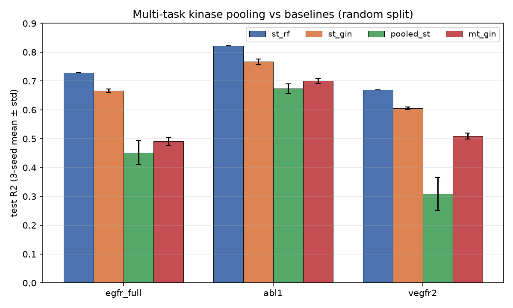
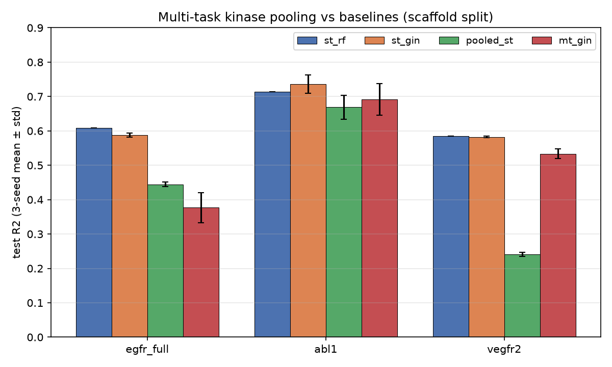

**Both pooling configurations have lower per-seed mean scores in this experiment.**
Neither mean beats the single-task RF or GIN in any of the six cells: MT-GIN trails
RF by **−0.022 to −0.238**, pooled by **−0.045 to −0.361**, versus
**−0.064 to +0.022** for single-task GIN. These are mean-score comparisons,
not a claim of significant losses in all cells; an ensemble estimate and
its interval answer a different question. This describes the tested
configurations; it does not isolate a causal effect of sharing. Cross-target
train/test molecule overlap and the linear-versus-MLP head difference remain
confounders. Establishing negative transfer requires a common molecule split
and matched head capacity; the overlap's effect has no guaranteed direction.
See [methodology](docs/methodology.md).

## Publication-year time split: corrected results

The full time campaign has been retrained after removing future measurements
from training labels. The old first-report split used all-year median labels:
for example, `egfr_full` had 413 training parents with measurements in 2019 or
later, including 279 with measurements in 2021 or later. `CHEMBL266995` had a
1999-only median pIC50 of 6.898, but its old label became 8.097 after including
a 2024 measurement. The old scores and MSE decomposition remain historical
records in Git revision `7ce15c1`; they are not the current results below.

**Policy (`exact-dated-asof-v1`).** First-report group assignment is unchanged:
the earliest dated activity across raw records determines the molecule's year,
with newest years held out. Labels use exact (`=`), valid nM measurements with
known document years: train uses years **before the validation cutoff**,
validation uses years **before the test cutoff**, and test uses years **at or
after the test cutoff**. A molecule without an eligible measurement in its
assigned pool is excluded (168 rows across the eight tags); undated measurements
cannot supply labels. `scripts/time_labels.py` verifies dataset signatures and
`label_id`; training and analysis reject mismatched versions. RF fits train
only; GIN fits the same pool and selects checkpoints on validation. The constant
baseline uses the training-label mean. Thus the checkpoint-selection asymmetry
between RF and GIN remains.

The [three-host campaign](docs/methodology.md#three-host-temporal-retraining-campaign-2026-10-13)
completed 8 RF searches on M3 Max and 24 GIN fits on the Ubuntu RTX 4070 Laptop
GPU (8 GiB), with the M4 Air preparing inputs and accepting results. Training
used frozen source revision `7ce15c1f0849ae69e0ca208f781a9824517eb328`.
A subsequent cached-parent-key repair recovered one eligible hERG training
molecule and reran its RF plus three GIN fits from
`d13f9125af56028f60e099ec2e914dd2509c239e`. The other 28 jobs retain their
original inputs and provenance;
[result acceptance and provenance](results/time_split/campaign_acceptance.json)
record all 32 jobs. Source/input hashes, label IDs, test alignment, recomputed
metrics and checkpoint prediction replay passed. All three predeclared seeds
(42, 1, 2) are retained. All 24 best epochs are early (2–27 of 100; median 9.5). The original
metric flags used the last training epoch's loss and are retained as historical
records. Re-evaluating the saved best checkpoints in eval mode flags **13/24**
under the same early-epoch / standardized training MSE > 0.5 heuristic; a2a's
three training MSEs are 0.749–0.976. See
`results/time_split/checkpoint_diagnostics.csv`. This diagnostic neither proves
convergence nor establishes that more training would help. Models and test
predictions are unchanged; no test score selected a new training budget.

**Eight-seed M3 study accepted; matched CUDA cohort pending.** A separate
[cross-computing-environment reproducibility and robustness study](docs/methodology.md#follow-up-a-matched-environment--training-budget-study)
keeps the data and GIN architecture fixed; it is not data k-fold
cross-validation or a comparison of different model structures. The initial
M3 CPU pilot completed 48 GIN jobs in 11 min 23 s, comparing 100/0/20 versus 200/60/40
(`epochs/min_epochs/patience`) on all eight targets and seeds 42/1/2.
All passed artifact checks and CPU model replay. The 24 paired early training
logs match at printed precision; 23/24 pairs retain identical saved test
predictions. Only `hivpr`, seed 42, selects a later best checkpoint (epoch
44 → 84), reducing standardized validation RMSE 0.741784 → 0.735256.
Across 24 pairs the mean validation-RMSE change is −0.000272; the common
diagnostic flags remain **9/24 → 9/24**. These M3 counts are separate from the
historical CUDA **13/24**, not an improvement from 13 to 9.

Secondary mean single-seed test R² changes −0.009381 → −0.007437, driven by
that one pair; this is not strong evidence of a general gain. Extending this
budget with the current scheduler did not broadly improve the selected models,
but does not prove that all models converged. See the complete
[paired results](results/time_budget_sensitivity/m3/analysis/paired.csv) and
[acceptance report](results/time_budget_sensitivity/m3/analysis/report.json).

**Current expansion:** after the three-seed M3 pilot was accepted (commit
`54f4c7d`) and before the new CUDA experiment started, the user explicitly
requested **eight seeds per cell: 42/1/2/3/4/5/6/7**. This is a documented
post-pilot amendment, not an eight-seed preregistration. CPU/CUDA ×
original/extended budget now gives **64 jobs per cell, 256 total**. M3 has
completed all **128 CPU jobs**: the accepted 48-job pilot plus 80 added jobs
(18 min 33.54 s for the supplement). All 128 checkpoints passed independent
CPU replay; maximum test-prediction replay error was 9.54e−7. Trainer, original
worker, training mathematics and inputs remain frozen at `90a4700`; the
supplement coordinator/seed-wrapper bundle is `8521063`.

Across all **64 target/seed pairs**, **61/64** saved test predictions are
identical between budgets, and all 64 rounded training-log prefixes match.
Only `hivpr` seeds **4, 5 and 42** select different best checkpoints. Mean
extended-minus-original standardized validation RMSE is **−0.001458**, mean
training MSE **−0.006898**, and common diagnostic flags change **27/64 → 26/64**.
Secondary mean single-seed test R² changes **0.007337 → 0.006742**
(Δ **−0.000595**). For `hivpr` seed 5, validation improves but test R² falls
**0.102889**; retaining all declared seeds prevents a favorable subset from
standing in for the full result. This is neither a general performance gain
nor proof of convergence. See the
[eight-seed summary](results/time_budget_sensitivity/m3_eight_seed/summary.json)
and [acceptance](results/time_budget_sensitivity/m3_eight_seed/acceptance.json).

The three-seed pilot and its offline replay remain separate historical records.
CUDA's fresh **128 jobs remain pending** host availability;
no cross-environment result is available. The documented
[post-pilot amendment](results/time_budget_sensitivity/replication_extension.json)
retains its actual decision chronology.
The pilot's historical CUDA references do not fill a new study cell. Main
campaign results below are unchanged.

**Test R2 and paired molecule-bootstrap CI** (B = 10,000). GIN time is the
per-seed mean ± population standard deviation; GIN ens is R2 of the averaged
prediction; Δ = GIN ens − RF. Files: `results/time_split/summary.csv` and
`results/significance/summary_time.csv`. Bold Δ entries indicate that the
unadjusted 95% molecule-bootstrap CI excludes zero. These intervals condition
on the three fitted seeds; they do not capture all training or assay uncertainty.
Random columns retain the earlier all-year-label protocol and are context,
not a controlled isolation of the effect of splitting.

| Tag | RF rand | GIN rand | Constant | RF time | GIN time | GIN ens | Δ time (ensemble) | 95% CI |
|---|---|---|---|---|---|---|---|---|
| `a2a` | 0.710 | 0.621 | −0.007 | −0.273 | +0.081±0.036 | +0.115 | **+0.389** | [+0.292, +0.490] |
| `abl1` | 0.822 | 0.767 | −0.120 | +0.559 | +0.203±0.179 | +0.257 | **−0.302** | [−0.352, −0.252] |
| `egfr` | 0.721 | 0.665 | −0.054 | +0.140 | +0.097±0.036 | +0.123 | −0.017 | [−0.068, +0.035] |
| `egfr_full` | 0.729 | 0.667 | −0.460 | −0.753 | −0.233±0.065 | −0.188 | **+0.565** | [+0.513, +0.623] |
| `herg` | 0.607 | 0.619 | −0.003 | −0.056 | −0.065±0.033 | −0.034 | +0.022 | [−0.016, +0.061] |
| `hivpr` | 0.692 | 0.632 | −0.002 | −0.044 | +0.066±0.064 | +0.094 | **+0.138** | [+0.061, +0.217] |
| `mpro` | 0.602 | 0.572 | −0.000 | +0.007 | +0.035±0.046 | +0.084 | **+0.077** | [+0.034, +0.122] |
| `vegfr2` | 0.670 | 0.605 | −0.006 | +0.150 | −0.006±0.074 | +0.047 | **−0.102** | [−0.130, −0.074] |

A fresh B = 10,000 seed-deletion sweep on these **current** predictions
finds **0/8 conditional time cells**: all 24 deletions preserve the
three-seed verdict (`logs/all_pr_review_20261014/seed_sensitivity.json`).
The old hivpr/time seed-42 dependence referred to superseded predictions.
This checks GIN-seed and ensemble-size sensitivity conditional on one RF fit;
it does not establish robustness to RF training randomness.

The ensemble CI favours GIN on `a2a`, `egfr_full`, `hivpr` and `mpro`, RF on
`abl1` and `vegfr2`, and includes zero on `egfr` and `herg`. Across the eight
tags, the unweighted mean time R2 is **−0.034 RF**, **+0.022 GIN per seed** and
**+0.062 GIN ensemble**; `egfr` and `egfr_full` overlap and are not independent
targets. GIN's relative advantage on `egfr_full` still leaves its ensemble R2
negative (−0.188); both model families also have negative R2 on `herg`.

**Train-mean baseline and error levels.** The constant column predicts the
mean training pIC50. Paired molecule-bootstrap comparisons with that baseline
(B = 10,000, seed 42; `results/time_split/baseline_diagnostics.csv`) put RF
below it on a2a, egfr_full and herg; RF's differences on hivpr and mpro include
zero. The GIN ensemble exceeds the baseline on every tag except herg, whose
interval includes zero. These are unadjusted, model-conditional comparisons.

For a2a, the +0.389 ensemble advantage decomposes into a +0.579 mean-level
term, −0.099 scale term and −0.091 correlation term: RF predicts 0.806 below
the test mean, GIN 0.143 above it, while RF has the higher Pearson correlation
(0.570 versus 0.450). GIN prediction SD is only 0.189 of the label SD.
For egfr_full, the mean-level term is +0.318, about 56% of the +0.565 total.
These are an exact squared-error decomposition with symmetric allocation of
the scale/correlation interaction, not causal explanations or proposals to
calibrate on test labels. Test fractions are 59% for a2a and 51% for mpro
because a newest first-report year can itself exceed the target fraction.

**RF training uncertainty.** Each published temporal RF result is one fit
(`random_state=42`). The paired molecule bootstrap conditions on that fit and
the fitted GIN ensemble; it does not cover RF training randomness. The hERG
repair changed ensemble ΔR² from +0.005748 to +0.021937, but also changed the
training input and retrained all three GIN seeds, so this is not an estimate
of RF seed variance. A review mentioned R² SD ≈ 0.006 across five RF random
states; its limitations section says only a2a RF was retrained, so the
number must not be attributed to hERG. No corresponding five-fit cohort,
seed list or configuration was found in the published artifacts, so that
historical experiment remains unverified. The separate follow-up below
provides new, reproducible evidence rather than claiming to identify that cohort.

**Independent RF seed sensitivity (completed 2026-10-14).** Five fixed
seeds (42, 1, 2, 3, 4) per target, with current as-of data and selected
hyperparameters unchanged, give RF R² SD **0.02346 for a2a** and
**0.00549 for hERG** (population SD, ddof=0; sample SD, ddof=1, is
0.02623 / 0.00614). Both seed-42 fits reproduce the published predictions
within 2e−15. The hERG sample SD rounding to 0.006 does not establish
identity with the original review experiment. This measures refit randomness
at fixed hyperparameters, not data or search uncertainty; published models
remain unchanged. Predictions, per-run metrics and verified provenance:
[`results/rf_seed_sensitivity/`](results/rf_seed_sensitivity/).

**A2A source concentration.** Exact raw records from the 2022 document
`CHEMBL5728996` supply **371/802 test parents (46.26%)**. Its 378 eligible
activity rows use only **30, 75 and 300 nM** values and one assay description;
parent medians yield six frozen label values. Shared document/description does
not establish that all rows came from one laboratory batch. This concentration
limits interpretation as broad future-chemistry generalization and makes
source/assay dependence a relevant sensitivity check. See the reproducible
[Low diagnostics](results/review_low_diagnostics/summary.json).

These are retrospective publication-year holdouts, not evidence of a causal
drift mechanism or deployment readiness. A negative constant R2 alone cannot
establish drift: for any constant c,
R2 = −(c − mean(y_test))² / Var(y_test). The current `constant_r2` uses train
labels only, unlike the old train-plus-validation constant. No hyperparameters,
seeds or continuation decisions were selected from these test scores.

The timeline figures (`figures/time_split/{tag}_timeline.png`), three-split
panel and RF temporal prediction plots have been regenerated for this campaign.

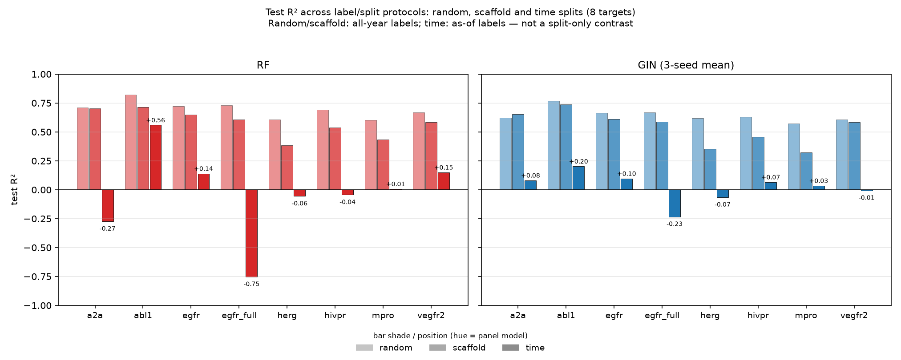

## Uncertainty & applicability domain: error ranking and screening checks

`experiments/uncertainty_ad.py` evaluates 8 targets × random/scaffold, for RF
and GIN/GINE (`results/uncertainty/`, `figures/uncertainty/`).

- **RF tree std ranks error imperfectly.** Quintile RMSE rises monotonically
  with predicted std in **8/16 cells**, and Spearman(std, |error|) averages
  **0.356** (0.156–0.490). These are error-ranking diagnostics, not proof of
  probabilistic calibration or reliable prediction-interval coverage. GIN and
  GINE 3-seed std rank errors more weakly (mean rho **0.147** and **0.112**;
  monotonicity **3/16** and **5/16**); these experiments do not establish a
  calibrated uncertainty estimate for any model.
- **AD uses each model's actual fit pool.** For random/scaffold, RF references
  train + valid, while GNN references train only; max Morgan Tanimoto ≥ 0.4
  defines in-domain. Recomputed RF coverage averages **96.96%**, with in-AD
  R2 averaging **0.638** (0.390–0.825). Out-of-AD R2 averages **−0.418** over
  the 13 scorable cells (worst `egfr`/random **−1.417**). These aggregates
  describe this panel and threshold, not a guaranteed reliability boundary.
  Subset R² also depends on each subset's label variance. Across the same
  13 scorable cells, out-of-AD RMSE exceeds in-AD RMSE in **10/13**;
  unweighted means are **1.075 vs 0.746 pIC50**, and MAE **0.861 vs 0.548**.
  These absolute-error comparisons support a descriptive association, not a
  universal AD reliability rule.
- **Screening:** AD filtering changes RF P@100 in **1/16 cells**
  (`herg`/random 0.65 → 0.66). Filtering report-positive molecules
  ({prediction ≥ 7}) by std ≤ the **whole test library's median std** raises
  mean precision **0.827 → 0.889**. It does not retain half of the positives:
  retention varies from **26% to 75%** across cells. Sorting the whole library
  by lowest std instead lowers mean P@100 to **0.602**, versus **0.913** when sorting by prediction.
  These retrospective screening checks support evaluating std as a filter;
  they do not validate it as a probability of correctness.

## Repository layout

```
qsar-activity-prediction/
├── README.md
├── docs/            # methodology.md (deep detail), interview.md (prep notes)
├── data/            # raw/ (gitignored), processed/ (cleaned, splits/)
├── notebooks/       # qsar_pipeline.ipynb (from scripts/)
├── scripts/         # pipeline (01-07_* QSAR, gnn_* GNN), fetch_artifacts.py
├── figures/         # plots for the results quoted here
├── models/          # trained RandomForests (gitignored)
├── tests/           # pytest suite (CI)
├── results/         # metrics/predictions for both phases
└── pyproject.toml   # tool config
```

## Reproduce

For current temporal statistics, use the restore → bootstrap → summary
commands near the top of this README. For random/scaffold inference and feature
caches, `fetch_artifacts.py --all` installs the 18 corresponding RF models,
raw data and caches; it skips the historical time models. Full retraining and
accepted temporal-model requirements are in [methodology](docs/methodology.md).

Docs: [methodology](docs/methodology.md) · [interview
notes](docs/interview.md) · [data provenance](data/README.md) ·
[review fix checklist](docs/reviews/fixes-2026-10-11.md) · [label-policy
sensitivity](docs/reviews/h1-sensitivity-2026-10-10.md).
