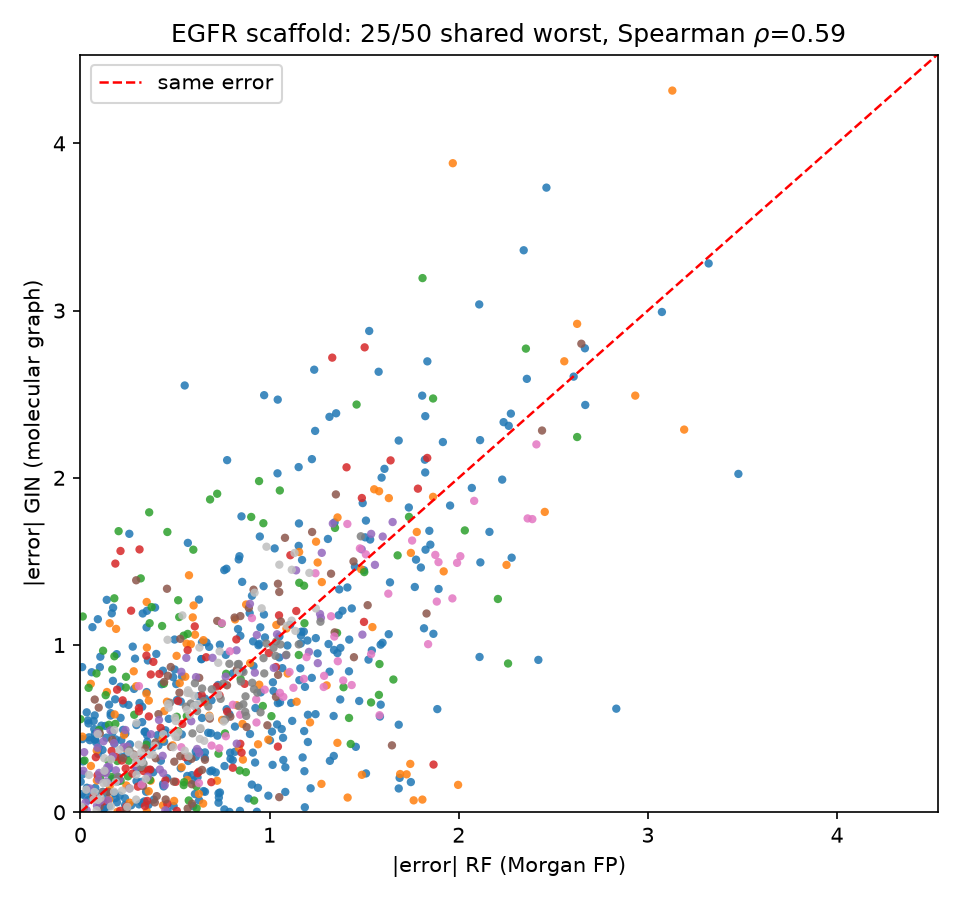
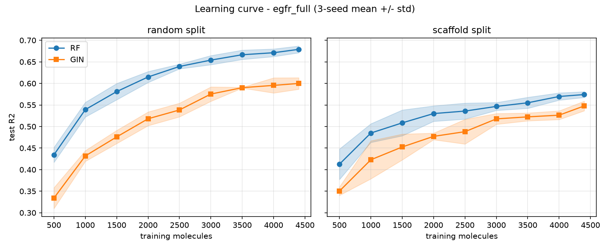
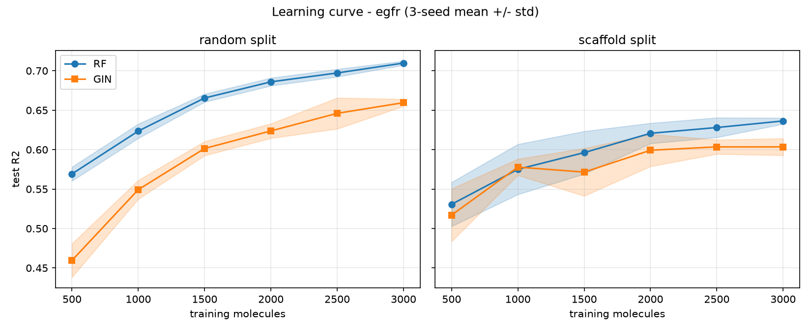
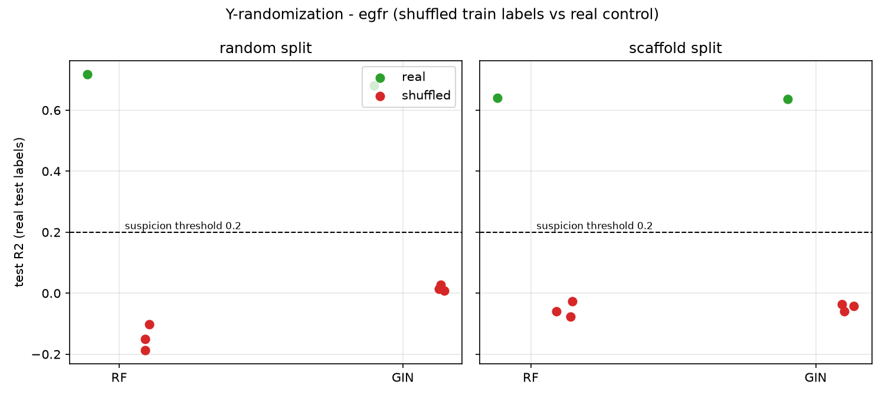
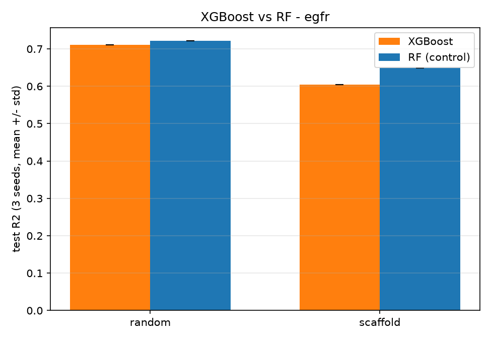
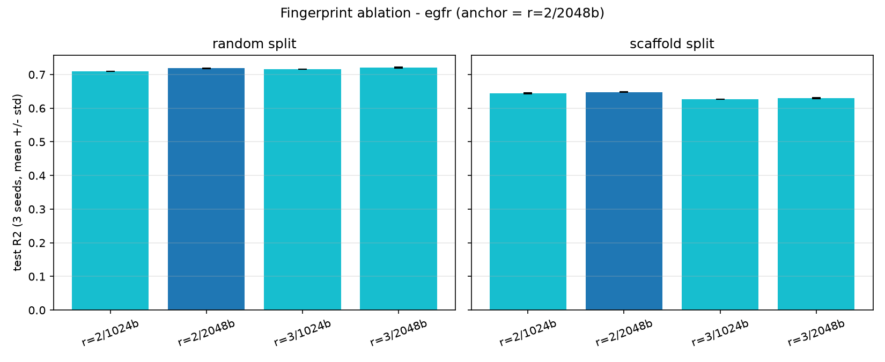

# Methodology & supplementary results

Deep technical companion to the top-level [`README.md`](../README.md).
This file was split out of the README during the docs slimming pass
and has been maintained against `results/` ever since - updated for the
2026-10-10/11 data refresh and re-verified against the files on disk for
the 2026-10-11/12 re-review - so it is no longer a verbatim copy of
anything. The interview prep material lives separately in
[`docs/interview.md`](interview.md), and every experiment is
recomputable from `results/` (run ledger: `experiments/LOG.md`).

## Data QC

Label and structure policy, as rebuilt on 2026-10-10/11 (per-finding
status in [`docs/reviews/fixes-2026-10-11.md`](reviews/fixes-2026-10-11.md)):

- **Label policy - keep only `standard_relation == "="`.** Censored
  records ("IC50 > 10000 nM", "IC50 < 50 nM") are bounds, not exact
  pIC50 values, so `scripts/02_clean_data.py` now admits only equality
  relations as labels (review H1; policy rationale, record-level
  reconciliation and the sensitivity rerun are in
  [`docs/reviews/h1-sensitivity-2026-10-10.md`](reviews/h1-sensitivity-2026-10-10.md):
  20.17% of pre-refresh `egfr_full` compounds were censored-only).
  `pchembl_value.notna()` is **not** an equivalent filter - 263 exact
  rows carry an empty pChEMBL (typically
  `data_validity_comment="Outside typical range"`), so the relation test
  is the single inclusion rule and the pChEMBL cross-check now runs over
  all retained rows. Disclosure: only that one direction occurs - across
  every ChEMBL raw pull in `data/raw/` there are **0** censored IC50
  records carrying a pChEMBL value, so the asymmetry is one-sided: the
  263-row exact-but-empty direction is the only observed failure mode
  (the `02` docstring now states exactly this). BACE and ESOL raw files
  carry no relation column: the filter is skipped for them with a
  printed note, and bace labels are unchanged.
- **Parent standardization before dedup.** Each canonical SMILES is
  standardized with RDKit `LargestFragmentChooser` + `Uncharger` into
  `parent_smiles`; rows are grouped by `parent_smiles` and take the
  median pIC50. The original `canonical_smiles` is kept as a provenance
  column alongside `n_measurements` and `n_structural_variants`, and the
  clean table is sorted by `parent_smiles` (so fingerprints, graphs and
  splits inherit that row order). Scope limit, deliberate: this merges
  multi-fragment/charge variants only - it does **not** resolve
  tautomers or stereochemistry (the same boundary the audit definition
  in `docs/reviews/codex-verification-2026-10-10.md` draws). Before the
  fix, salt forms let the same parent sit in RF train and test for up to
  **2.04%** of a random test set (ABL1 - PR #1's "~1.7%" was corrected
  in PR #2); after dedup each parent appears exactly once, so that
  salt-form leak is structurally gone (a different overlap - fingerprint
  twins - is disclosed below). Disclosure: `ic50_nm_median` is the
  median in *linear* space while `pic50` is the median in log space, so
  for even-sized groups the two need not be reciprocal - `ic50_nm_median`
  and the IC50 implied by `pic50` can differ by up to **3.02** log units
  (max over all clean CSVs); treat `ic50_nm_median` as provenance and
  `pic50` as the label.
- **Random-split fingerprint twins (disclosure).** Parent dedup removes
  salt duplicates, but it does not remove stereoisomer/homologue twins:
  **3.5-20.2%** of random-split test molecules have a bit-identical
  2,048-bit Morgan fingerprint somewhere in that tag's 80% non-test pool
  (the RF's fit set; hivpr 104/515, vegfr2 68/1,929) - mostly
  stereoisomers the achiral fingerprint cannot tell apart plus
  homologues, and most pairs carry different labels (mean |ΔpIC50|
  0.30-0.65 across twin pairs). Dropping those test molecules moves the
  RF's random-split R² by −0.018..+0.033 and flips no verdict (re-review
  N9, measured on the committed `rf_preds`), so this is disclosed rather
  than treated as a bug: the "structurally gone" claim above holds for
  salt forms only.
- **Featurization (disclosure).** `02` can keep an unparseable SMILES
  as a raw fallback parent; `03` refuses to featurize it - the script
  aborts loudly instead of silently dropping the row (a drop would
  desynchronise every downstream split/prediction index). Latent: all
  current parents parse, so neither path triggers.
- **Provenance of the refreshed raw pulls.** The 7 ChEMBL panel targets
  plus the egfr early-stop pull were re-downloaded on 2026-10-10 with
  both downloaders' `COLUMNS` extended by `standard_relation`,
  `data_validity_comment` and `activity_id` (`scripts/01d_download_incremental.py`,
  `scripts/01e_download_chembl.py`). Row counts are unchanged for the
  seven `01e` pulls (egfr_full: 24,560 rows, reconciled 100% against the
  API by record-level matching); the egfr pull itself was rebuilt
  (`e37c572`, "8k early-stop") and `data/raw/egfr_activities.csv` now
  holds 8,000 data rows instead of the pre-refresh 8,936 (manifest diff,
  re-review N6), so egfr's raw subset - and with it the 2013-2016 window
  - is a property of the pull, not of the label refresh.
  `data/raw/sha256sums.txt` was regenerated (manifest dated 2026-10-10).

The audit deliverables behind the README's short QC note:

- **Ultra-potent audit** (pIC50 > 9, i.e. IC50 < 1 nM): run on the
  pre-refresh pulls, EGFR had 326 such rows (3.7%), spread across many
  independent assays and documents (largest single source: 14%) -
  consistent with genuinely potent inhibitors, not unit mislabels. On
  the refreshed labels 155 of 4,560 EGFR parents (3.4%) still sit above
  9 - same picture, conclusion unchanged. BACE has 8 rows (0.5%) from a
  single FRET assay, also kept. No filtering rule was needed; the audit
  itself is the deliverable.
- **Inactive-end censoring**: the pre-refresh EGFR scatter plot showed
  vertical striations at low pIC50 (e.g. many compounds pinned at
  exactly 5.0 = IC50 10000 nM) - assay detection limits reporting
  "inactive above X". Review H1 traced most of that mass to censored
  records trained as exact labels; under the `=` filter those bounds are
  gone as labels, and the 27 refreshed EGFR parents still at exactly 5.0
  are equality-relation measurements, not bounds. Known QSAR nuisance,
  visible in the data.
- **Test-set distributions** are compared before trusting any RMSE
  (see the BACE fallback results in the README, and
  `figures/testset_hist_bace.png` / `figures/testset_hist_egfr.png` /
  `figures/testset_hist_vegfr2.png` - regenerated from the refreshed
  splits by `scripts/07_qc_checks.py`, in the same run that produced the
  `results/permutation_importance_*.csv` quoted below).

## 2026-10-11 data refresh

Two reviews landed on 2026-10-10: the PR #1 findings sheet
(`.claude/skills/qsar-review/references/findings-2026-10-10.md`,
H1/M1-M5/L1-L7) and its independent verification
([`docs/reviews/codex-verification-2026-10-10.md`](reviews/codex-verification-2026-10-10.md),
whose corrections were preferred over the original wording where they
disagreed). Code/docs fixes commit `43f5267`; the label/parent policy
then triggered a full data rebuild - per-finding status, commit hashes
and verification evidence are tabulated in
[`docs/reviews/fixes-2026-10-11.md`](reviews/fixes-2026-10-11.md), and
the pre-rebuild sensitivity experiment (egfr_full RF, censored-only
compounds dropped: ΔR² **−0.0250** random / **+0.0088** scaffold, no
verdict-level effect) is recorded in
[`docs/reviews/h1-sensitivity-2026-10-10.md`](reviews/h1-sensitivity-2026-10-10.md).

What was rebuilt (commits `d1bebd9` -> `e37c572`, raw re-download
2026-10-10):

- cleaning with the `=` filter + parent dedup (`02_clean_data.py`),
  parent-SMILES featurization (`03_featurize.py`) and parent-based
  document-year joins (`gnn_08_time_splits.py`); all 8 ChEMBL tags
  re-cleaned, bace untouched (labels - see the note below). Panel size
  drops from **55,145** to **42,804** parents (sum of the per-tag rows;
  herg 12,019 -> 8,403, egfr_full 13,497 -> 10,729, egfr 6,165
  -> 4,560, ...; full table in
  `docs/reviews/readme-numbers-2026-10-11.md` appendix A.2);
- fingerprints, graph caches, random/scaffold/time splits and
  `document_years.csv` re-derived from the new parents.
- **BACE regeneration (repaired 2026-10-14).** BACE retains its legacy
  raw canonical SMILES, charges, schema and row order through an explicit
  BACE-only cleaning path. Applying the ChEMBL Uncharger pathway would have
  changed 838/1,513 fingerprints; it is no longer used for BACE. A temporary
  regeneration from the actual raw BACE file reproduces all 1,513 committed
  rows and labels exactly (`logs/all_pr_review_20261014/bace_regeneration.json`),
  without overwriting the frozen clean data or changing ChEMBL parent handling.

Recomputed **after** the rebuild (historical status at 2026-10-12; its time
outputs were superseded by the corrected campaign below):

- **RF**: `results/metrics_{tag}.json` for all 8 panel tags + bace,
  retrained under the shuffled-fold grid search (`18d888e`, `05be454`;
  vegfr2 landed 2026-10-11 15:31) - so `best_params_{split}` everywhere
  reflects L3-fixed CV on the refreshed labels;
- **GIN**: 3-seed random/scaffold/time panels for all 8 tags
  (`results/gnn_metrics_*`, `gnn_preds_*`, 2026-10-10 23:20 - 10-11);
- **Downstream on the new RF/GIN**: XGBoost re-runs for all 8 tags
  (`results/xgboost/`, all 16 cells `same_pool: true`; every `rf_control`
  column now matches the refreshed `results/metrics_{tag}.json`), the
  multitask `st_rf` row (`results/multitask/summary.csv`, regenerated
  2026-10-12 from the refreshed RF), uncertainty/AD (8 tags x
  `--model gin` + `--model gine`), error analysis (8 tags), and the
  auxiliary interpretability / y-randomization / learning-curve batches
  (7 of 8 tags - vegfr2 was not run; completed 2026-10-11).

Status update (2026-10-12): the files this note originally flagged as
still pre-refresh - the B=10,000 significance tables
(`results/significance/*`, incl. the full 16-cell `summary_gine.csv`),
`results/multi_target/summary.csv`, `results/time_split/summary.csv`,
the `results/comparison_*` files, the xgboost `rf_control` columns, the
multitask `st_rf` row, and the test-set histograms / permutation-
importance outputs (Data QC) - have all since been refreshed, and the
sections below quote the refreshed tables. Still vintage-labelled rather
than recomputed: the n\* crossover extrapolation and the ep300 budget
confirmation, both pre-refresh and now archived under
`results/_archive-2026-10-09/scaling_ep300/` (see Data scaling), plus
the other pre-refresh artifacts under `results/_archive-2026-10-09/`.
`docs/reviews/readme-numbers-2026-10-11.md` is the number draft behind
the README rewrite (generated 2026-10-11 ~13:15): its per-file
NEW/PENDING/STALE markers are a snapshot of that moment and are now
historical - it still shows `results/significance/` as STALE and the
vegfr2 RF as PENDING, both since refreshed - so take current status from
the paragraph above, not from that map, and re-check file mtimes before
quoting any CI or panel number.

## Feature-importance checks (README "Interpretation & data QC")

Because RandomForest's built-in (MDI) importance is known to be inflated
for correlated features - and 2048 fingerprint bits contain many
chemically equivalent ones - every importance claim was cross-checked with
**permutation importance on the held-out test set**
(`scripts/07_qc_checks.py`):

- EGFR: bit 1367 drops test R2 by **0.43** when permuted - the MDI ranking
  *under*-casts it (MDI 0.274 vs a 0.428 permutation drop).
  Top-100 MDI-vs-permutation Spearman = 0.568.
- BACE: agreement is similar but slightly weaker (Spearman 0.543). MDI
  ranks the rare fluorinated-aromatic bit 964 first (MDI 0.154);
  permutation ranks the broadly carried oxygen environment first
  (bit 650, 0.197) and bit 964 second (0.096) - still important, but the
  substructure story must be told at the set level, not as "the one bit".

## Panel Δ conventions

Every Δ (GIN − RF) in this repo is reported under one of two
conventions. Both are computed from the same 3 seed predictions on the
same test molecules, but they are **different functionals of those
predictions**, so a point estimate and a confidence interval can
legitimately disagree. Never mix them in one comparison.

**1. per-seed-mean Δ - the panel point estimate.**

`Δ_panel = mean_s R2(y_test, ŷ_s) − R2(y_test, ŷ_RF)`

Each seed's test R2 is scored on its own, the 3 R2s are averaged, then
the RF test R2 is subtracted. This is every Δ printed next to a ±std in
the README and the panel tables: the `d_*_mean_*` columns of the
per-target `results/comparison_{tag}.csv` (rolled up by
`experiments/multi_target_summary.py` into the `d_r2_* (mean)` columns
of `results/multi_target/summary.csv`), and the `d_r2_mean` column of
`results/gine_panel/summary.csv` / `results/afp_panel/summary.csv`.
Computed at full precision; rounding happens only for display.

**2. ensemble Δ (mean3) - the significance estimate.**

`Δ_ens = R2(y_test, mean_s ŷ_s) − R2(y_test, ŷ_RF)`

The 3 seed predictions are averaged **per molecule** first, one R2 is
computed from that ensemble prediction (the deployable "3-seed
ensemble" model), and only then is the RF R2 subtracted. This is the
`pair=mean3` row of every `results/significance/summary*.csv` (columns
`d_r2`, `ci_lo/ci_hi`, `frac_boot_gin_better`; csv files written before
the 2026-10-10 rename still say `p_one_sided`), the `ci_lo/ci_hi`
whiskers drawn over the panel `d_r2_mean` bars, and the `d_r2_mean3` +
`ci_lo/ci_hi` columns of `results/time_split/summary.csv` (the same
numbers as the `mean3` rows of
`results/significance/summary_time.csv`).

**Why the two differ, systematically.** Averaging predictions before
scoring cancels per-molecule seed variance while the denominator SST is
unchanged, so:

`R2(ensemble) − mean_s R2(seed_s) = Σ_m var_s(ŷ_m,s) / SST ≥ 0`

(the numerator sums over the n test molecules; equivalently
`mean_m var_s(ŷ_m,s) / (SST/n)`, the mean variance over the mean square).

The **ensemble gain is never negative**: for any cell
Δ_ens ≥ Δ_panel (same RF reference), with equality only when the 3
seeds agree exactly. The offset grows with seed spread - it is a
property of the convention, not a bug or a data problem.

**Worked example (`egfr`/random).** The panel table and
`results/comparison_egfr.csv` read **−0.057** (per-seed-mean); the
`mean3` row of `results/significance/egfr_random.csv` reads **−0.044**
[−0.079, −0.010] (ensemble). The ~0.013 offset is pure ensemble gain -
two right answers to two different questions ("how far are the
individual seeds from RF" vs "how far is the deployed ensemble from
RF"), not a discrepancy.

**Reading rule.** Significance (is this cell separable from 0?) - read
the CI from the significance tables (`frac_boot_gin_better` there is the
fraction of bootstrap replicates favouring GIN, a direction descriptor,
not a hypothesis-test p). Point estimates, ±std and panel
bars - read the panel tables. Never compare a panel point against an
ensemble CI: `afp_panel`'s `herg`/scaffold is the illustration - its
point reads **+0.020** (per-seed-mean) while its own ensemble CI is
**[+0.030, +0.092]**, so the point sits outside "its own" interval
purely because of the convention difference (`experiments/afp_panel.py`
documents both). One more reference column: `d_*_seed42_*` is the
single-seed convention, reference only. Some scaffold cells show seed
spread of about 0.02, so a single-seed margin should not be generalized
to the training procedure without checking seed sensitivity. Whether any given Δ is separable from
test-molecule resampling noise is assessed by the paired bootstrap under
"Statistical significance" below; it does not cover every uncertainty source.

**Multiplicity.** The per-cell 95% intervals and counts are exploratory and
uncorrected across targets, splits and architectures. They do not provide
simultaneous 95% panel coverage. The bootstrap sign fraction is not a
calibrated null p-value; converting it to `2 × min(f, 1−f)` and applying
Bonferroni (as in the earlier review) does not establish formal family-wise
error control. No adjusted significance claim is made. Seed deletion and
scaffold-cluster resampling are separate sensitivity analyses.

## GNN model & graph featurization

Featurization (README "Controlling the comparison"): molecules are graphs:
atoms = nodes (9 categorical features: atomic number, chirality, degree,
formal charge, num H, radical electrons, hybridization, aromaticity, ring
membership), bonds = undirected edges (bond type, stereo, conjugation) -
the MoleculeNet/OGB featurization convention (`scripts/gnn_graph_dataset.py`),
cached as one CSR-style npz (`scripts/gnn_02_build_graphs.py`).

Model: GIN (Graph Isomorphism Network), the canonical MoleculeNet baseline:
AtomEncoder (sum of per-feature embeddings) -> 4 x [GINConv -> BatchNorm
-> ReLU -> dropout, residual] -> global mean pool -> MLP head. PyTorch
Geometric. The corrected temporal campaign ran all 24 GIN fits on the CUDA
host win4070 (RTX 4070 Laptop GPU, 8 GiB VRAM), with torch 2.14.0+cu126 and
CUDA 12.6. Every new time metrics block and checkpoint records the actual
device; `results/time_split/campaign_acceptance.json` records the accepted
per-run provenance. This source revision is distinct from the later revision
that publishes the resulting artifacts.

Historical random/scaffold device evidence remains scoped to committed logs:
the non-egfr GIN cells and the GINE/AttentiveFP campaigns used win4070
(`logs/win4070_/`, `device=cuda`). The 2026-10-12 rerun of stalled
`abl1`/scaffold AttentiveFP seed 42 ran under local MPS
(`logs/review11_n3_afp_abl1_scaffold_s42_min60.log`). The 2026-10-11
learning-curve and y-randomization batches are associated with
`logs/aux_m4_*.log`, but those logs do not record a device. The refreshed
2026-10-11 multitask rerun has no committed training log and its device is
unrecorded. `logs/multitask.log` records the superseded 2026-10-04 M3 Max
run (egfr_full test n=2,700), not the refreshed results (n=2,146). The refreshed `egfr` GIN
random scores (0.6694 / 0.6608 / 0.6636) and scaffold scores
(0.6308 / 0.6074 / 0.5991) have no committed training logs. They are not the
pre-re-pull `egfr` runs in `logs/win4070_/win4070_gin_c.log` and their device
remains unrecorded. Those historical metrics predate device metadata; the new
time metadata must not be used to infer their device. The default `gin` does not use
bond features (plain GINConv aggregates node features only), but the
cached 3-dim bond features are no longer "stored but unused":
`scripts/gnn_03_train_gin.py --model {gin, gine, attentivefp}` - all three
choices are live and were run panel-wide - builds the baseline **GIN**
(byte-for-byte the original recipe, artifacts keep their old names),
**GINE** (same shell; `GINEConv` consumes `BondEncoder(data.edge_attr)`,
`BOND_FEATURE_DIMS = [13, 7, 2]`), or PyG **AttentiveFP**. AttentiveFP
keeps the same two embedding front-ends (`AtomEncoder` -> in_channels,
`BondEncoder` -> edge_dim) and then runs the raw PyG model as-is:
`AttentiveFP(in_channels=hidden, hidden_channels=hidden, out_channels=1,
edge_dim=hidden, num_layers=4, num_timesteps=30, dropout=dropout)` -
gated atom/bond attention with a GRU readout over 30 timesteps, no
residual/BatchNorm shell of its own; hidden 128, 4 layers, dropout 0.2,
100 epochs, early stopping on validation RMSE - everything else is the
frozen `gnn_03` recipe. The P8 GINE panel (Statistical significance
below) runs the `gine` variant across all 8 targets - bond features are
used, and they still do not flip the verdict. P8 phase 3 runs the
`attentivefp` variant the same way (8 targets x 2 splits x 3 seeds = 48
runs; `results/afp_panel/summary.csv`) and it wins 1 of 16 cells on
per-seed panel points (2 of 16 under the mean3 CI - Statistical
significance below).
Pooling is mean rather than the paper's sum so prediction scale
does not couple to molecule size. Target standardized with train
statistics; metrics reported in original pIC50 units.

**RF hyperparameter search.** `scripts/04_train_and_evaluate.py` tunes
n_estimators x max_depth x min_samples_split with `GridSearchCV` on the
training pool only, using `KFold(5, shuffle=True, random_state=42)`.
The shuffle is deliberate: scaffold and time train pools are ordered by
scaffold group / SMILES, so unshuffled folds would each be one block of
the same chemotype family (or one alphabetical SMILES run) and the grid
winner would be picked on folds that never see some families. The test
set plays no role in the search. Each split's winner is persisted in
`results/metrics_{tag}.json` under `best_params_{split}`
(`best_params_random` / `best_params_scaffold` / `best_params_time`,
merged next to that split's metrics by step 04), and the auxiliary
experiments (fingerprint ablation, learning curve, y-randomization)
read the split-specific key - falling back to `best_params_random` with
a printed note for tags that predate the backfill. Before review M2 all
four auxiliary scripts reused `best_params_random` on the scaffold split
too (the fourth, `interpretability_alignment.py`, no longer refits at
all: it loads the committed split RF), although on today's committed
`best_params_*` the two winners still differ for 4 of 9 datasets
(`abl1`, `egfr`, `mpro`, `bace`).

## Statistical significance (paired bootstrap)

**Resampling-unit sensitivity (2026-10-13).** The primary CIs below resample
individual test molecules. They may understate uncertainty for generalization
to new chemotype families when errors within a scaffold are dependent.
`experiments/scaffold_bootstrap.py` additionally resamples whole held-out
Murcko groups, paired across models, at B = 10,000 and seed 42 for all
24 scaffold cells (8 targets × GIN/GINE/AttentiveFP), retaining molecule-weighted
R2 in each sampled set. Results are in
`results/significance/scaffold_cluster_sensitivity.csv`. Across all 24 scaffold cells, **7 of the 10 molecule-level significant
verdicts become intervals containing zero** under scaffold-group resampling:
2 of 3 GNN wins and 5 of 7 RF wins. All 14 original intervals containing zero
remain so. Only GINE/abl1 (GNN), GINE/a2a (RF), and AttentiveFP/mpro (RF)
retain an exclusion of zero. Thus the 21 RF / 5 GNN wins across random and
scaffold panels are molecule-bootstrap counts, not counts robust to both
resampling units. The full 24-cell table is in methodology; only 5–85 held-out
groups are available, which also limits the group bootstrap. This sensitivity
is separate from deleting a training seed.

| Model | Target | Molecule 95% CI | Scaffold-group 95% CI | Groups |
| --- | --- | --- | --- | ---: |
| gin | a2a | [−0.081, +0.015] | [−0.137, +0.025] | 5 |
| gin | abl1 | [+0.006, +0.069] | [−0.003, +0.249] | 12 |
| gin | egfr | [−0.053, +0.006] | [−0.096, +0.017] | 10 |
| gin | egfr_full | [−0.017, +0.022] | [−0.036, +0.039] | 28 |
| gin | herg | [−0.047, +0.017] | [−0.108, +0.049] | 85 |
| gin | hivpr | [−0.082, +0.004] | [−0.111, +0.047] | 16 |
| gin | mpro | [−0.133, −0.018] | [−0.175, +0.010] | 25 |
| gin | vegfr2 | [−0.001, +0.048] | [−0.024, +0.075] | 34 |
| gine | a2a | [−0.121, −0.028] | [−0.189, −0.058] | 5 |
| gine | abl1 | [+0.028, +0.092] | [+0.008, +0.329] | 12 |
| gine | egfr | [−0.052, +0.007] | [−0.120, +0.024] | 10 |
| gine | egfr_full | [−0.034, +0.008] | [−0.051, +0.023] | 28 |
| gine | herg | [−0.021, +0.048] | [−0.101, +0.087] | 85 |
| gine | hivpr | [−0.096, −0.007] | [−0.151, +0.057] | 16 |
| gine | mpro | [−0.130, −0.012] | [−0.171, +0.028] | 25 |
| gine | vegfr2 | [−0.015, +0.029] | [−0.032, +0.059] | 34 |
| attentivefp | a2a | [−0.091, +0.000] | [−0.207, +0.026] | 5 |
| attentivefp | abl1 | [−0.018, +0.057] | [−0.023, +0.223] | 12 |
| attentivefp | egfr | [−0.037, +0.025] | [−0.102, +0.072] | 10 |
| attentivefp | egfr_full | [−0.063, −0.013] | [−0.128, +0.045] | 28 |
| attentivefp | herg | [+0.030, +0.092] | [−0.057, +0.155] | 85 |
| attentivefp | hivpr | [−0.123, −0.003] | [−0.202, +0.054] | 16 |
| attentivefp | mpro | [−0.189, −0.051] | [−0.258, −0.011] | 25 |
| attentivefp | vegfr2 | [−0.041, +0.008] | [−0.065, +0.035] | 34 |


`experiments/paired_bootstrap.py` decides whether any single cell's Δ is
separable from resampling noise - analysis only, nothing is retrained:

- **Method**: B = **10,000** bootstrap replicates; test **molecules**
  resampled with replacement, *paired* - one index matrix applied to both
  models' predictions (test-index alignment asserted, never assumed).
  Every cell is evaluated under two conventions: `seed42` (seed-42 GIN vs
  RF, reference) and `mean3` (primary: per-molecule mean of the 3 GIN
  seed predictions vs RF, matching the campaign's mean convention). The
  95% CI is the [2.5, 97.5] percentile of the bootstrap ΔR2
  distribution; `frac_boot_gin_better = #(ΔR2_boot > 0)/B` - the
  fraction of bootstrap replicates favouring GIN, **not a p-value**
  (renamed from `p_one_sided` on 2026-10-10; a strong GIN win reads
  ≈1.0, so filtering on `p < 0.05` would silently drop every GIN win);
  a cell is *significant* iff the CI excludes 0. Signs: ΔR2 = R2_GIN − R2_RF (> 0
  favours GIN); ΔRMSE = RMSE_GIN − RMSE_RF (> 0 favours RF). Both
  conventions of a cell draw from the same seeded generator (seed 42, so
  runs are order-independent).
- **Results (random/scaffold, gin, 16 cells)** - under `mean3`, 9 of 16
  cells have a CI excluding 0: **7 favour RF, 2 favour the GIN**
  (`abl1`/scaffold, `herg`/random - both *conditional* on at least one
  training seed, per the single-seed-dependence standard below); the
  other 7 straddle 0:

  | cell | ΔR2 (mean3) | 95% CI | winner |
  |---|---|---|---|
  | `a2a`/random | −0.073 | [−0.138, −0.013] | RF |
  | `abl1`/random | −0.044 | [−0.076, −0.016] | RF |
  | `egfr`/random | −0.044 | [−0.079, −0.010] | RF |
  | `egfr_full`/random | −0.039 | [−0.059, −0.021] | RF |
  | `hivpr`/random | −0.048 | [−0.083, −0.014] | RF |
  | `mpro`/scaffold | −0.074 | [−0.133, −0.018] | RF |
  | `vegfr2`/random | −0.044 | [−0.068, −0.021] | RF |
  | `abl1`/scaffold | +0.037 | [+0.006, +0.069] | GIN |
  | `herg`/random | +0.038 | [+0.006, +0.069] | GIN |

  Under `seed42` 10 cells are significant - 9 favour RF and the one
  *GIN* win is `abl1`/scaffold +0.060 [+0.025, +0.096]. The GIN win
  survives `mean3` at roughly half the single-seed size (+0.037
  [+0.006, +0.069]), while two `seed42` RF cells (`egfr_full`/scaffold
  −0.028 [−0.049, −0.007], `hivpr`/scaffold −0.084 [−0.132, −0.038])
  straddle 0 under `mean3` and `herg`/random gains a CI (+0.001 ->
  +0.038). This is the single-seed-is-noise convention (Panel Δ
  conventions above) promoted from a heuristic to a bootstrap result: a
  lone seed can manufacture a "significant" verdict, and it inflates
  the `abl1`/scaffold GIN lead - *conditional*, see the next bullet -
  by ~0.023.
- **Single-seed dependence - one standard for every model.** Every
  verdict above is the paired-bootstrap CI of the 3-seed ensemble; a
  verdict that changes when at least one training seed is dropped is
  *conditional* on that seed. Recomputing the same B = 10,000 bootstrap
  over all 48 random/scaffold GIN, GINE and AttentiveFP cells with each
  seed omitted in turn (ensemble = mean of the two kept seeds):
  **14 of 48 cells are conditional** - 4 of the 5 GNN wins (all but
  GINE `abl1`/scaffold), 1 of the 21 RF wins (AFP `hivpr`/scaffold:
  drop seed 42 -> −0.013 [−0.076, +0.046]), and 9 ties that become
  RF-significant. Of the GNN wins: GIN `abl1`/scaffold is conditional
  on seed 42 (+0.037 [+0.006, +0.069]; drop seed 42 -> +0.015
  [−0.017, +0.046]); GIN `herg`/random on seeds 1/2 (drop seed 1 ->
  +0.027 [−0.007, +0.058]); AFP `herg`/random on seed 42 (drop seed
  42 -> +0.003 [−0.031, +0.035]) and on seed 1; AFP `herg`/scaffold on
  seed 1 (drop seed 1 -> +0.031 [−0.002, +0.063]). Only GINE
  `abl1`/scaffold survives every drop (worst +0.047 [+0.017, +0.080]).
  This perturbation changes only the GNN arm and reduces ensemble size.
  For predictions p_k and their mean m, mean_k (y−m_{−k})² equals
  (y−m)² + mean_k (p_k−m)²/4, so averaging the three drops necessarily
  worsens the GNN ensemble MSE. The asymmetry is not evidence that RF
  wins are robust to RF training seeds; RF randomness was not varied.
- **GINE** (`--model gine`, `results/significance/summary_gine.csv`):
  **all 16 cells have a CI** (frozen-recipe per-seed predictions for
  every tag, incl. `abl1`/`herg`/`vegfr2`): **1 favours GINE**
  (`abl1`/scaffold **+0.058 [+0.028, +0.092]** - the only GNN win of
  the 48 that survives every drop-one-seed recompute), **7 favour RF**
  (`a2a`/scaffold, `abl1`/random, `egfr`/random, `egfr_full`/random,
  `hivpr`/scaffold, `mpro`/scaffold, `vegfr2`/random), **8 contain 0**.
- **AttentiveFP** (`--model attentivefp`, P8 phase 3): all 16 cells have a
  CI - 9 are significant: **7 favour RF, 2 favour AttentiveFP**
  (`herg`/scaffold +0.062 [+0.030, +0.092], `herg`/random +0.034
  [+0.002, +0.065]; both *conditional* - each loses its CI on at least
  one drop-one-seed recompute, per the standard above), 7 contain 0;
  summary in
  `results/significance/summary_attentivefp.csv` (details: the
  "AttentiveFP control" write-up under supplementary experiments).
- **Outputs**: `results/significance/summary.csv`,
  `results/significance/summary_gine.csv`,
  `results/significance/summary_time.csv`,
  `results/significance/summary_attentivefp.csv`, per-cell
  `results/significance/{tag}_{split}{,_gine,_attentivefp}.csv`; forest
  plots `figures/significance/ci_panel.png` (+ `_time` /
  `_with_gine` / `_attentivefp` / `_with_afp` variants). The campaign
  summaries are **merge-updated by (tag, split, pair)**, never blindly
  rewritten: every row carries its `n_boot`, and a stored row whose B
  differs from the current run's is refused with an error unless
  `--force` is passed - so a `--n-boot 300` smoke test can never mix
  into the B=10,000 table. Any partial invocation (a tag subset, or a
  non-default `--n-boot`) is by definition not a campaign run: it writes
  `summary_partial{suffix}.csv` / `ci_panel_partial{suffix}.png` and
  leaves the campaign files untouched (review L2; the merge, the
  legacy-`p_one_sided` reader and the partial-run guard are pinned by
  `tests/test_p8_analysis.py`). The corrected time-split comparison is
  reported in the publication-year section below.

## Scaffold split convention: largest groups go to *test* (opposite of DeepChem)

Every split in the repo comes from `scaffold_split()`
(`scripts/qsar_common.py`, the single source of truth shared by phase 1,
phase 2 and the experiments):

- **Our rule**: group molecules by Bemis-Murcko scaffold (RDKit, no
  chirality; a molecule whose SMILES fails to parse forms its own
  group), sort the groups **largest first**, and fill the **test** set
  from the largest groups until it reaches ~20% of the data; everything
  left over goes to train.
- **DeepChem / MoleculeNet's `ScaffoldSplitter` does the reverse**: the
  largest scaffold groups are assigned to **train** first, and test/valid
  get whatever small groups are left over.
- **Interpretation**: the conventions hold out different chemotype
  populations, so absolute scaffold R2 values are not directly comparable.
  Mutual similarity within test families does not imply similarity to the
  training set. Neither the direction of a score change nor persistence of
  model rankings has been established under the alternative convention;
  testing those claims would require retraining.
- **Why this direction was chosen, and the cost**: keeping the large
  families in test is what makes chemotype-level error analysis possible
  - the scaffold-coloured scatters and the thienopyrimidine /
  4-anilinoquinoline series findings (`scripts/gnn_05_error_analysis.py`) need whole
  families present in the test set. The cost is explicit: campaigns
  already run are not redone under the other convention, and switching
  to a MoleculeNet-aligned split later would require full retraining of
  every cell.

## Publication-year (time) split: corrected policy and results

**Correction and completed retraining.** The historical time models used
cleaned all-year median labels. First-publication grouping did not prevent
later measurements from changing a training label. The current results replace
that campaign with 8 RF searches and 24 GIN fits using `exact-dated-asof-v1`,
followed by acceptance, B=10,000 paired bootstrap and regenerated summaries
and figures. Random/scaffold labels and results were preserved.

For `egfr_full`, the old training pool included 413 parents with measurements
from 2019 onward and 279 from 2021 onward. `CHEMBL266995` illustrates the
effect: its two 1999 measurements yield median pIC50 6.898, while inclusion of
a 2024 measurement makes the old label 8.097. First-report grouping can stay
as-is, but a training label must use measurements available at its cutoff.

**Current protocol (`scripts/gnn_08_time_splits.py`,
`scripts/time_labels.py`, policy `exact-dated-asof-v1`):**

- The earliest known document year across raw activity records defines
  first report. `data/raw/document_years.csv` contains the document-year
  lookup (4,147 documents across eight targets; missing years remain missing).
  Test and validation cutoffs select the newest first-report years.
- Labels are aggregated separately within each assigned pool from exact (`=`)
  measurements, after relation normalization, valid positive nM values and
  known document years. Train labels use **year < cutoff_valid**; validation
  labels use **year < cutoff_test**; test labels use **year >= cutoff_test**.
  Existing cleaning range rules apply before taking the parent median.
  Missing eligible labels produce explicit exclusions, not fallback to an
  all-year label. Train, valid, test and excluded indices partition cleaned
  parent rows; excluded labels are missing. The campaign excludes 168 rows.
- Versioned NPZ files include policy, source/dataset signatures, cutoffs,
  labels and `label_id`. Consumers validate these and prediction provenance;
  partially rerun campaigns cannot mix as-of labels with old predictions.
  An NA marker takes precedence over an old split. Regeneration makes valid
  and NA states mutually exclusive.
- RF fits train only with shuffled five-fold hyperparameter selection. GIN
  fits the same train pool and selects checkpoints on validation. The constant
  uses the training-label mean. This checkpoint-selection asymmetry remains.
- All three predeclared GIN seeds (42, 1, 2) are included. No test score was
  used to choose hyperparameters, discard seeds or decide whether to extend a run.

The [three-host campaign](#three-host-temporal-retraining-campaign-2026-10-13)
records execution and reproduction commands. The initial training source was
`7ce15c1f0849ae69e0ca208f781a9824517eb328`; four hERG jobs were then replaced
from `d13f9125af56028f60e099ec2e914dd2509c239e` after the cached-parent-key
repair described below. The remaining 28 jobs retain their original provenance. `results/time_split/campaign_acceptance.json`
records 32 accepted jobs, source/input/label hashes, environments, metric
recomputation and checkpoint prediction replay. The RF replay matched exactly;
GIN CUDA replay had maximum absolute prediction difference 9.54e-7. All 24 best epochs are early (2–27 of 100; median 9.5). The original
metric flags used the last training epoch's loss and are retained as historical
records. Re-evaluating the saved best checkpoints in eval mode flags **13/24**
under the same early-epoch / standardized training MSE > 0.5 heuristic; a2a's
three training MSEs are 0.749–0.976. See
`results/time_split/checkpoint_diagnostics.csv`. This diagnostic neither proves
convergence nor establishes that more training would help. Models and test
predictions are unchanged; no test score selected a new training budget.

**RF training uncertainty.** Each published temporal RF result is one fit
(`random_state=42`). The paired molecule bootstrap conditions on that fit and
the fitted GIN ensemble; it does not cover RF training randomness. The hERG
repair changed ensemble ΔR² from +0.005748 to +0.021937, but also changed the
training input and retrained all three GIN seeds, so this is not an estimate
of RF seed variance. A review mentioned R² SD ≈ 0.006 across five RF random
states; its limitations section says only a2a RF was retrained, so the
number must not be attributed to hERG. No corresponding five-fit cohort,
seed list or configuration was found in the published artifacts, so that
historical experiment remains unverified. The separate follow-up below
provides new, reproducible evidence rather than claiming to identify that cohort.

**Independent supplement completed 2026-10-14.**
`experiments/rf_seed_sensitivity.py` fixes the current a2a and hERG
`{tag}_time.npz` label IDs and train/test indices, fingerprint caches and
selected `best_params_time`, then refits RF estimators on the same train-only
pools with random states **42, 1, 2, 3, 4** (no renewed hyperparameter search).
Both historical and current sklearn versions are 1.9.1.

| Target | Mean RF R² | Population SD (ddof=0) | Sample SD (ddof=1) | Observed R² range |
|---|---|---|---|---|
| a2a | −0.305437 | 0.023457 | 0.026225 | [−0.344882, −0.273178] |
| hERG | −0.051668 | 0.005488 | 0.006136 | [−0.058191, −0.042333] |

Against the unchanged GIN ensemble, GIN-minus-RF Δ ranges from +0.388554
to +0.460259 on a2a and +0.008691 to +0.024549 on hERG. These observed
five-seed ranges are **not confidence intervals**. The hERG sample SD rounds
to 0.006, but matching that rounded value cannot identify the unpublished
review cohort. Seed-42 predictions reproduce the published fits within
2e−15, and all ten prediction metrics were independently recomputed to
1e−12 with source/input hashes verified. `results/rf_seed_sensitivity/`
contains per-run R²/RMSE/MAE, predictions, both SD conventions and provenance.
This measures refit randomness conditional on selected hyperparameters, not
search or data-sampling uncertainty. The published seed-42 models and GIN
checkpoints were not replaced.

**A2A document concentration, checked against raw rows and frozen labels.**
`CHEMBL5728996` (2022) contributes 378 eligible exact nM activity rows for
**371 of 802 test parents (46.26%)**; all 371 have no other eligible test-era
document. Raw IC50 values are **30 nM (80 rows), 75 nM (77), 300 nM (221)**,
with one shared assay description. After taking parent medians, these parents
have **six** distinct frozen pIC50 values, not merely three. The full 802-row
test-label reconstruction matches the frozen values within 4.71e−7.
A document and identical description do not independently verify one batch or
the measurement precision. Source/assay dependence and discretization can
contribute to apparent time-protocol performance; a molecule bootstrap does
not resolve them. Document/assay-group sensitivity or an external temporal
cohort would be needed before generalizing beyond these sources.

Reproduce these descriptive checks without training:
`python experiments/low_review_diagnostics.py`. It reads the raw a2a and
document-year CSVs plus restored frozen time inputs and the per-molecule RF AD
CSVs. `results/review_low_diagnostics/` contains source hashes, document counts,
subset metrics, and an initial hERG summary read from Git `920bc28` whose hash
is verified against `initial_campaign_acceptance.json`. A shallow checkout
without that Git blob explicitly reports the historical comparison unavailable.

**Current time seed sensitivity.** The published
`.claude/skills/qsar-review/scripts/single_seed_verdicts.py` recomputes all
8 current time cells with each of three GIN seeds removed (B=10,000, seed=42).
All 24 deletions preserve the full-ensemble verdict: 0/8 conditional cells.
The historical hivpr/time conditional result has been superseded by corrected
as-of-label predictions. Input hashes and numerical results are saved in
`logs/all_pr_review_20261014/seed_sensitivity.json`; the same run reproduces
14/48 conditional random/scaffold cells. As above, this changes only GIN
seeds and ensemble size, not RF training randomness.

**Current results.** Unweighted means over the eight tags are RF **−0.034**,
GIN per-seed **+0.022**, and GIN ensemble **+0.062** time R2. The ensemble
ΔR2 molecule-bootstrap CI excludes zero in six cells: four favour GIN
(`a2a`, `egfr_full`, `hivpr`, `mpro`) and two favour RF (`abl1`, `vegfr2`).
`egfr` and `herg` include zero. These unadjusted 95% intervals condition on the
three fitted seeds and resample paired test molecules; they do not capture
all training, assay or scaffold-cluster uncertainty. `egfr` is contained in
`egfr_full`, so the eight rows are not independent target replications.

**Train-mean baseline and error levels.** The constant column predicts the
mean training pIC50. Paired molecule-bootstrap comparisons with that baseline
(B = 10,000, seed 42; `results/time_split/baseline_diagnostics.csv`) put RF
below it on a2a, egfr_full and herg; RF's differences on hivpr and mpro include
zero. The GIN ensemble exceeds the baseline on every tag except herg, whose
interval includes zero. These are unadjusted, model-conditional comparisons.

For a2a, the +0.389 ensemble advantage decomposes into a +0.579 mean-level
term, −0.099 scale term and −0.091 correlation term: RF predicts 0.806 below
the test mean, GIN 0.143 above it, while RF has the higher Pearson correlation
(0.570 versus 0.450). GIN prediction SD is only 0.189 of the label SD.
For egfr_full, the mean-level term is +0.318, about 56% of the +0.565 total.
These are an exact squared-error decomposition with symmetric allocation of
the scale/correlation interaction, not causal explanations or proposals to
calibrate on test labels. Test fractions are 59% for a2a and 51% for mpro
because a newest first-report year can itself exceed the target fraction.

The relative GIN gain on `egfr_full` does not imply adequate absolute
performance: ensemble R2 is −0.188 there, versus RF −0.753. Both models also
have negative R2 on `herg`. Publication-year holdouts are retrospective and
do not identify a causal drift mechanism or establish deployment readiness.
For any constant c, R2 = −(c − mean(y_test))² / Var(y_test); a negative constant
score can occur under ordinary stationary sampling variation. Current
`constant_r2` uses train-only labels, whereas the historical constant also
used validation. Random/scaffold comparisons also use a different label
aggregation policy and cannot isolate the effect of splitting alone.

Current artifacts are `results/time_split/summary.csv`,
`results/significance/summary_time.csv`, `figures/time_split/panel_3splits.png`,
`figures/time_split/{tag}_timeline.png` and
`figures/pred_vs_actual_time_{tag}.png`. The README reports the matching table.
The old all-year-label scores and MSE decomposition in
`logs/2026-10-13_time_split_mse_decomposition.log` are historical only, retained
in Git revision `7ce15c1` and a coordinator scratch archive. They cannot be
recomputed from the replaced current prediction files. Their level and
Shapley-allocated spread/correlation terms were arithmetic descriptions of
those old predictions, not causal evidence. Only the level term and total
are allocation-independent; spread and correlation share an interaction
term, so their magnitudes (and sometimes signs) depend on the allocation
convention. For the archived a2a example, assigning spread first versus
correlation first changes the spread term from −0.128 to +0.143; this does
not change the total. The same convention limit applies to the current
symmetric decomposition.

## Uncertainty & applicability domain

`experiments/uncertainty_ad.py` evaluates 8 targets × random/scaffold for
RF and GIN, then GINE. Refreshed AD outputs use each model's actual fitting
pool: RF train + valid, GNN train only. Per-row CSVs expose both similarities,
and summaries record the reference policy. This prevents GNN validation
molecules from silently becoming its training-domain references.

- **Error ranking, not demonstrated probabilistic calibration.** RF tree std
  has monotone quintile RMSE in 8/16 cells, regression slope 0.736, and mean
  Spearman(std, |error|) 0.356 (0.156–0.490). GIN and GINE seed std are weaker
  ranking signals: rho 0.147 and 0.112, monotonicity 3/16 and 5/16, slopes
  1.13 and 0.81. The stored `calibration` diagnostics name is historical:
  monotonic bins or a fitted slope do not establish nominal interval coverage
  or calibrated probabilities. No model's uncertainty is certified here.
- **RF AD, recomputed:** max Morgan Tanimoto to train + valid ≥ 0.4 yields
  mean coverage 0.9696. In-AD R2 averages 0.638 (0.390–0.825); out-of-AD R2
  averages −0.418 across 13 scorable cells (worst `egfr`/random −1.417).
  The threshold and aggregate R2 are descriptive panel diagnostics. Because
  R² = 1 − MSE / Var(y), comparing in/out subsets changes the denominator.
  The independent per-molecule calculation in
  `results/review_low_diagnostics/ad_subset_metrics.csv` reports n, label
  variance, R², RMSE and MAE for every subset. On the same 13 cells with
  scorable in/out R², out-of-AD RMSE is higher in **10/13**, with unweighted
  cell means **1.074599 outside vs 0.745936 inside**; mean MAE is
  **0.861382 vs 0.548032**. These are paired cell averages, not pooled
  molecule-weighted errors or evidence that AD status causes error.
- **Retrospective screening:** applying AD changes RF P@100 in 1/16 cells
  (`herg`/random 0.65 → 0.66). For report positives (prediction ≥ 7),
  keeping std ≤ the **whole test library's median** raises mean precision
  0.827 → 0.889 (14/16 cells improve). This threshold retains half of the
  library before intersection with positives, not half of the positives;
  the positive retention fraction ranges from **26% to 75%** across cells.
  Re-ranking the entire library by lowest std yields P@100 0.602 versus 0.913 when ranked by
  prediction. Selection/filter performance does not establish calibration.
- **Artifacts:** `results/uncertainty/summary_*.json`, per-cell CSVs, and
  `figures/uncertainty/` (32 bin-diagnostic plots, 32 AD-error scatters,
  4 screening panels). Figure names containing `calibration` are descriptive
  labels for the bin diagnostics, not a probabilistic calibration claim.

## Hyperparameters: an honest negative result

A bounded tuning pass (300 epochs + ReduceLROnPlateau, dropout {0.2, 0.3})
improved validation RMSE for one config (0.517 vs 0.533, standardized
units) but **degraded** test R2 (0.525 vs 0.544): with only ~490
validation molecules, best-epoch selection was fitting validation noise.
All three configs land at test R2 0.52-0.54, so the simplest recipe was
kept as the final model rather than reporting a best-of-three test
number. Tuning artifacts (run 2026-09-24, pre-refresh; archive dated 2026-10-09) are kept under
`results/_archive-2026-10-09/` (`gnn_metrics_egfr_tuneA/B.json`,
`gnn_preds_egfr_scaffold_tuneA/B.npz`, `egfr_gin_scaffold_tuneA/B.pt`).

## Error analysis: do the models fail on the same molecules?

`scripts/gnn_05_error_analysis.py`:

- Of each model's 50 worst-predicted test molecules, **25/50 (random) and
  25/50 (scaffold) are shared**, against a random expectation of ~2.7.
  Per-molecule absolute errors correlate at Spearman **0.50 (random) /
  0.59 (scaffold)**. This establishes shared difficult examples, but does
  not identify assay noise as their cause: common representation limits,
  distribution shift and label noise are alternative explanations. Independent
  assay-level evidence would be needed for a data-quality conclusion.
- The displayed error analysis uses GIN seed 42. On the refreshed scaffold
  test set, the documented thienopyrimidine series (n=47) costs RF 1.318
  mean |error| vs GIN 1.021. The GIN values are 1.325 and 0.996 for
  seeds 1 and 2, so the direction changes for seed 1. It is a seed-specific
  case study, not a stable architecture-level chemotype advantage. For seed 42,
  the 4-anilinoquinoline series (n=88,
  scaffold `c1ccc(Nc2ccnc3ccccc23)cc1`) costs the GIN more - RF 0.779 vs
  GIN 0.962; the quinazoline series proper is the largest scaffold in
  the test set (n=355, `c1ccc(Nc2ncnc3ccccc23)cc1`), where the two
  models nearly tie (RF 0.868 vs GIN 0.850); the chromone query now
  matches **0 of 912** `egfr` test molecules and is skipped there.
  Chromone and thienopyrimidine are the two documented EGFR-family
  queries, selected **per tag** by
  `experiments/interpretability_alignment.py` (a family with 0 matches
  is dropped: herg keeps chromone with 30 matches, mpro 17;
  a2a/abl1/hivpr fall back to their own two most frequent Murcko
  scaffolds), and across the 7 tags the GNN-vs-RF atom-overlap fraction
  spans 0.32-0.68. Core-attribution fractions must **not** be pooled
  across the two family types: a documented query family (chromone,
  thienopyrimidine) is a small substructure, while a Murcko-scaffold
  fallback covers a large fraction of each molecule by construction, so
  its "share of top-attributed atoms on the core" is high even for a
  chance allocation - the Murcko-fallback numbers need a chance-level
  baseline before being read as attribution. Per-tag readings live in
  the `results/interpretability/by_tag/{tag}/` outputs, keyed by family
  type. Fingerprints and
  message passing generalize differently across scaffold space.



## External benchmark: MoleculeNet ESOL

To show the pipeline is not tuned to one in-house dataset, the same GIN
(featurizer, split protocol, hyperparameters) was run on the public ESOL
aqueous-solubility benchmark (1128 molecules, log mol/L):

| Split | GIN R2 / RMSE |
|---|---|
| random | 0.913 / 0.642 |
| scaffold | 0.597 / 1.158 |

The random-split number is in line with published GNN results on ESOL
(random-split RMSE roughly 0.5-0.9 depending on protocol); the scaffold
number is much lower, as expected when whole chemotypes are held out.

## Data scaling: how much more data would it take?

The paired learning curve on `egfr_full` was re-run on the refreshed
labels with sizes 500, 1000, ..., 4,400 x seeds 42/1/2, with the test
set, validation set and hyperparameters frozen
(`experiments/learning_curve.py`):



- **Measured range: no crossover.** The refreshed curve stops at
  n = 4,400 (the pre-refresh run went to the then-full pool,
  n = 9,717). At n = 4,400 (random) RF 0.679 vs GIN 0.600, gap
  **−0.079**; the scaffold curve at the same point reads RF 0.574 vs
  GIN 0.548, gap **−0.026**. The random gap narrows from −0.100 at
  n = 500 but never closes - no point on either split crosses
  (random gaps −0.107..−0.076, scaffold −0.062..−0.026) - the
  curve-level echo of the eight-target panel, where only 2 of the 16
  cells still lead on the per-seed-mean Δ (`abl1`/scaffold +0.022 and
  `herg`/random +0.012; the other 14 are negative,
  `results/multi_target/summary.csv`), and where no n on this curve
  produces a crossing.
- **Extrapolated crossover: pre-refresh vintage.** Fitting a saturating
  curve R2(n) = R2_inf − a·n^(−b) and solving the gap for its root
  (`experiments/scaling_analysis.py`) gave n\* ≈ 25k-35k (≈ 3x current
  data): n\* = **28,156** on random (per-seed **33,522 ± 13,558**, 95%
  CI **[19,765, 45,215]**, 3/3 seeds find a root) and n\* = **25,112**
  on scaffold (1/3 seeds). But
  `results/_archive-2026-10-09/scaling_ep300/scaling_egfr_full.json`
  was fit on the
  *pre-refresh* curve (its `n_observed` grid still runs 500..9,717) and
  has not been re-fit on the refreshed 500-4,400 grid - treat the number
  as a pre-refresh (2026-10-04) order-of-magnitude estimate, not a
  property of the current curve.
- **Weakly identified (same vintage).** Three of those fits return
  **R2_inf > 1** (random RF 1.19, random GIN 2.37, scaffold GIN 1.88) -
  an asymptote above a perfect R2 is impossible. With only six curve
  points the asymptote (and therefore n\*) is poorly constrained:
  *roughly three times more data, not a precise threshold*.

**Training-budget caveat (pre-refresh, 2026-10-04).** All six baseline
full-pool runs of the pre-refresh curve sat against the 100-epoch cap
(`best_epoch` 93-100), so the same six were re-run at `--epochs 300` on
identical data, splits and seeds: every run then early-stopped later
(epochs 100-217; 5/6 now past the old cap), yet the 3-seed means moved
by only **|Δ| ≤ 0.0173** (+0.0035 on random - 7% of that gap; −0.0173
on scaffold - 31% of that gap) and *smaller than the 0.0277 drift
between two runs of the same seed*. Budget effect and run noise were
therefore not separable in a single pass, and either stayed well under
the RF−GIN gap: on those (pre-refresh) runs the conclusions were robust
to training budget. The confirmation was never repeated on the
refreshed labels (its `R2_base` values no longer match
`results/gnn_metrics_egfr_full*.json`). Full record:
`results/_archive-2026-10-09/scaling_ep300/ep300_confirmation.md`.

**The failures themselves transfer.** `gnn_05_error_analysis.py` on four
targets (worst-50 overlap / Spearman ρ of per-molecule |error|, random /
scaffold): `egfr` 25/25, ρ 0.50/0.59 (chance ≈ 2.7); `vegfr2` 23/20,
ρ 0.59/0.54 (chance ≈ 1.3); `herg` 22/40, ρ 0.53/0.58 (chance ≈ 1.5);
`a2a` 27/30, ρ 0.46/0.63 (chance ≈ 9). Overlap of 20-40 against an
expected 1-9 and ρ 0.46-0.63 across chemically unrelated targets: the
shared-error pattern recurs across targets. Its cause remains unresolved;
shared failures alone cannot distinguish measurement noise from common
model limitations or distribution shift.

## Supplementary experiment write-ups

Every number below is 3-seed mean +/- std and recomputable from
`results/` (run ledger: `experiments/LOG.md`).

**Data scaling: the GIN climbs faster but never catches up (n=3,000).**
On the refreshed paired learning curve (n=500-3000) the RF leads
throughout on random (0.569 -> 0.710, seed-std <=0.01) while the GIN
climbs faster without catching up (0.460 -> 0.660; gap -0.110 -> -0.050);
on scaffold the gap narrows to 0.033 at the largest n (a single
mid-curve point at n=1,000 sits +0.003 above RF - within noise).



**The signal is real: Y-randomization kills it.** Training on permuted
labels, every shuffled-label group mean stays deep in noise (random
split: -0.146 RF / +0.0097 GIN; scaffold: -0.054 / -0.028) and under
the script's acceptance threshold: across all 7 tags only two shuffled
group means are positive at all - `egfr`/random GIN **+0.0097** and
`egfr_full`/random GIN +0.0002 - and every mean is **< 0.2** (the
script's own verdict: "ok: all shuffled-label means < 0.2"),
while real-label controls land on the baselines - no
train/test leakage. Individual shuffled GIN seeds on `egfr`/random land
at -0.007/+0.010/+0.026, so the 3-seed mean is slightly positive
(+0.0097) rather than <= 0; the test still passes under its < 0.2
criterion. One number needs a footnote: the real-label control
RF reads **0.7179** (random) against the headline **0.7214**. The ~0.004
gap comes from the control's training pool, not from skipped tuning:
`experiments/y_randomization.py` fits its control RF on the GNN train
pool (`train_idx`: 3,283 rows on both egfr splits), i.e. without the
validation carve-out the headline RF also trained on (3,648 rows -
365 more rows). Real and shuffled controls always fit on the same
pool, so the comparison stays valid. It is not leakage evidence either
way: the y-randomization verdict only requires every shuffled mean
< 0.2 with the real control landing inside the baseline band.



**XGBoost does not beat the tuned RF either** (-0.011 random /
-0.045 scaffold vs the same-pool RF control, deterministic across
seeds; all 16 cells re-reproduce bit-exactly under the pinned
`xgboost==3.4.1`). One cell is version-sensitive: `egfr_full`/random
reads 0.68144 under the pinned 3.4.1 but 0.68950 under unpinned
xgboost 3.2.0 (Δ ~0.008 R²), while the other 15 cells are identical
across those two versions - the version pin is part of the
reproduction contract (`logs/review12_p5_xgb_egfr_full_repro_3.4.1.log`,
`logs/review12_p5_xgb_egfr_full_xgb_3.2.0.log`). "Deterministic" is
literal, and worth reading correctly:
`XGBRegressor(tree_method="hist")` with the default
`subsample=1.0` / `colsample_{bytree,bylevel,bynode}=1.0` has no
stochastic path into the fit, so `random_state` changes nothing and the
three "seed" runs are identical models - the reported std=0 describes
repeated deterministic fits, not data- or split-level uncertainty, and
no algorithm change is needed to manufacture seed spread. Second
comparison: on this featurization, 11 of the 16 same-pool XGBoost
point estimates are ≤ RF (worst cell `hivpr`/scaffold −0.080). This
does not rule out individual gains. The independent deterministic refits
in `experiments/xgboost_paired.py` reproduce all 16 historical scores
exactly under 3.4.1 and save predictions in `results/xgboost_paired/`.
Paired molecule resampling (B=10,000, seed=42) yields 6 RF wins, 1 XGB
win and 9 intervals containing zero; hERG/scaffold favours XGBoost by
+0.032 [+0.014, +0.051]. These are unadjusted per-cell 95% intervals
conditional on fixed fitted models. They cover test-molecule resampling,
not training randomness or scaffold-group dependence. Deterministic
training is not a reason to omit this uncertainty analysis.



**Radius matters at least as much as fingerprint length.** The
ablation (r={2,3} x bits={1024,2048}) on the refreshed labels: on
scaffold splits, averaged over the 8 tags, switching r=2 -> 3 costs
**−0.015** R² while dropping 2048 -> 1024 bits costs only **−0.007** -
radius now moves R² more than halving the fingerprint (on `egfr`
itself: −0.018 vs −0.003). On random splits both effects are −0.006
and the four cells per tag span ≤ 0.019. The headline r=2/2048
configuration remains the anchor: its random-split cell reproduces the
headline metrics to within 0.003 across all 8 tags.



**AttentiveFP control (P8 phase 3): the strongest GNN does not flip the
verdict.** `gnn_03 --model attentivefp` (gated attention + 30-timestep
GRU readout over the same atom/bond encoders, frozen recipe otherwise)
ran 8 targets x 2 splits x 3 seeds = 48 runs. Under the mean3 paired
bootstrap **9 of 16 CIs exclude 0 - 7 favour RF, 2 favour
AttentiveFP** (`herg`/scaffold **+0.062 [+0.030, +0.092]** and
`herg`/random **+0.034 [+0.002, +0.065]**; both *conditional* on at
least one training seed under the single-seed-dependence standard in
"Statistical significance" - e.g. `herg`/random drops to +0.003
[−0.031, +0.035] without seed 42; the points and the CIs
follow different conventions, per-seed mean vs mean3 ensemble, see
`experiments/afp_panel.py`), 7 CIs contain 0, and all 8 random-split
point Δ are negative (−0.167 to −0.022). `abl1`/scaffold moved from
RF-favoured to undecided after its stalled seed-42 run (best epoch
15/100, train MSE 0.57; early stop at epoch 35,
`logs/win4070_/win4070_overnight_train_attentivefp_abl1_scaffold_s42.log`,
device=cuda) was independently re-run on this Mac
(`logs/review11_n3_afp_abl1_scaffold_s42_min60.log`, device=mps):
ensemble Δ **+0.020 [−0.018, +0.057]**. The flip is a fresh random
draw on another device - the two runs already diverge at epoch 2
(valid 0.9411 vs 0.9546) - **not** the `--min-epochs 60` floor added
with the re-run: in the re-run the improving epochs run 1-7, 9-11,
15, 24,
..., 69-71, 82, and no stretch without improvement reaches patience 20
(longest 46 -> 62), so the stop rule never fires and the floor never
binds - the run reaches 100 epochs with or without it. The `seed42` convention
reads 12/16 significant, every cell to RF. Tables
`results/afp_panel/summary.csv`,
`results/significance/summary_attentivefp.csv`; figures
`figures/afp_panel/panel_dR2.png`,
`figures/significance/ci_panel_attentivefp.png`,
`figures/significance/ci_panel_with_afp.png` (gin / gine / afp side by
side).

## Multi-task details: sharing & head capacity

**Observed mean-score result:** the tested pooled and MT configurations
trail both the single-task GIN and RF in all six cells under the per-seed-mean
convention. This is not a significance verdict for every fitted ensemble. On `vegfr2`, pooled scores
0.309/0.240 versus single-task GIN 0.605/0.583; MT scores 0.510/0.533.
MT averages about +0.09 above pooled, largely carried by `vegfr2` (the
other four cells average +0.01); `egfr_full`/scaffold MT is below pooled.
These comparisons do not by themselves isolate negative transfer.

**Cross-target overlap:** 362 unique SMILES in random and 38 in scaffold
appear in one target's train set and another's test set. Auxiliary labels
for the same molecule can be legitimate for an observed-auxiliary-target
prediction task, but this does not measure fully unseen-molecule performance.
The overlap's effect on scores has no guaranteed direction and gives no
lower bound on a multitask deficit. A common molecule-level split across
all targets is required for the unseen-molecule comparison.

**Head-capacity confound:** these pooled/MT runs use linear heads, whereas
`gnn_03` uses an MLP head. A pre-refresh single-task diagnostic scored
0.661 with the linear head versus 0.707 with the MLP on `egfr_full`/random
(`results/_archive-2026-10-09/_diag_tasks1/`). That one historical difference
cannot be added uniformly to current targets, splits or multitask models.
A causal sharing comparison needs refreshed single-task, pooled and MT
runs with matched head capacity, common splits and comparable selection
budgets. Until then the conclusion is confined to the configurations tested.

## Reproduce: slow path (full retraining, phases 1-2)

From a clean checkout (the phase-3 panel commands follow below):

```bash
python -m venv .venv && source .venv/bin/activate
pip install -r requirements.txt

# phase 1 - classic QSAR (RF on Morgan fingerprints)
export QSAR_TAG=egfr   # or: bace
python scripts/01d_download_incremental.py     # egfr only
python scripts/02_clean_data.py
python scripts/03_featurize.py
python scripts/04_train_and_evaluate.py
python scripts/05_explain_bits.py
python scripts/07_qc_checks.py

# phase 2 - GNN on molecular graphs, compared against the same splits
python scripts/gnn_01_make_splits.py           # regenerate + VERIFY splits
                                               # (needs models/*.joblib from step 04 -
                                               # RF models are gitignored, 30-180 MB each,
                                               # over GitHub's file limit; run step 04 first,
                                               # or fetch pretrained models with
                                               # scripts/fetch_artifacts.py)
python scripts/gnn_02_build_graphs.py          # SMILES -> graph cache
python scripts/gnn_03_train_gin.py --split random
python scripts/gnn_03_train_gin.py --split scaffold
python scripts/gnn_04_compare.py               # table + scaffold-coloured scatter
python scripts/gnn_05_error_analysis.py        # shared-failure analysis

# bonus: MoleculeNet ESOL benchmark
python scripts/gnn_06_esol_prep.py
QSAR_TAG=esol python scripts/gnn_03_train_gin.py --split scaffold
QSAR_TAG=esol python scripts/gnn_03_train_gin.py --split random
```

## Reproduce: phase-3 full panel (8 targets)

Phase 3 is the cross-target panel plus data scaling: one `QSAR_TAG` per
target, every other step byte-for-byte the same as phase 1/2.

```bash
# 1) download each of the 8 panel targets
python scripts/01d_download_incremental.py                                  # egfr (CHEMBL203, early-stopped)
python scripts/01e_download_chembl.py --target-chembl-id CHEMBL251 --tag a2a
python scripts/01e_download_chembl.py --target-chembl-id CHEMBL1862 --tag abl1
python scripts/01e_download_chembl.py --target-chembl-id CHEMBL203 --tag egfr_full --max-rows 0
python scripts/01e_download_chembl.py --target-chembl-id CHEMBL240 --tag herg
python scripts/01e_download_chembl.py --target-chembl-id CHEMBL243 --tag hivpr
python scripts/01e_download_chembl.py --target-chembl-id CHEMBL279 --tag vegfr2
python scripts/01e_download_chembl.py --target-chembl-id CHEMBL4523582 --tag mpro

# 2) for each tag below, run the same sequence (a2a shown; substitute the tag):
QSAR_TAG=a2a python scripts/02_clean_data.py
QSAR_TAG=a2a python scripts/03_featurize.py
QSAR_TAG=a2a python scripts/04_train_and_evaluate.py
QSAR_TAG=a2a python scripts/gnn_01_make_splits.py      # regenerate + VERIFY
QSAR_TAG=a2a python scripts/gnn_02_build_graphs.py
QSAR_TAG=a2a python scripts/gnn_03_train_gin.py --split random             # seed 42
QSAR_TAG=a2a python scripts/gnn_03_train_gin.py --split random  --seed 1 --suffix _seed1
QSAR_TAG=a2a python scripts/gnn_03_train_gin.py --split random  --seed 2 --suffix _seed2
QSAR_TAG=a2a python scripts/gnn_03_train_gin.py --split scaffold           # ...x3, then:
QSAR_TAG=a2a python scripts/gnn_04_compare.py          # results/comparison_a2a.csv
QSAR_TAG=a2a python scripts/gnn_05_error_analysis.py   # shared-failure analysis
# repeat the sequence above for: egfr, egfr_full, abl1, herg, hivpr, vegfr2, mpro

# 3) panel aggregates + scaling analysis
python experiments/multi_target_summary.py             # summary.csv + delta_vs_n.png
python experiments/learning_curve.py --tag egfr_full --sizes 500,1000,1500,2000,2500,3000,3500,4000,4400
python experiments/scaling_analysis.py --tag egfr_full # n* + CI, writes results/learning_curve/scaling_egfr_full.json/png
                                                      # (the committed pre-refresh copy now lives in results/_archive-2026-10-09/scaling_ep300/)
```

After downloads, per-target raw-file provenance is recorded in
[`data/README.md`](../data/README.md).

## Three-host temporal retraining campaign (2026-10-13)

This campaign replaces the historical time-split results with results from
`exact-dated-asof-v1` labels. It covers 8 RF searches and 24 GIN fits
(8 targets × seeds 42, 1, 2). Random/scaffold results and other GNN variants
are outside this campaign. New scores must not be inferred from the old
scores or from the number of changed labels.

**Status: complete and accepted.** All 32 jobs ran in isolated remote environments and passed coordinator
acceptance. Preparation lives in the `retrain/time-asof-2026-10-13` worktree,
based on main commit `d925163431b419a1b66e2417e8528447f0cbdeb4`. Training used
initial frozen source commit `7ce15c1f0849ae69e0ca208f781a9824517eb328`.
The hERG repair uses `d13f9125af56028f60e099ec2e914dd2509c239e`. Durable records
are `results/time_split/campaign_acceptance.json`, which maps each current job
to its source and manifest, and `input_manifest_{rf,gin}{,_repair}.json`.
The original manifests and `initial_campaign_acceptance.json` remain historical
records; their old hERG split is superseded by the repair manifests.

| Host | Responsibility | Observed configuration |
| --- | --- | --- |
| M4 MacBook Air, coordinator | Freeze inputs; create and verify transfer bundles; receive, validate and summarize results | 16 GiB RAM / 10 CPU cores; preparation, acceptance and analysis |
| `ssh m3`, M3 Max MacBook Pro | 8 RF jobs, one target at a time; each job is the existing 12-setting × 5-fold search plus refit | 64 GiB RAM / 16 CPU cores; 4 CV workers for first five targets, 16 for hivpr/mpro/vegfr2 and the hERG repair; individual forest and BLAS/OpenMP threads = 1 |
| `ssh win4070`, Ubuntu / RTX 4070 Laptop GPU | 24 GIN jobs, one GPU job at a time | 8 GiB VRAM; torch 2.14.0+cu126 / CUDA 12.6; explicit CUDA, batch 128, CPU threads = 2 |

**Artifact distribution:** the `artifacts-v2` release used by
`scripts/fetch_artifacts.py` has not been republished. Its RF temporal models
are historical and do not reproduce this campaign. The fetcher installs only
18 random/scaffold models; it skips time members and preserves local accepted
time models, even when other model files are missing. The new RF models remain
on M3 and in the coordinator's accepted local results; they are gitignored.
The updated Git artifacts include 24 GIN checkpoints, all 32 prediction
files, and the eight frozen temporal splits in
`results/time_split/inputs/splits.tar.gz`. Its adjacent `manifest.json` records
archive and member sizes, SHA256 hashes and label IDs. RF inference requires
an accepted model or retraining from the frozen inputs.

### Recompute temporal statistics from a fresh checkout

After installing `requirements.txt`, run:

```bash
python scripts/restore_time_inputs.py
python experiments/paired_bootstrap.py --model gin --splits time --n-boot 10000
python experiments/time_split_summary.py
```

These commands need no Release download, raw activity table, fingerprint/graph
cache or remote machine. The frozen NPZs contain the split indices, as-of labels,
original labels, publication years and dataset/label signatures needed to validate
the committed predictions and calculate the train-only constant baseline.
Restoration checks schema, exactly eight regular archive members, byte hashes,
internal split checksums, every RF/GIN prediction and metric label version,
and all 24 GIN checkpoint label/role/seed records. All validation finishes before
any split is atomically installed. Existing different splits and NA
markers cause an error and remain untouched; use a fresh checkout or inspect and
archive the conflicting local files explicitly. Matching files are retained.
The command validates consistency with the checked-out publication, not independent
authenticity of a third-party package. Use the package from the same Git revision.

Maintainers create a **new** package directory only after accepted predictions
and metrics have been integrated:

```bash
python scripts/restore_time_inputs.py --pack --package /path/to/new-input-package
```

The packing command also requires all eight splits to match all 32 published
prediction/metric versions. Review its manifest and then publish that complete
package as `results/time_split/inputs/`; do not reuse an older package for a new
label generation. Statistical reproduction is separate from rebuilding the
as-of labels from raw records or retraining the RF/GIN models described below.

### Independently audit raw labels and current results

`scripts/audit_time_campaign.py` is a new parameterized auditor added during the
PR #8 review. It is not claimed to be the script originally used to accept the
campaign. From the repository root, after installing `requirements.txt`, run:

```bash
python scripts/restore_time_inputs.py
python scripts/audit_time_campaign.py --root . --scope data --report audit-data.json
```

The `data` audit additionally requires the eight frozen raw activity tables
`data/raw/{tag}_activities.csv` and `data/raw/document_years.csv`. The eight tags
are `a2a`, `abl1`, `egfr`, `egfr_full`, `herg`, `hivpr`, `mpro`, and `vegfr2`.
These nine raw CSVs and the eight restored `data/processed/splits/{tag}_time.npz`
files are its non-Git inputs. Obtain the pinned raw archive with
`python scripts/fetch_artifacts.py --raw` if needed; the auditor itself never
downloads anything. It also needs the checked-out predictions, metrics, tables,
figures and acceptance/input manifests, plus the local Git objects for the
historical source revisions named in those records. A shallow clone missing
those revisions cannot pass the historical-source checks.

The auditor independently reconstructs first-publication pool membership and
eligible exact-nM medians from raw rows, including checking whether any excluded
row should have been retained. It reuses only `02_clean_data.py`'s chemical parent
normalization, applies that normalization once to raw structures, and never calls
the production temporal label builder. It uses the saved year cutoffs rather
than independently reselecting them. It verifies current test indices, labels,
versions and metrics for all 32 prediction files; compares non-time metric entries
with the recorded historical revision; and independently recomputes both bootstrap
pairs for all eight targets using each row's stored replicate count and seed.
Historical training-source hashes, input-manifest hashes and current split hashes
are checked in both scopes.

`--scope data` explicitly skips hashes of model weights and fingerprint/graph
caches. The report lists all skipped paths; passing this scope is not a claim
that those training artifacts are present or verified. To include their hashes:

```bash
python scripts/audit_time_campaign.py --root . --scope full --report audit-full.json
```

`full` additionally requires all eight current RF temporal joblib files and all
16 fingerprint/graph NPZ caches, as well as the tracked GIN checkpoints. The old
`artifacts-v2` RF temporal models do not satisfy this requirement; the fetcher
deliberately does not install them. Neither scope loads model weights, replays
checkpoint predictions, retrains models, calibrates on test labels, or changes
published results. Only the requested JSON report is written. A failed check
produces `status: failed` and a nonzero exit status. `--root` may point to another
checkout; the command does not depend on the caller's working directory.

Both scopes were run successfully against the current repaired campaign:
42,636 retained labels, 168 exclusions, 32 prediction files and 16 bootstrap rows
with 10,000 replicates each. The full audit verified 108 recorded artifact hashes;
the data audit verified 76 and explicitly skipped 32 model files plus 16 caches.
These audits check reproduction and consistency, not external validation or
uncertainty from retraining; the bootstrap remains conditional on saved predictions.

The actual surviving coordinator source files are archived byte-for-byte as
non-executable `.py.txt` snapshots under `scripts/campaign_history/initial/` and
`scripts/campaign_history/herg_repair/`. The adjacent `manifest.json` records the
16 original scratch paths, byte counts and SHA256 values, associates each phase
with its training source and acceptance record, and transcribes worker argument
templates from the archived supervisors. The snapshots retain their original
machine paths and one-off mutation logic: **do not execute them**. They were
captured from coordinator scratch files after the campaign, are not a complete
SSH/shell transcript, and do not establish every historical invocation. Their
purpose is to expose the historical implementation; the supported read-only
re-audit commands are the parameterized commands above.

### Low-review input integrity and interruption recovery

The post-review tools preserve accepted model, prediction and frozen-input
bytes. Regeneration computes in staging first: an input/plotting failure, or
an unavailable replacement for an existing split, raises an error while
retaining the existing split. Split restoration validates the package and all
24 published GIN checkpoint label/role/seed fields before publication. It
writes and syncs temporary files on the destination filesystem, then uses an
atomic no-clobber link; a killed copy cannot leave a truncated final NPZ.
Conflicting existing files are preserved and rejected.

Legacy `label_id` values retain their original algorithm. They do not cover
`scaffold_smiles`; legacy archive SHA256 checks cover the complete file. New
splits additionally carry `integrity_schema` and a full-payload SHA256 that
includes scaffold arrays, dtypes and shapes. These unkeyed hashes detect
inconsistency, **not source authenticity**; neither old nor new files are
cryptographically signed by an authenticated issuer.

The NPZ and its timeline are published with a separate per-target journal and
OS file lock. NPZ replacement is the commit point: a failed pre-commit
publication restores the old timeline; after SIGKILL the next regeneration
recovers before reading new inputs. A completed pair is retained, and unknown
external file changes cause an error rather than being overwritten. The local
`.<tag>_time_last_publication.json` records the recovery outcome. Readers can
observe a short mixed-version window during publication; this is a recoverable
transaction, not instantaneous atomic visibility of two files.

Current campaign workers verify the complete bundle manifest, including files
for targets outside the current job. The verifier itself is included in the
worker source inventory. An extracted bundle nested in another Git repository
does not inherit that repository's HEAD, and included gitignored Python files
are recorded as dirty source. GIN checkpoint normalization must match the
frozen training labels, in addition to label, parameter and architecture checks.

Publication writes a recovery journal before replacing canonical outputs. A
successful status record is the commit point. Python exceptions restore the
old set; SIGTERM/SIGKILL may leave a temporary mixture until explicit recovery.
For the **current** worker, run from its own checkout/bundle:

```bash
python scripts/run_time_campaign.py --role gin --execute --recover-interrupted
```

Use `--role rf` for RF and preserve any custom `--campaign-dir` from the
interrupted run. Recovery reclaims only a confirmed dead local process's lock,
refuses live/foreign/unknown owners, and never starts training. Rerunning a
failed job is a separate explicit `--execute --rerun` operation. A dry-run
without `--execute` remains read-only. Recovery is not an instantaneous
multi-file transaction or a guarantee against storage-device failure.

Tests include real short CPU GIN subprocess training, real RF fitting and
serialized-checkpoint corruption; critical interruption checks use real
SIGTERM/SIGKILL subprocesses. The disclosed mutation audit is reproducible:

```bash
python scripts/check_time_tooling_mutations.py --out-dir .scratch/tooling-mutation-audit
```

It removes ten named acceptance protections in isolated temporary copies.
All ten were caught by the real-artifact tests; import/setup/training failures
are explicitly inconclusive. PR #8 did not publish the source of its sixteen
original mutants, so this result does not claim to reproduce that exact set.
The accepted matched CUDA experiment used the immutable `8521063` bundle
and `90a4700` training core described below, not these changed worker sources.

### Follow-up: a matched environment × training-budget study

The follow-up is a **cross-computing-environment reproducibility and robustness
study** with a 2 × 2 design, separate from the accepted temporal results above.
Data, splits and GIN architecture remain fixed; this is neither data k-fold
cross-validation nor a comparison of different GIN model structures.

**Current design amendment (2026-10-14): eight seeds per cell.** The initial
three-seed M3 pilot completed all 48 jobs and passed acceptance (commit
`54f4c7d`). After observing that completed pilot, and before the new matched
CUDA experiment began, the study sponsor explicitly requested expansion to
eight seeds:
**42, 1, 2, 3, 4, 5, 6, 7**. This sequence is recorded in
`results/time_budget_sensitivity/replication_extension.json`; the eight-seed
plan was not preregistered before the pilot. The original design and pilot
JSON/CSV, parameters, archives and results remain unchanged as historical
evidence. Both eight-seed environments and their four-cell comparison are now
independently accepted and reported below.

| Execution environment | Original budget | Extended budget |
| --- | --- | --- |
| M3 Max CPU | 64 completed and independently accepted | 64 completed and independently accepted |
| Ubuntu / RTX 4070 Laptop CUDA | 64 completed and independently accepted | 64 completed and independently accepted |

Each current cell covers all eight targets and all eight declared seeds.
The original budget is `epochs=100, min_epochs=0, patience=20`; the extended
budget is `epochs=200, min_epochs=60, patience=40`. The expanded design has
**256 jobs: 64 per cell and 128 per environment**. M3 completed its 80
additional jobs for seeds 3/4/5/6/7 in 1,113.540 seconds
(18 min 33.54 s). The combined **128-job CPU cohort passed independent
artifact checks and CPU checkpoint replay**. The fresh 4070 CUDA campaign
also completed and independently passed all 128 jobs. All four cells and
64 paired target/seed environment contrasts are now accepted; the separate
18-fit missing-log supplement is still awaiting its own acceptance.

Both budgets retain the same learning-rate scheduler. Trainer, original
worker, label loader, graph dataset, common helpers, training mathematics
and data hashes remain frozen at
`90a470050367cebc4cd83dfe8d3f7fb37d53e6de`. The original pilot coordinator
`scripts/run_time_budget_study.py` and its results remain available. New
entry points `scripts/run_time_budget_extension.py` and
`scripts/run_time_campaign_seed_extension.py` add seed coverage without
editing those frozen training files; their own source and bundle hashes are
recorded separately, with the supplement bundle frozen at `8521063`.
Both arms remain isolated from the input bundle and
published outputs. The CUDA deployment verified the same frozen training/input
versions. Historical accepted CUDA runs remain reference data and were not
substituted for any of the newly matched 128 CUDA jobs.

**Frozen-comparison boundary after the Low fixes.** The accepted eight-seed
M3 cohort and matched CUDA training both used
`results/time_budget_sensitivity/extension_inputs.tar.gz`: bundle revision
`8521063` contains the unchanged training core from `90a4700`. This revision's
repairs to the current worker/label utilities change source hashes even though
training mathematics are unchanged. Do not substitute current source or a
newly built bundle for the frozen comparison input: that would introduce a
code change alongside the execution-environment change. New tools may validate
or restore the immutable package externally; training still executes its
frozen source. Post-acceptance CPU replay likewise uses the original input
archives in the commands below. Current-source Low repairs serve subsequent
ordinary workflows and do not modify accepted model/label artifacts.

The M3 host reports 12 performance cores and 4 efficiency cores. The CPU study
uses four concurrent workers, each with four PyTorch intra-op threads and one
inter-op thread, with identical limits in both arms. macOS schedules these threads;
they are not pinned to performance cores. Thread count is not achieved core
utilization, and these runs are not a controlled hardware-speed benchmark.

Freeze the labels, split indices, graph caches, model architecture, optimizer,
scheduler, seeds and lowest-validation-RMSE checkpoint-selection rule across all
four cells. Record the source/input hashes, actual device, package versions,
operating system, thread/concurrency settings and numerical execution settings.
Keep execution settings consistent between the two budgets within each
environment. The environment contrast still combines CPU/CUDA, operating system,
processor architecture, library builds and numerical kernels; it must be called
an **environment effect**, not a pure causal hardware effect. Matching seed
numbers permits pairing experiment labels, but does not guarantee the same
random-number sequences, stochastic masks or operation results across CPU and
CUDA. Backend random-number generation and operator implementations can differ;
observed differences cannot be attributed only to floating-point rounding.
[PyTorch 2.14 reproducibility documentation](https://docs.pytorch.org/docs/2.14/notes/randomness.html)
explicitly states that CPU/GPU results need not match even with identical seeds,
and discusses controlling randomness and nondeterministic operations separately.
This study evaluates the combined execution environments; it does not causally
isolate hardware effects.

For each target and seed, report both budgets in both environments, including
best epoch, stopping epoch, best-checkpoint eval training MSE, validation RMSE,
test metrics and runtime. The primary comparison concerns training/validation
behavior; test scores are a secondary report for the complete declared
cohort, with the post-pilot timing of the seed amendment disclosed. Do not select budgets, seeds or replacement models from test performance.
Use a common supplementary flag (`best_epoch < 30` and standardized training
MSE > 0.5) across both budgets, rather than allowing the diagnostic threshold to
double with `max_epochs`. This flag remains a heuristic, not proof of failure
to converge.

For any reported metric, let `M(environment, budget)` denote its value for the
same target/seed. Calculate the paired budget contrast
`M(environment, extended) − M(environment, original)` within each environment,
the paired environment contrast `M(CUDA, budget) − M(CPU, budget)` at each
budget, and their interaction as the CUDA budget contrast minus the CPU budget
contrast. Preserve the target/seed rows and paired contrasts alongside any
aggregate tables or uncertainty summaries; four grand means alone conceal
heterogeneity. Lower loss and higher R² have opposite favorable directions.
Targets include overlapping datasets; eight seeds increase training replication
but do not make all target/seed rows independent. Retain every declared seed
in every cell and report all paired contrasts, including unfavorable results.
The seed expansion follows the documented post-pilot sponsor request above; it is
not conditioned on achieving a desired test ranking. Do not choose further
seeds, budgets or replacement models from test performance. All CUDA outcomes
are included, including trajectories that differ between budget arms. The original
accepted weights, predictions and metric history remain unchanged.

**Accepted eight-seed M3 results (2026-10-14).** All 128 jobs were independently
checked using auditor `df97088`: 48 retained pilot fits plus 80 supplemental
fits, with the frozen training core `90a4700` and supplement bundle `8521063`.
All 128 checkpoints replayed on CPU; maximum test-prediction error was
9.54e−7. All 64 common training-log prefixes match at their printed precision,
which does not establish bitwise identity of unprinted optimizer states.

| Descriptive outcome over all 64 target/seed pairs | Original | Extended |
| --- | ---: | ---: |
| Common fitting-diagnostic flags | 27/64 | 26/64 |
| Mean single-seed test R² (secondary) | 0.007337 | 0.006742 |

Mean paired extended-minus-original changes are **−0.006898** for standardized
training MSE, **−0.001458** for standardized validation RMSE (primary), and
**−0.000595** for test R² (secondary). Saved test predictions are identical in
**61/64 pairs**. Only the following HIVPR pairs select different checkpoints:

| Seed | Best epoch, original → extended | Δ validation RMSE | Δ test R² (secondary) |
| --- | --- | ---: | ---: |
| 4 | 51 → 90 | −0.010035 | +0.018141 |
| 5 | 5 → 42 | −0.076737 | −0.102889 |
| 42 | 44 → 84 | −0.006528 | +0.046639 |

Seed 5 improves validation while losing test R². Every declared seed remains
in the report; neither that seed nor the favorable ones can be selectively
removed to choose a budget. Most selected models are unchanged, and these
results establish neither a general gain nor convergence. The 27 → 26 count
uses the common diagnostic, not the legacy max-epochs-dependent flag.

Records: `results/time_budget_sensitivity/m3_eight_seed/summary.json`,
`acceptance.json` and `analysis/` (128 diagnostic rows, 64 paired rows and
64 log-prefix comparisons). The supplement archive contains 698 verified file hashes, and all 70
extension-input manifest files passed extraction/hash verification. The full
CPU report also passed the environment comparator's accepted-report loader;
no partial CPU-only four-cell report was generated at that stage. The M3
acceptance revision passed 503 tests, Ruff for `scripts experiments tests`,
and CI at `df97088`. Main accepted temporal/RF results and the original
three-seed pilot artifacts remain unchanged. The subsequently accepted CUDA
cohort completes the design as described next.

**Accepted eight-seed CUDA results and four-cell comparison (2026-10-14).**
The returned 128 fresh CUDA jobs passed manifest, status, frozen-source/input,
parameter and device checks plus independent CPU replay of every checkpoint.
The maximum prediction discrepancy was **1.9073486328125e−6**, below the
fixed absolute tolerance **1e−5**; training-MSE and validation-RMSE replay
discrepancies were at most **1.78814e−7** and **1.19209e−7**, respectively.
Acceptance is `results/time_budget_sensitivity/cuda_eight_seed/analysis/report.json`.

| Environment | Budget | Jobs | Train MSE | Validation RMSE | Test R² | Flags |
| --- | --- | ---: | ---: | ---: | ---: | ---: |
| CPU | original | 64 | 0.518934 | 0.813357 | 0.007337 | 27 |
| CPU | extended | 64 | 0.512036 | 0.811900 | 0.006742 | 26 |
| CUDA | original | 64 | 0.506191 | 0.814175 | 0.011845 | 23 |
| CUDA | extended | 64 | 0.499029 | 0.809495 | 0.027442 | 22 |

Each cell is an arithmetic mean over eight targets × eight seeds with equal
job weights, not molecule-count weights. Train MSE and validation RMSE are
best-checkpoint metrics in standardized label units; `valid_rmse_std` denotes
label standardization, not dispersion across seeds. Test R² is secondary;
flags use the common `<30 epochs` / `>0.5 MSE` rule. No pooled cross-target SD,
p-value or confidence interval is inferred from these four means.
`environment_comparison/paired.csv` preserves all 64 matched target/seed rows;
`targets.csv` gives descriptive per-target seed summaries, and
`cross_target_means.csv` gives equally weighted target-average contrasts.

CUDA's mean extended-minus-original changes are **−0.007162** train MSE,
**−0.004679** standardized validation RMSE and **+0.015598** test R². Its common
flags change **23/64 → 22/64**. Crucially, **0/64 CUDA rounded training-log
prefixes match between arms**, versus **64/64 CPU prefixes**. The CUDA budget
contrast therefore includes run-to-run variation; it is not the isolated
effect of continuing the same trajectory for more epochs. This observation
neither identifies a single numerical cause nor establishes the benefit of
longer training. Identical integer seeds do not guarantee identical random
streams or trajectories, even within the CUDA environment. Across environments,
the contrast also combines OS, architecture, kernels and library builds; it is
not a pure hardware causal effect. Eight seeds on fixed splits are training
replicates, not data k-fold cross-validation. All declared outcomes are retained.

The CUDA phase envelope was **2026-10-14 21:52:07.451877–22:18:57.034290
(UTC+8)**, including preflight (1,609.582413 seconds). The earliest job start to
latest job completion was **21:52:13.904796–22:18:56.521163 (UTC+8)**,
**1,602.616367 seconds (26 min 42.62 s)**. These intervals exclude transfer and
independent acceptance; different concurrency and execution environments prevent
interpreting them as a controlled CPU/GPU speed benchmark. The 18 missing-log
replacement fits are a separate accepted supplement (18 models / 42 result cells).
The three-seed pilot below remains historical and is not rewritten by these results.

**Observed initial three-seed M3 pilot (2026-10-14; unchanged).** Frozen training source
`90a470050367cebc4cd83dfe8d3f7fb37d53e6de` completed both arms in 683.063 seconds
(11 min 23 s), excluding environment setup, transfer and acceptance. All 48
success statuses, canonical/snapshot hashes, source/input versions, parameters
and recorded CPU thread counts passed independent acceptance. CPU replay of the
saved checkpoints reproduced training MSE, validation RMSE and test predictions;
the maximum test-prediction difference was 9.54e-7. Stopping logs establish that
the extended arm actually met its minimum-epoch requirement.

| Descriptive outcome over 24 target/seed pairs | Original | Extended |
| --- | ---: | ---: |
| Mean standardized validation RMSE (primary) | 0.808139 | 0.807867 |
| Common fitting-diagnostic flags | 9/24 | 9/24 |
| Mean single-seed test R² (secondary) | −0.009381 | −0.007437 |

All 24 shared logged trajectory prefixes agree at printed precision; this does
not establish bitwise identity of unprinted optimizer states. Saved test
predictions are array-identical in 23/24 pairs. The only changed pair is
`hivpr`, seed 42: best epoch 44 → 84, actual stopping epoch 64 → 124,
standardized train MSE 0.273681 → 0.166170, and standardized validation RMSE
0.741784 → 0.735256 (Δ −0.006528). Its secondary test R² changes
0.012266 → 0.058906. Across all 24 pairs, mean Δvalidation RMSE is −0.000272;
the small aggregate test change is driven by this single pair and is not strong
evidence of a general gain. Under this scheduler and these budgets, extending
training did not broadly improve the selected models. This does not prove all
models converged, nor predict the result of other optimization changes.

The M3 9/24 diagnostic count is not a reduction from the earlier CUDA 13/24:
those are different cohorts and environments. At the pilot stage, matched
CUDA arms were still required; the completed eight-seed comparison is reported
above and does not alter this historical pilot.
Full rows, paired differences, target summaries and rounded-log comparisons are
in `results/time_budget_sensitivity/m3/analysis/{diagnostics,paired,targets,prefix_logs}.csv`;
`report.json` records the pilot verification and marks two of its original
three-seed factorial cells complete. That historical status is not completion
of either eight-seed CPU cell. No selected subset replaces the main results.

**Offline replay of the preserved three-seed pilot.** The repository includes
`results/time_budget_sensitivity/inputs.tar.gz` (about 4.6 MiB: frozen source,
eight graphs and eight splits) and `m3/study.tar.gz` (29,868,373 bytes, about
28.5 MiB: all 48 models, predictions, logs, statuses and snapshots). The result
archive uses tar hardlinks to deduplicate identical canonical/snapshot files.
Its manifest records 442 file hashes; extraction was checked against all of
them. Install the project's Python/PyTorch dependencies first. Then, from the
repository root, verify both archive hashes before extracting into new paths:

```bash
python - <<'PY'
from pathlib import Path
import hashlib
import json
import tarfile

base = Path("results/time_budget_sensitivity")
dest = Path(".scratch/m3-budget-replay")
archives = [
    (base / "inputs.tar.gz", base / "inputs_archive.json", dest / "input"),
    (base / "m3/study.tar.gz", base / "m3/study.tar.gz.manifest.json", dest / "returned"),
]
for archive, metadata, _ in archives:
    expected = json.loads(metadata.read_text())["sha256"]
    if hashlib.sha256(archive.read_bytes()).hexdigest() != expected:
        raise SystemExit(f"SHA256 mismatch: {archive}")
dest.mkdir(parents=True, exist_ok=False)
for archive, _, target in archives:
    target.mkdir()
    with tarfile.open(archive, "r:gz") as stream:
        stream.extractall(target, filter="data")
PY
python experiments/time_budget_report.py \
  --study-root .scratch/m3-budget-replay/returned/study \
  --input-root .scratch/m3-budget-replay/input \
  --out-dir .scratch/m3-budget-replay/report --threads 2
```

The report command retains its default three-seed mode (42/1/2), so the
unchanged command above continues to reproduce the original pilot, not the
eight-seed extension. This replay needs no network, raw activity tables or
remote machine, and does not train any model. Use the frozen `90a4700` scripts inside the input archive;
future edited training scripts must not silently replace them. An existing
replay directory is refused; choose a new directory for another run.

**Offline replay of the accepted eight-seed CPU cohort.** First run the
unchanged pilot extraction above. The supplemental archive
`results/time_budget_sensitivity/m3_extension/study.tar.gz` is now published:
**49,725,424 bytes**, with **698 member hashes** (hardlinks deduplicate repeated
snapshot bytes). Its frozen input bundle is `extension_inputs.tar.gz`, with
`extension_inputs_archive.json` and `extension_input_manifest.json` (70 input
manifest files).
The following verifies archive hashes before data-filtered extraction into
new directories, then checks every declared result/input member hash. Python
3.12 or newer supports the `filter="data"` extraction used here.

```bash
python - <<'PYREPLAY'
from pathlib import Path
import hashlib
import json
import tarfile

base = Path("results/time_budget_sensitivity")
dest = Path(".scratch/m3-extension-replay")
archives = [
    (base / "m3_extension/study.tar.gz",
     base / "m3_extension/study.tar.gz.manifest.json", dest / "returned"),
    (base / "extension_inputs.tar.gz",
     base / "extension_inputs_archive.json", dest / "input"),
]
for archive, metadata, _ in archives:
    spec = json.loads(metadata.read_text())
    if archive.stat().st_size != spec["bytes"] or hashlib.sha256(archive.read_bytes()).hexdigest() != spec["sha256"]:
        raise SystemExit(f"Archive mismatch: {archive}")
dest.mkdir(parents=True, exist_ok=False)
for archive, _, target in archives:
    target.mkdir()
    with tarfile.open(archive, "r:gz") as stream:
        stream.extractall(target, filter="data")
result_spec = json.loads(archives[0][1].read_text())
expected = result_spec["member_sha256"]
actual = {p.relative_to(dest / "returned").as_posix()
          for p in (dest / "returned").rglob("*") if p.is_file()}
if actual != set(expected) or len(actual) != result_spec["files"]:
    raise SystemExit("Supplement file inventory mismatch")
for name, checksum in expected.items():
    if hashlib.sha256((dest / "returned" / name).read_bytes()).hexdigest() != checksum:
        raise SystemExit(f"Supplement member mismatch: {name}")
input_spec = json.loads(archives[1][1].read_text())
manifest = dest / "input/manifest.json"
if hashlib.sha256(manifest.read_bytes()).hexdigest() != input_spec["manifest_sha256"]:
    raise SystemExit("Extension input manifest mismatch")
for item in json.loads(manifest.read_text())["files"]:
    member = dest / "input" / item["path"]
    if member.stat().st_size != item["size"] or hashlib.sha256(member.read_bytes()).hexdigest() != item["sha256"]:
        raise SystemExit(f"Extension input member mismatch: {item['path']}")
print(f"Verified {len(actual)} supplement files and frozen extension inputs")
PYREPLAY
python experiments/time_budget_report.py \
  --study-root .scratch/m3-budget-replay/returned/study \
  --supplement-root .scratch/m3-extension-replay/returned/study \
  --seeds 42 1 2 3 4 5 6 7 --training-device cpu \
  --input-root .scratch/m3-budget-replay/input \
  --out-dir .scratch/m3-eight-seed-report --threads 2
```

The original and supplemental study trees stay separate; the auditor checks
matching frozen training/data versions before combining their outcomes. It
uses the pilot input root above for CPU replay, while the extension input
archive separately preserves the wrapper and bundle provenance. The accepted
report is available in `m3_eight_seed/analysis/`; replays write to a new directory.

**Offline replay of the accepted CUDA cohort and four-cell comparison:**

```bash
# Verify archive bytes, complete member inventory, sizes and hashes in a new directory.
python scripts/unpack_verified_return.py \
  --archive results/time_budget_sensitivity/cuda_eight_seed/artifacts/study.tar.gz \
  --manifest results/time_budget_sensitivity/cuda_eight_seed/artifacts/study.tar.gz.manifest.json \
  --out-dir .scratch/cuda-eight-seed-replay

# Requires the frozen input extraction from the M3 replay above.
python experiments/time_budget_report.py \
  --study-root .scratch/cuda-eight-seed-replay/study \
  --seeds 42 1 2 3 4 5 6 7 --training-device cuda \
  --input-root .scratch/m3-budget-replay/input \
  --out-dir .scratch/cuda-eight-seed-report --threads 2

# Requires both complete, independently accepted 128-job reports.
python experiments/time_environment_comparison.py \
  --cpu-report .scratch/m3-eight-seed-report \
  --cuda-report .scratch/cuda-eight-seed-report \
  --out-dir .scratch/environment-eight-seed-comparison
```

Each report writes to a new directory and verifies its declared full cohort;
`--training-device` identifies the original training environment, while the
independent replay runs on CPU. The comparison refuses missing or unaccepted
CUDA reports instead of publishing a partial four-cell result. For accepted
inputs it produces 64 target/seed pairs and five contrasts: CPU budget,
CUDA budget, CUDA-minus-CPU under the original budget, CUDA-minus-CPU under
the extended budget, and the difference between the two budget contrasts.
The accepted CUDA analysis is committed under
`results/time_budget_sensitivity/cuda_eight_seed/analysis/`, and the comparison
under `results/time_budget_sensitivity/environment_comparison/`. It also emits
`cells.csv`, the complete four-cell descriptive summary, and records hashes of
all output tables. Replays write to new directories and do not overwrite these
accepted records. Archive verification alone is not numerical model acceptance.

### Frozen inputs and local preparation

The coordinator copies and hashes the 25 existing input files (document
years, 8 activity tables, 8 fingerprint caches, 8 graph caches), then rebuilds
all 8 time splits once. Both model families consume identical split files
and `label_id` values; workers must not download new data or regenerate
labels. Fingerprint/graph SMILES order and original labels are checked for
agreement. Rows with no eligible dated exact measurement are excluded:

| Target | Train | Validation | Test | Excluded |
| --- | ---: | ---: | ---: | ---: |
| a2a | 399 | 143 | 802 | 22 |
| abl1 | 1,387 | 202 | 531 | 0 |
| egfr | 2,948 | 340 | 1,233 | 39 |
| egfr_full | 6,848 | 781 | 3,043 | 57 |
| herg | 4,944 | 1,115 | 2,325 | 19 |
| hivpr | 1,812 | 232 | 529 | 0 |
| mpro | 1,017 | 643 | 1,750 | 0 |
| vegfr2 | 6,294 | 1,280 | 2,038 | 31 |

The 168 exclusions are eligibility filtering, not prediction failures.
RF fits the training pool only, using its existing shuffled 5-fold selection
protocol. GIN fits on the same pool, selects its checkpoint on validation,
and evaluates on test. The no-skill constant baseline uses only the training
labels. Test results must not drive hyperparameters, seed selection or
decisions about whether to continue training.

`scripts/time_campaign_bundle.py` creates separate RF and GIN archives,
each containing the relevant caches, the same 8 time splits, Python source
and dependency specifications. It excludes old models and results. The
manifest records source revision and hashes, dependency hashes, data hashes,
label versions, cutoff years and pool sizes. Source changes require a new
bundle. Example preparation commands, from the coordinator worktree:

```bash
python scripts/time_campaign_bundle.py --role rf --output .scratch/time-campaign/bundles/rf
python scripts/time_campaign_bundle.py --role gin --output .scratch/time-campaign/bundles/gin
```

### Remote execution procedure

1. Inspect each remote machine's CPU, RAM, disk, OS and Python; inspect the
   Ubuntu NVIDIA driver, actual free VRAM and CUDA availability. Do not assume
   VRAM capacity from the GPU name. Use a dedicated campaign directory and
   virtual environment on each machine. Resolve the pinned dependencies
   there; record any necessary platform-specific CUDA wheel choice before
   accepting a run. Avoid changing the system Python or GPU driver.
2. Transfer the appropriate archive and its checksum, verify the archive
   SHA256, and unpack into an empty directory. From that directory run
   `python scripts/time_campaign_bundle.py --verify-manifest manifest.json --root .`.
   Compare both hosts' 8 label IDs with the coordinator manifest. Successful
   dependency imports and an actual CUDA smoke check are required before GIN.
3. Run a read-only plan first. Then run a2a RF and a2a GIN seed 42 as full
   pilot jobs, followed by egfr_full to check the larger workload. These jobs
   count toward the campaign if their configuration remains unchanged.
   Measure peak memory, elapsed time, throughput and validation convergence;
   estimate the remaining duration from these observations. No reliable
   completion time is available before this step.
4. Continue the remaining jobs with the same environment and configuration.
   Keep both laptops powered and awake. The worker runs serially per host;
   RF and GIN hosts can work simultaneously. If memory is insufficient or
   the protocol needs changing, resolve and record that decision before
   continuing; do not silently lower only one job's model size or epochs.
   A change to the GIN architecture or training budget requires a fresh
   consistent GIN campaign, including replacement of the pilot runs.

Worker commands below show the pilot and subsequent complete campaign.
They are dry-runs until `--execute` is explicitly appended. Preserve the
same environment between pilot and continuation so verified jobs can resume.

```bash
# m3: set these in its dedicated environment
export QSAR_RF_JOBS=4
export OMP_NUM_THREADS=1 MKL_NUM_THREADS=1 OPENBLAS_NUM_THREADS=1
python scripts/run_time_campaign.py --role rf --tags a2a
python scripts/run_time_campaign.py --role rf --tags egfr_full
python scripts/run_time_campaign.py --role rf

# win4070: set these in its separate dedicated environment
export OMP_NUM_THREADS=2 MKL_NUM_THREADS=2 OPENBLAS_NUM_THREADS=2
python scripts/run_time_campaign.py --role gin --tags a2a --seeds 42 --device cuda
python scripts/run_time_campaign.py --role gin --tags egfr_full --seeds 42 --device cuda
python scripts/run_time_campaign.py --role gin --device cuda
```

GIN settings are fixed at hidden size 128, 4 layers, dropout 0.2, learning
rate 0.001, batch 128, at most 100 epochs, patience 20, and minimum epochs 0.
Explicit CUDA selection fails if unavailable instead of falling back to CPU.
RF started with four concurrent CV fits to bound memory. The final three
targets (`hivpr`, `mpro`, `vegfr2`) used 16; all
individual forests still used one job. This concurrency change is recorded
per job and did not change the search space, folds or model parameters.
Initial RF wall time was 7,071 seconds (117.9 minutes); the initial 24 GIN fits completed in
225 seconds (3.75 minutes), excluding environment setup and artifact transfer.
All 24 GIN fits used the frozen recipe. Their original last-epoch flags were
false; the best-checkpoint diagnostic above supersedes that interpretation.

### Cached-parent-key repair (2026-10-14)

Feature-cache SMILES are already normalized by cleaning. Applying the parent
transform again is not necessarily idempotent: for hERG `CHEMBL2035183`, it
changed the key and hid the dated exact 7,200 nM measurement from 2012. The
split generator now normalizes raw records once and joins them to unchanged
cached parent keys. A real-compound regression test covers this case. The generator also now
rejects any cache key absent from all once-normalized raw records, reporting
the row and key. A matching raw structure with genuinely missing document
years remains eligible for the documented missing-label exclusion policy.

Rebuilding all eight splits changed only hERG: training rows increased from
4,943 to 4,944 and exclusions fell from 20 to 19. Validation (1,115) and test
(2,325) rows and labels did not change. The other seven splits have identical
arrays and label IDs, with original file bytes retained. Their 28 completed
jobs remain valid. `repair_split_comparison.json` records the comparison.
The four prescribed hERG fits use the same hyperparameters and seeds; only
RF outer CV concurrency changes from four to sixteen workers. This rerun is
required by the corrected training input, not chosen from test performance.
The repair took 1,625 seconds for RF and 47 seconds for the three GIN jobs,
excluding transfer and acceptance. RF checkpoint replay matched exactly;
maximum CUDA GIN prediction replay error was 9.54e-7. On hERG, RF R2 is
−0.056, mean single-seed GIN R2 is −0.065±0.033, and ensemble GIN R2 is
−0.034. The ensemble ΔR2 is +0.022 with 95% CI [−0.016, +0.061], still
including zero. Logs are under `logs/time_asof_repair_20261014/`.

### Recovery and acceptance

The worker creates `results/time_campaign/{role}_{tag}_seed{seed}/status.json`,
an attempt log and an immutable artifact snapshot for every executed job.
Each attempt trains in a fresh source/input directory with no old model or
prediction outputs. NA state and source/input/manifest hashes are checked before
training, before resume and again before publication; an empty or partial
training run cannot succeed by reusing an old file. Validated outputs are
snapshotted, with non-time metric entries preserved, and a publication exception
rolls back files already replaced.
It hashes source, data, parameters and environment. A completed job is skipped
only when that provenance and both canonical/snapshot output hashes match.
Failed or incompatible jobs require inspection and explicit `--rerun`.
Training restarts a failed job from the beginning; this is job-level resume,
not an optimizer checkpoint continuation. After a crash, inspect any role
lock's host/PID before manually removing a stale lock.

Return snapshots, statuses, logs and both manifests into separate coordinator
staging directories. Do not copy remote result directories over the local
repository: clean worker bundles contain time-only metric JSON files.
Acceptance must verify all 32 job identities, source/input hashes, label IDs,
test indices, true labels, finite predictions and requested device. Recompute
R²/RMSE/MAE from predictions, compare stored metrics, and ensure the three GIN
seeds share the same test rows. Merge only `time` and RF `best_params_time`
into existing metric files, preserving random/scaffold entries; archive old
time results before replacing their canonical files.

After all 32 jobs passed acceptance, the coordinator ran:

```bash
python experiments/paired_bootstrap.py --model gin --splits time --n-boot 10000
python experiments/time_split_summary.py
```

The resulting time figures, tables and narrative use the accepted campaign.
Acceptance checked all source/input hashes and label versions, recalculated
R²/RMSE/MAE, and loaded every checkpoint. RF predictions replayed exactly;
GIN replay on CUDA differed by at most 9.54e-7. Old temporal artifacts were
archived before replacement, and only the `time` / RF `best_params_time`
metric entries were merged, preserving all random/scaffold entries.
The acceptance record preserves per-job hashes and environments independently
of subsequent documentation and result-publication changes.


### Full PR review and Release installation audit (2026-10-14)

`results/review_all_prs/audit.json` maps all eight PR discussions and six
review reports to code, statistics and documentation dispositions. Historical
reports remain historical: a corrected claim is not automatically an instruction
to change the model or statistical procedure. Original unpublished mutation
patches and some training logs remain unavailable; the ledger names those limits.

The actual `artifacts-v2` archives were installed in a separate scratch tree:
18 random/scaffold RF models, 9 fingerprint caches and all 11 pinned raw files;
no historical temporal model was installed. The archive member inventory,
archive hashes and fetcher hash are in
`logs/all_pr_audit_20261014/release_install.json`. The original packaging command
was not recorded and is not inferred from the member list. Repeat the audit with:

```bash
python scripts/verify_release_install.py \
  --work-dir .scratch/release-install-audit \
  --report .scratch/release-install-audit-report.json
```

This downloads real Release archives and verifies/installs them in the isolated
scratch tree. Optional `--metadata` accepts saved GitHub Release API metadata
for asset discovery; archive download and hash checks still run normally.
The fetcher installs only the named key files. Model/cache installation receipts
bind every installed file hash to the current archive hash; completeness alone
no longer permits skipping corrupt or stale files. Receipts establish consistency,
not publisher authenticity. Safe tar root directories and ordinary AppleDouble
sidecars are tolerated after path/type validation. Existing replaced files survive
under `.artifacts_cache/backups/`; failed rollback leaves `.fetch_backup` files
for recovery. A retry refuses to overwrite an unresolved backup. Catchable
interruptions attempt rollback, but multi-file installation is not atomic under
SIGKILL or power loss. These changes live on PR #7 until merged.


### Meaning of the README check and inferred replacement experiments

The 2026-10-14 README check reports 447 checked cells and zero mismatches.
These are table entries covered by `verify_readme_tables.py`, not independent
experiments or a claim that every statement in the project is correct.
Numeric entries are compared at the displayed three-decimal precision
(tolerance 0.0005001); the conditional markers use exact text comparison.
Selected values are independently recomputed from saved predictions, while
others are checked against stored result summaries. The script does not prove
that those underlying models or scientific assumptions are valid. Prose,
figures and unparsed tables still need separate review.

Missing historical review material is handled with explicitly inferred,
new experiments. The selection rule is to implement the faults described in
the reports and reuse recorded model parameters where available; unknown
historical settings remain unknown. `reconstruct_review_mutations.py` combines
ten real-artifact acceptance mutations with six label-rule/version mutations
motivated by PR #8 T4. It saves all sixteen patches, original/modified hashes,
baseline tests and per-case results. This is a replacement suite of sixteen,
not a reconstruction of the identity of the original sixteen tooling mutants.
Fixture/import errors or unrelated assertions count as inconclusive, not as
caught faults. Run it in an unused output directory:

```bash
python scripts/reconstruct_review_mutations.py \
  --out-dir logs/reconstructed_review_new/mutations
```

For the undocumented RF five-state claim, both plausible targets (a2a and
hERG) have already been rerun with seeds 42/1/2/3/4, fixed current as-of inputs
and their recorded best parameters. No additional fit is needed merely to
assign a historical identity. The new hERG sample SD is close to 0.006, but
that proximity is descriptive evidence, not proof of which original run the
reviewer performed. The supplementary predictions and exact parameters are
in `results/rf_seed_sensitivity/`.


The completed replacement suite caught 16/16 specified faults with both
unmodified baselines passing; all patches apply cleanly to their hashed source.
Evidence: `logs/reconstructed_review_20261014/mutations/report.json` and
`patch_verification.json`. The suite says nothing about unnamed missing mutants.

The missing-log replacement plan is `results/provenance_reconstruction/plan.json`:
six current EGFR random/scaffold fits and twelve multitask/pooled fits. Its
three current EGFR time counterparts already have accepted provenance and are
excluded. The 18 command lines were parsed by the actual trainers without
training; source/input/metric hashes were verified. Preparation uses exclusive,
separate job directories and never starts training:

```bash
python scripts/plan_provenance_reconstruction.py \
  --plan results/provenance_reconstruction/plan.json \
  --prepare-job egfr_gin_random_seed42
```

The new backend is explicitly chosen as CUDA, while the historical backend
remains unknown. The 18-fit supplement completed after the 128-job budget queue
and passed independent M3 CPU replay for all 42 result cells. Its records
include a CUDA availability check, package/thread/device metadata, full stdout/stderr,
exit status and output hashes. The multitask trainer's automatic device choice
requires supervision to prohibit fallback. These 18 supplementary jobs are
separate from the 128 frozen CUDA budget-comparison jobs; their training code
and results must not replace that frozen study's inputs or outputs.

### Portable CUDA execution and return checks

`scripts/win4070_handoff.py` prepares the two queues in separate directories:
128 frozen CUDA budget-comparison jobs first, then the 18 missing-log
replacement jobs. Preparation and `--check` never connect to a host or train:

```bash
python scripts/win4070_handoff.py --prepare .scratch/cuda-delivery-new
python .scratch/cuda-delivery-new/handoff.py \
  --root .scratch/cuda-delivery-new --check
```

The delivery archive has a SHA256 inventory. The frozen study archive,
manifest, training source and inputs are verified before staging; a dry run
checks the complete 128-job cohort. On the CUDA host, preflight verifies the
pinned Python/packages, CUDA version and visible 4070 GPU, records the driver
and memory, and exercises forward/backward passes on the largest training
batches and forward passes on the largest validation/test batches for all
eight targets. These checks run separately from the seeded experiments.

After transfer and verification in a fresh remote directory, the explicitly
authorized launch is:

```bash
<verified-python> handoff.py --root <delivery-directory> --execute --detach
```

Detached execution requires a working `systemd-inhibit` idle/sleep inhibitor.
The queue runs one GPU job at a time with the frozen 4 intra-op / 1 inter-op
thread settings. A phase failure stops subsequent phases. Completed jobs are
reused only after receipt/hash verification; incomplete jobs restart their
fit, not an arbitrary saved epoch. Frozen-worker locks/backups left by an
uncatchable interruption require inspection before retrying.

The return packages preserve checkpoints, predictions, isolated source/input
identities, and training logs. Packaging is not acceptance: the supervisor
ends in `completed_pending_independent_replay`. The returned 128 jobs must
pass `experiments/time_budget_report.py` CPU checkpoint replay before
`experiments/time_environment_comparison.py` compares them with the accepted
M3 cohort. The 18 replacement fits require their own independent CPU replay;
they do not establish the identity or computing environment of missing
historical experiments:

```bash
python experiments/provenance_reconstruction_report.py \
  --run-dir <returned-provenance> \
  --plan <delivery>/supplement/source/results/provenance_reconstruction/plan.json \
  --runner <delivery>/tools/run_provenance_reconstruction.py \
  --out-dir <new-provenance-report>
```

This independent inference checks all 18 fits and 42 task/result cells,
including training-label normalization and pooled-task offsets. Its default
prediction tolerance is absolute 1e-4 / relative 1e-5; metric tolerances are
1e-5. A failed comparison is rejected and investigated, not silently accepted
by widening a tolerance. Initial offline validation passed 649 tests and a
143-file archive round trip; evidence is in `logs/win4070_ready_20261014/`.


### Executed CUDA queues and independent acceptance (2026-10-14)

The two queues finished without a failed training job: 128 frozen budget fits,
then 18 separate provenance replacement fits. The latter ran between the
budget-package completion at 14:19:14.547107 UTC and trainer exit at
14:33:36.994273 UTC; packaging finished at 14:34:39.370610 UTC. Final queue state
is `completed_pending_independent_replay`; subsequent independent M3 reports
establish acceptance, rather than rewriting that historical execution state.
Both archives passed full byte/member verification on the M4 coordinator and M3.

The supplement's 18 saved models and 42 task/result cells all passed CPU replay,
with maximum prediction discrepancy **2.384185791015625e−6** and maximum
label discrepancy **4.76837158203125e−7** (floating-point reconstruction). The fixed absolute/relative tolerances were not widened. Its saved
R² minus the historical recorded R² spans **−0.082235 to +0.129518**. These are
new replacement experiments: neither similar scores nor complete new logs
recover historical executable, backend, environment or run identity. Main
models, predictions and historical numbers remain unchanged. Evidence and the
complete per-cell differences are in
`results/provenance_reconstruction/cuda_20261014/acceptance.json` and
`analysis/summary.csv`.

To unpack the supplement before using the replay command above:

```bash
python scripts/unpack_verified_return.py \
  --archive results/provenance_reconstruction/cuda_20261014/artifacts/provenance-20261014T143337822825.tar.gz \
  --manifest results/provenance_reconstruction/cuda_20261014/artifacts/provenance-20261014T143337822825.tar.gz.manifest.json \
  --out-dir .scratch/provenance-replay-new
```

Execution records are in `logs/cuda_execution_20261014/`. The first standard
idle/sleep inhibitor request was denied by the host policy, before any training.
Read-only inspection confirmed AC power and an existing AC idle-suspend timeout
of zero. A scoped idle-only inhibitor was then used; global power settings were
unchanged. This was not protection against manual suspend or battery operation.
An initial preflight also rejected the old minimal environment's missing
matplotlib dependency before training. A separate environment copied the old
runtime, added missing requirements under constraints preserving every existing
package version, and passed `pip check` plus 24 actual CUDA smoke checks. The
llvmlite wheel fetched from a mirror was checked against official PyPI's SHA256.
Failed preparation logs, before/after package versions and the final preflight
are retained; no model fitting took place in those failed attempts.

Independent review verified all 64 CUDA control/extended commands differ only
in epochs, minimum epochs and patience. Every pair has unequal values at common
logged epochs: 60 differ in epoch one and the remaining four first differ in
epochs 2, 3, 10 and 10, all before the earliest original-budget stopping point.
This is therefore a budget/early-stopping-policy comparison with independent
run variation, not the effect of appending epochs to identical trajectories.
Validation RMSE improves in 36 pairs and worsens in 28; test R² improves in 30
and worsens in 34. No within-budget repeated CUDA run estimates nondeterministic
variance separately. Frozen code does not enable deterministic algorithms;
its additive graph reductions are consistent with such variability, but these
records cannot identify its unique cause. Inference replay verifies artifacts,
not deterministic retraining. See `independent_prefix_review.json` in the logs.
