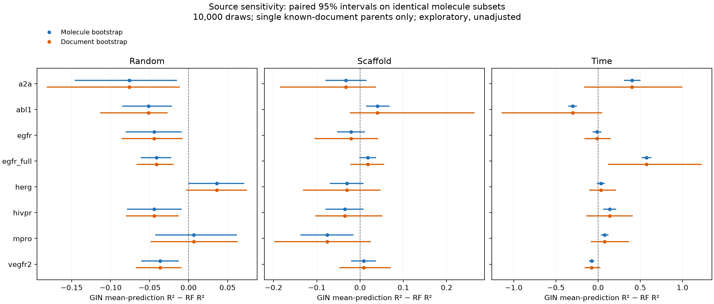

# Measurement sources and core experiment provenance

This follow-up tests whether the RF–GIN comparison depends on publication or
assay-type composition, and adds auditable evidence for core fitted artifacts.
It preserves the published labels, splits, predictions and scientific tables.
Source sensitivity **weakens some generalization claims** even though no
prediction/label mismatch was detected. Historical identities remain unknown
where original records were not retained; new evidence is explicitly dated.

## Source analysis protocol

`experiments/source_heterogeneity.py` includes all eight dataset tags and all
three splits: **24 evaluation cells**. It compares the saved RF prediction with
the arithmetic mean of saved GIN seed 42/1/2 predictions. It reconstructs
parent-level median pIC50 from frozen raw records using the original exact
relation, nM, positive-value and parent-standardization rules. Each train,
validation and test pool must reproduce its frozen labels within 1e-6.
Temporal reconstruction uses dated records before the validation cutoff for
training, before the test cutoff for validation, and at/after the test cutoff
for testing. It verifies molecule order, test indices, labels and temporal
label IDs before any analysis. Code, raw data, splits and predictions are hashed.

Available metadata are document ID, assay type and assay description. Unique
assay ID, laboratory identity, species and protein-variant harmonization are
**not reconstructed**. ChEMBL's B and F annotations mean Binding and Functional;
these broad annotations do not identify a uniform protocol or establish that
every F record is a cellular assay. See the [official ChEMBL assay definitions](https://chembl.gitbook.io/chembl-interface-documentation/frequently-asked-questions/chembl-data-questions).

The analyses are:

1. Count every document contributing to each test parent. Multi-document parents
   have overlapping memberships, so document fractions need not sum to one.
2. Remove test parents linked to each of the five largest documents, selected
   by membership count with lexical ties. Keep the models and remaining labels
   fixed. This is a test-set sensitivity calculation, **not** leave-document-out
   training, a new holdout or external validation.
3. On parents with exactly one known document, compare 10,000 paired molecule
   draws with 10,000 paired document-cluster draws, seed 42. Both intervals use
   **the same molecule subset and point estimate**. A document draw includes all
   its molecules, with multiplicity; R² is recomputed with the draw's own mean
   and denominator. At least five documents are required. Undefined constant-
   label draws are omitted and counted; fewer than 95% valid draws suppresses
   the interval. These are exploratory percentile intervals conditional on the
   fitted models, without multiple-comparison adjustment.
4. Report B-only, F-only and mixed-type parent subsets separately, plus
   cross-document measurement disagreement and train/test document overlap.
   Tiny strata are recorded but are not evidence of a general model ranking.

The 24 cells include 29,449 test **appearances**, not independent unique
molecules. The exclusive-source subsets include 26,456 appearances; coverage
ranges from 76.7% to 100.0%. EGFR subset/full overlap. Publication clusters are
also not guaranteed independent laboratories or independent chemical series.

## Findings and interpretation

On the same exclusive-source subsets, molecule intervals exclude zero in
14/24 cells (9 favor RF, 5 favor GIN); document intervals exclude zero in 7/24
(6 favor RF, 1 favors GIN). Seven apparent molecule-level signals therefore
cross zero under document resampling. These counts describe unadjusted
exploratory intervals; they are not a corrected win tally. All six remaining
RF intervals are random-split cells. The one remaining GIN interval is
`egfr_full/time`; both models still have negative full-test R² there.



### Temporal cells

Δ means R²(GIN mean prediction) − R²(RF). The full-test Δ differs from the
exclusive-source subset Δ where multi-source parents are removed. The final
column uses the exclusive-source subset, not the original full test cohort.

| Dataset | Full test n | Full-test ΔR² | Single-source n | Documents in bootstrap | Single-source ΔR² | Document 95% interval |
|---|---:|---:|---:|---:|---:|---|
| a2a | 802 | +0.389 | 796 | 17 | +0.402 | [−0.165, +1.000] |
| abl1 | 531 | −0.302 | 530 | 44 | −0.301 | [−1.142, +0.050] |
| egfr | 1,233 | −0.017 | 1,216 | 102 | −0.011 | [−0.161, +0.149] |
| egfr_full | 3,043 | +0.565 | 2,909 | 232 | +0.573 | [+0.116, +1.230] |
| herg | 2,325 | +0.022 | 2,015 | 357 | +0.033 | [−0.103, +0.213] |
| hivpr | 529 | +0.138 | 527 | 41 | +0.137 | [−0.141, +0.412] |
| mpro | 1,750 | +0.077 | 1,744 | 69 | +0.079 | [−0.085, +0.365] |
| vegfr2 | 2,038 | −0.102 | 1,742 | 222 | −0.076 | [−0.158, +0.028] |

**A2a is not explained solely by its largest document.** CHEMBL5728996 supplies
371/802 test parents (46.26%). Removing all 371 leaves 431 parents and a ΔR²
of **+0.325845**, compared with **+0.388554** originally. Nevertheless, the
document-cluster interval on the exclusive-source subset crosses zero. A
positive point estimate after one-source deletion is not proof of robustness
to new publications.

**Assay-type composition matters descriptively.** In A2a/time, B-only parents
(n=626) have ΔR² **+0.740466**, while F-only parents (n=170) have ΔR²
**−0.998784**. In Mpro/time, the corresponding values are **+0.178777**
(B-only, n=1,297) and **−0.228202** (F-only, n=453). Their RMSE rankings also
reverse. Different subsets have different R² denominators; these values are
not additive effects. Assay type, publication, chemistry and label range are
confounded, so this does not identify a causal assay effect or justify deleting
the unfavorable subset. Six mixed B/F A2a parents and the 15-parent HIVPR F
subset are too small for broad ranking conclusions.

Removing the largest document does not reverse the sign of ΔR² in any of the
24 cells. Across the **120** individual top-five removals, five removals in
three cells do reverse the sign: A2a/scaffold, EGFR/time and hERG/time. Some
documents share exactly the same parents; these are not 120 independent tests.
Random/scaffold test molecules frequently share a publication with training
molecules, even when molecular or scaffold overlap is prevented. This is
source dependence, not evidence of duplicate-parent leakage. The eligible
temporal train and test records share no publication in this frozen corpus.

**Recommended claim:** the original molecule-bootstrap result (including
four GIN-favoring temporal cells) remains a conditional result under that
sampling scheme. Evidence for consistency across publication sources is
weaker. The project demonstrates where rankings depend on evaluation design;
it does not establish broad superiority in future assays or clinical utility.

## Core experiment evidence

The new RF experiment fits all **16 random/scaffold baselines** using the
published selected parameters and seed 42 on M3 Max. It reconstructs both RF's
full training pool and its order, rather than concatenating GNN train/valid
indices, which would change bootstrap samples. Eight RF threads are used;
outer hyperparameter search is not repeated. Every run saves its source/input
digests, full parameters, environment, start/end time, training log, fitted
model, predictions and receipt. Model serialization is replayed on the training
host and independently on the M4 coordinator. Original outputs remain intact.

`experiments/audit_core_gin_artifacts.py` separately replays **72 published GIN
checkpoints** (8 tags × 3 splits × 3 seeds) on CPU. All pass strict architecture,
seed, train-only normalization, temporal label ID, test membership, prediction
and metric checks. Maximum prediction discrepancy is **1.9073486328125e−6**.
The audit pins today's source, caches, model weights, metrics and predictions.
It does not claim that today's source or environment was the original trainer.

The previously completed **18 CUDA replacement fits** (6 EGFR GIN plus 12
multitask/pooled fits) already have full execution records and independent CPU
acceptance across 42 task/result cells. The current audit rechecks their entire
**931-file** archive against its committed manifest; prior numerical acceptance
remains separately identified. The old plan's “waiting” status is a frozen
planning record, not the current completion status. These 18 fits are reused
instead of being presented as new 2026-10-15 training.

| Evidence group | What is now supported | What is still not established |
|---|---|---|
| 16 new RF fits | New source/input/environment/model/prediction chain; independent replay | Historical original-run identity and original search trajectory |
| 72 published GIN checkpoints | Current model-to-prediction consistency and train-only label normalization | Full historical execution identity for the 48 older random/scaffold fits |
| Accepted as-of campaign | Previously accepted 8 RF searches and 24 GIN fits | Unrecorded historical experiments before that campaign |
| 18 prior replacement fits | New logged fits with frozen sources and independent CPU replay | Recovery of the original EGFR/multitask runs |
| Prior five-seed RF supplement | Ten explicit fits on A2a/hERG temporal data | Identity of the original review's undocumented five-fit experiment |

Thus the provenance gap is reduced by new evidence and a clear ledger. It is
not erased retroactively. GINE/AttentiveFP, the device-budget study and external
wet-lab validation are outside this follow-up's additional replay scope.

## Reproduction and evidence

Source analysis (requires the frozen raw CSVs and restored caches/splits):

```bash
python experiments/source_heterogeneity.py --out-dir .scratch/source-analysis-new
python experiments/audit_core_gin_artifacts.py --report .scratch/gin-replay-new.json
```

The committed source report binds 24 molecule-level tables, per-document
statistics, all 120 exclusions and assay-type metrics. Consult
[`results/source_heterogeneity/report.json`](../results/source_heterogeneity/report.json),
[`top5_document_exclusions.csv`](../results/source_heterogeneity/top5_document_exclusions.csv),
[`assay_type_metrics.csv`](../results/source_heterogeneity/assay_type_metrics.csv), and
[`core_gin_audit_20261015.json`](../results/provenance_reconstruction/core_gin_audit_20261015.json).
Full RF receipt/acceptance and download instructions are indexed in
[`results/provenance_reconstruction/core_rf_20261015/README.md`](../results/provenance_reconstruction/core_rf_20261015/README.md).

No historical labels or scientific results are replaced. Use the new source
analysis as a qualification to interpretation, and the new RF cohort as a
separately identified fixed-parameter confirmation.
